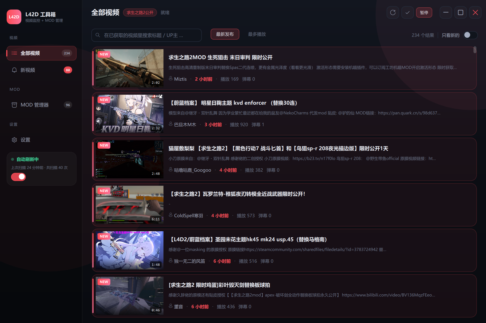
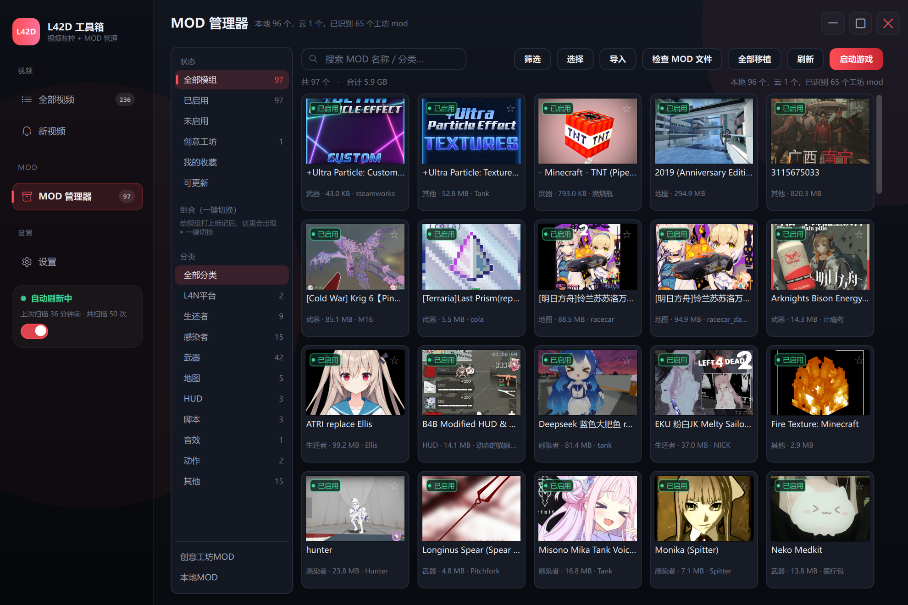
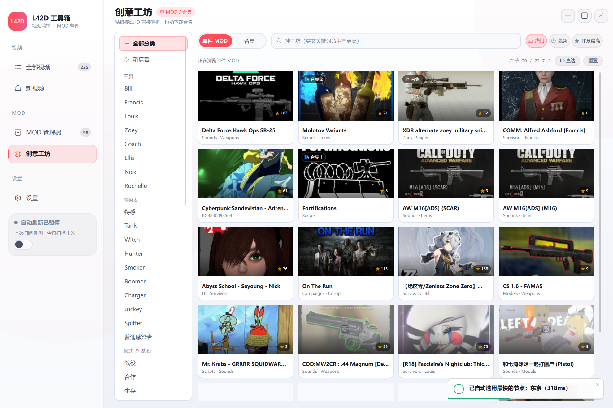
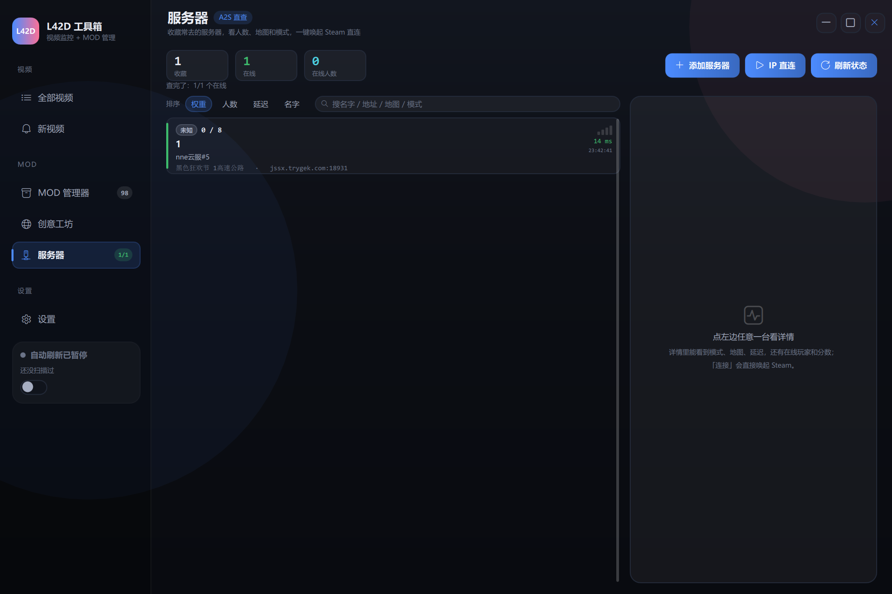

# Yumi的L4D2工具箱

一个求生之路 2（L4D2）玩家向的小工具箱，包含三块功能：

- **视频监控**：盯 B 站「求生之路2公开 / 求生之路2替换」等关键词，有新视频弹通知，
  可内置播放、自动提取简介里的网盘链接
- **MOD 管理器**：自动找到 L4D2 目录，把创意工坊的纯数字 MOD 识别成真实名称 + 封面，
  支持导入 / 启用禁用 / 删除 / 转换到本地 / 调整加载顺序
- **服务器**：收藏服务器、A2S 直查人数与玩家、一键直连










## 致谢

本项目的产品思路与部分技术方案参考了开源项目
**[LytVPK](https://github.com/LaoYutang/lytvpk)**（作者 LaoYutang），特此致谢。

参考范围（代码均为本项目用 Python + QML 独立实现）：

- **工坊浏览**：分类分组、单件／合集切换、排序、ID 直达、稍后看、合集子项展开
- **MOD 加载顺序编辑器**：拖动排序 + 缺项标红的交互形态
- **应用更新检查**：GitHub Releases + 从重定向 URL 的 `/tag/` 取版本号的思路
- **CDN 优选**：测延迟挑最近节点的思路
- **工坊 DNS**：CNAME 跟随与跳数上限的解析规则（跨语言移植，已在
  `app/workshop_dns.py` 注明出处与改动）
- **CDN 兜底 IP 表**：内置的 6 个节点 IP 及其顺序（已在 `app/workshop_net.py` 注明）

VPK 解析、A2S 查询、网盘链接提取、B 站登录、下载器为独立实现。

> **本项目不调用 LytVPK 的任何线上服务。** 早期版本曾默认请求其运营的
> 工坊列表／详情／解析／节点池／地图名**五个**接口，占用对方自费额度；
> 在对方提出后已**全部移除**（见 [issue #1](https://github.com/Yumivvv/YumiL4D2/issues/1)）。
> 现在工坊数据全部直连 Steam 官方 API，地图名与 CDN 节点用内置表。
>
> 其余会联网的地方只有**公开、免费、无需注册**的第三方站点 ——
> 翻译接口 MyMemory / 腾讯交互翻译、以及 B 站自己的网页与接口。
> 它们与 LytVPK 无关。
>
> 创意工坊的**列表、搜索、详情、下载、合集展开**全部直连 Steam 官方 API，
> 不使用任何第三方下载站。

**不需要任何 API Key**：工坊的列表、搜索、排序、筛选、详情、下载、合集展开
全部直连 Steam 官方服务，开箱即用。

## 快速开始

1. 双击 **`启动.cmd`**（第一次会自动检查依赖，之后秒开）
2. 视频页点右上角 **↻** 抓一次；MOD 页会自动检测 L4D2 目录，检测不到点「选择目录」
   选到 `...\Left 4 Dead 2\left4dead2\addons`

调试用 `调试启动.cmd`（带控制台，报错时用）。

### 打包成独立 exe

双击 **`打包.bat`**，产物是单文件 **`dist\Yumi的L4D2工具箱.exe`**（约 104 MB）。
拷到任意文件夹双击即可运行，第一次运行会在 exe **同目录**建好 `data\` / `sounds\` / `backgrounds\`。
卸载 = 删掉这个文件夹，不写注册表。

## 系统要求

Windows 10 / 11，Python 3.10+（源码运行）；或直接用打包好的 exe，无需装 Python。

## 使用说明

完整的功能介绍、界面截图、快捷键、常见问题见 **[docs/DEVELOPMENT.md](docs/DEVELOPMENT.md)**
的技术说明部分；概括版如下：

| 功能 | 说明 |
| --- | --- |
| 视频监控 | 关键词抓取、新视频 Toast + 提示音、只看新的、标记已读、内置播放器 |
| 网盘链接 | 自动从简介提取夸克 / 百度 / 阿里 / 蓝奏云链接，蓝奏云可直接下 |
| MOD 管理 | 工坊 ID → 真实名称 + 封面、VPD 内部解析、批量导入、分类筛选、更新检查 |
| 创意工坊 | 分类浏览、搜索、排序、ID 直达、稍后看、合集展开、按 ID 下载 |
| 加载顺序 | 拖动调整 `addonlist.txt`，缺项标红 |
| 服务器 | 收藏 / 分组 / 权重排序 / A2S 玩家列表 / `steam://connect` 直连 / **好友在玩**（显示哪位好友在哪台服） |
| 个性化 | 提示音效、背景图（透明度可调）、主题色、夜间 / 日间 / 跟随系统 |

## 数据与隐私

所有数据都在本地 `data/`（配置、视频库、MOD 缓存、日志），不经过任何自建服务器。
用环境变量 `L4D2_DATA_DIR` 可以把数据目录整个指到别处。

## 快捷键

| 键 | 作用 |
| --- | --- |
| `F5` | 立即检查新视频 |
| `Esc` | 依次关闭筛选面板 / UP 主卡片 / 播放器 / 简介面板 / 设置 |
| `Ctrl+F` | 视频页：清空搜索与筛选；服务器页：聚焦搜索框 |
| `Ctrl+C` | 服务器页：复制当前选中服务器的分享文本 |
| `Space` | 播放器打开时播放 / 暂停 |
| `Ctrl+J` | 打开下载页 |

## 常见问题

**没检测到 L4D2 目录？**
设置 → 「MOD 目录」→ 选择目录，选到 `...\Left 4 Dead 2\left4dead2\addons`
（选 `Left 4 Dead 2` 或 `left4dead2` 也能自动纠正）。

**MOD 归错类了？**
分类优先取工坊 tag，认不出才看标题。点「检查 MOD 文件」可刷新标签数据。

**播放器一直转圈？**
取流 + 建代理要几秒。长时间失败可能是付费 / 直播内容拿不到 MP4 合并流，
点「在浏览器中打开」即可。

**提示被 B 站限流（412）？**
请求太频繁，等几分钟，或把刷新间隔调长。

## 开发

```bat
python -X utf8 tools\run_all.py          :: 全量回归
python -X utf8 tools\run_all.py bg_test  :: 只跑某几个
```

测试会把 `data/` 隔离到临时沙盒，不会动你真实的配置。

实现细节、踩坑记录、各项返工原因都在 **[docs/DEVELOPMENT.md](docs/DEVELOPMENT.md)**。

## 许可

GPL-3.0，详见 [LICENSE](LICENSE)。
