# Yumi的L4D2工具箱

一个求生之路 2（L4D2）玩家向的小工具箱，目前包含两块功能：

- **视频监控**：盯着 B 站「求生之路2公开 / 求生之路2替换」等关键词，有新视频弹通知，
  可以内置播放、自动提取简介里的网盘链接
- **MOD 管理器**：自动找到你的 L4D2 安装目录，把 Steam 创意工坊的纯数字 MOD
  识别成真实名称 + 封面，支持导入 / 启用禁用 / 删除 / 转换到本地
- **个性化**：提示音效、界面背景图（可调透明度、可一键开关）、界面主题色（RGB 调色）
  都能换，设置里点几下就行


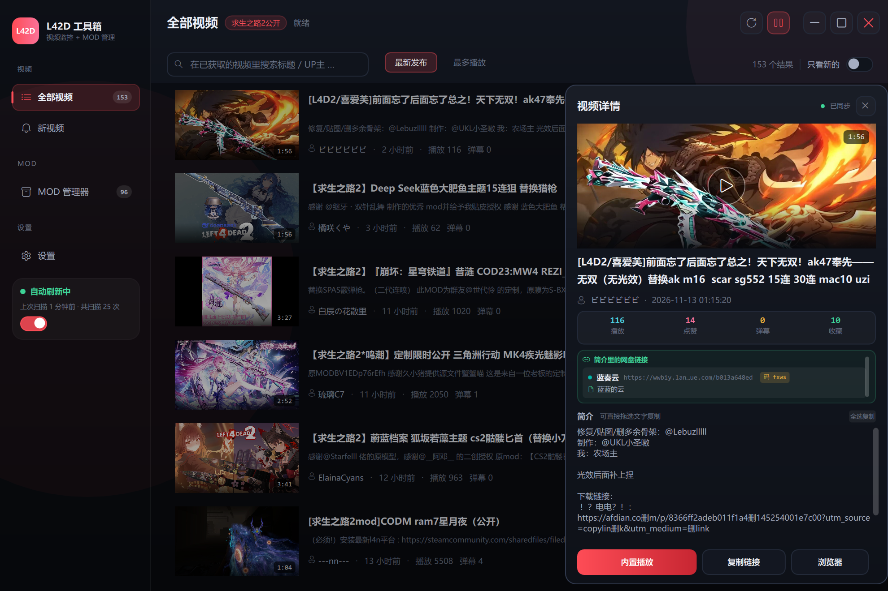

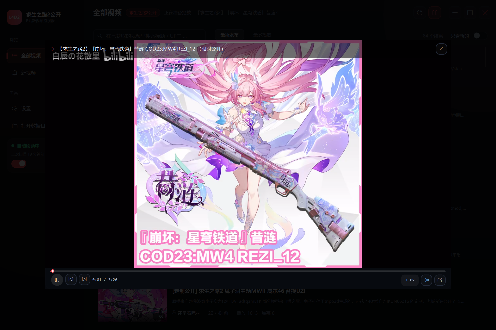


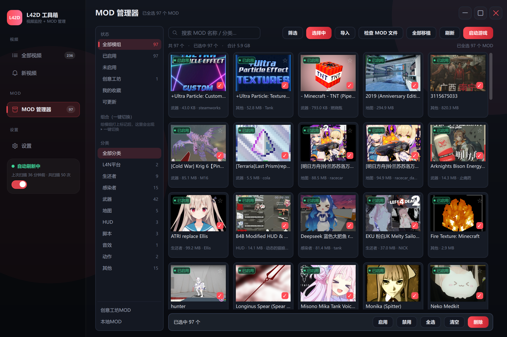

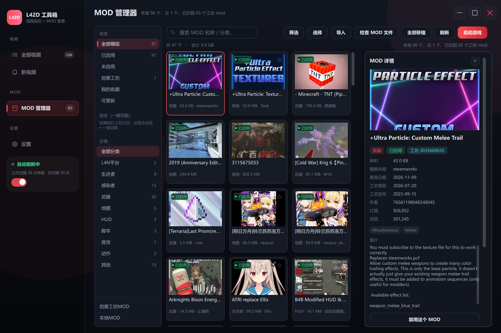

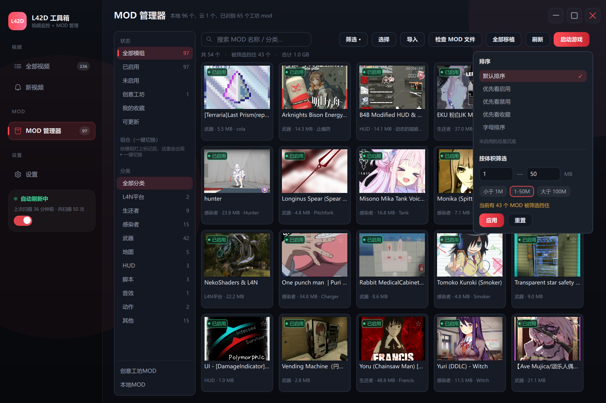

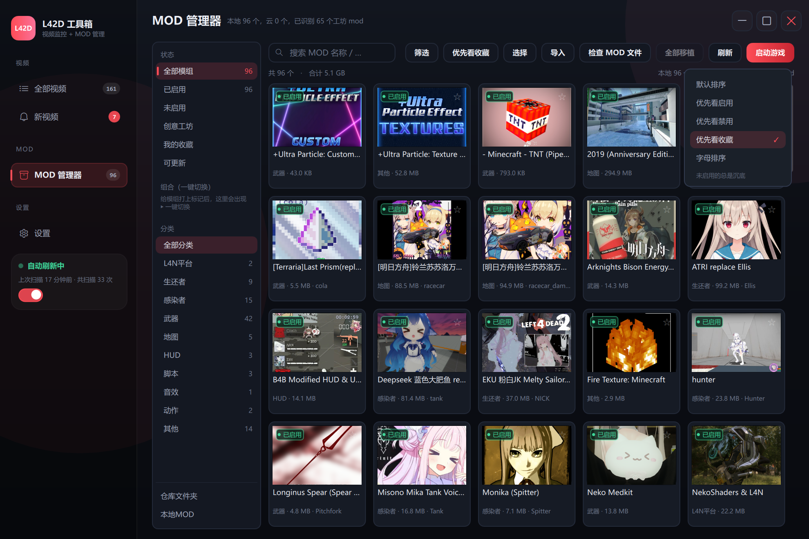

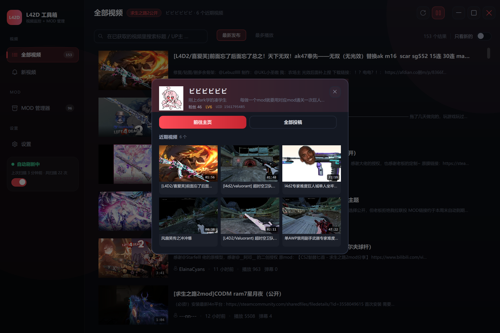

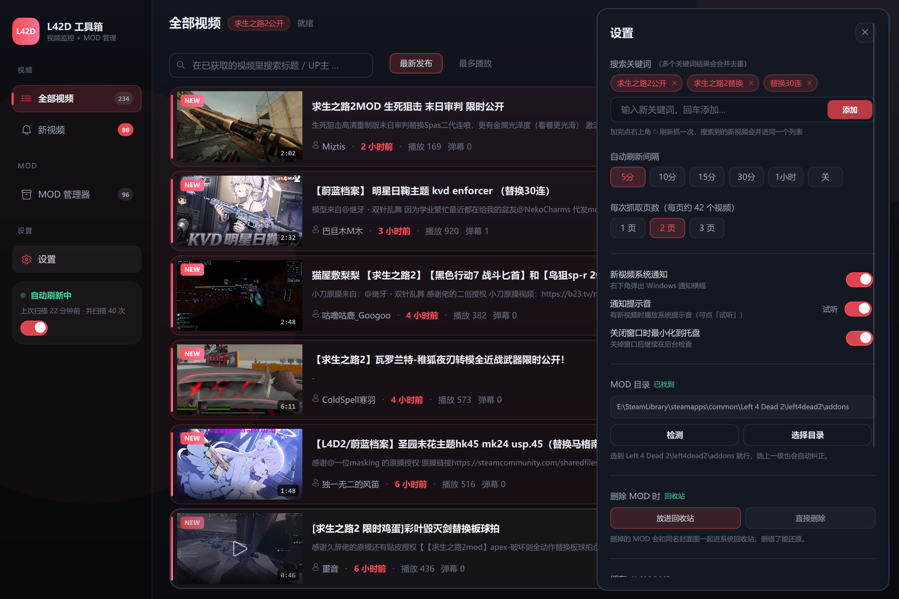

## 为什么用 Python + Qt Quick（QML）

你电脑上现成的环境：

| 已装 | 版本 | 说明 |
| --- | --- | --- |
| Python | 3.12.10 | 已装 PySide6 6.11.2、requests，开箱即用 |
| Node.js | 24.11.1 | 也能做 Electron，但要多装几百 MB |
| .NET SDK | 9 / 10 | WPF 可行，但圆角毛玻璃要写不少 XAML |
| Java | 17 | JavaFX 要额外拉依赖 |

**Python 3.12 + PySide6（Qt Quick / QML）**：GPU 加速原生渲染、QML 写界面短、
不用装新东西、PyInstaller 打包后是独立 exe。

## 快速开始

1. 双击 **`启动.cmd`**（第一次会自动检查依赖，之后秒开）
2. 视频页：点右上角 **↻** 抓一次；MOD 页：会自动检测 L4D2 目录，检测不到点「选择目录」

> 调试用 `调试启动.cmd`，带控制台能看到错误信息。

### 应用图标

图标是 `assets/icon.ico`（Windows 窗口 / 任务栏 / 托盘 / exe 都用它）和 `assets/appLogo.png`
（侧栏左上角那枚品牌图标），都是从 `assets/icon_src.jpg` 生成的 —— 想换图就替换这张源图，然后跑：

```bat
python tools\make_icon.py            :: 用 assets\icon_src.jpg
python tools\make_icon.py 新的图.jpg  :: 或者临时换一张
```

脚本会按主体自动裁成正方形、切圆角，导出 `appLogo.png` + `icon_256/128/64/48/32/16.png`
+ `icon.png` + 多尺寸 `icon.ico`。改完图标要**重新打包**（或删掉 `assets\icon.ico` 再打）才会进 exe。

### 打包成独立 exe

双击 **`打包.bat`**（或 `python -m PyInstaller --noconfirm --clean --distpath dist --workpath build tools\build.spec`），
产物是**一个单文件**：**`dist\Yumi的L4D2工具箱.exe`**（**约 98–99 MB**，本机实测构建约 1.5 分钟）。

**把它拷到任意文件夹、双击就能跑**，第一次运行会在 exe **同目录**自动建好：

```
你的文件夹\
├─ Yumi的L4D2工具箱.exe     ← 只有这一个文件，拷走就能用
├─ data\             ← 配置、视频列表、工坊缓存（config.json / library.json / covers / modcache…）
├─ sounds\           ← 提示音（自带 bbb.mp3 会复制进来，换成自己的也行）
└─ backgrounds\      ← 自定义背景图放这里
```

换电脑只要带上 exe（想保留记录就连 `data\` 一起拷）。卸载 = 删掉这个文件夹，不写注册表、不写系统目录。

实测启动耗时（同一台机器，win10）：**冷启动 7.8 秒**（第一次解包到临时目录）、**之后 6.6 秒**。

> 关窗口默认是**缩到托盘**继续监控，从托盘右键「退出」才会真的退出（这也是解包目录被清掉的时机）。
> 想关窗口就退出，设置里把「关闭时最小化到托盘」关掉即可。

要**文件夹版**（解包一次、启动快一点，方便单独改 `qml/`）用另一份 spec：

```bat
python -m PyInstaller --noconfirm --clean --distpath dist --workpath build tools\build_folder.spec
```

产物在 `dist\Yumi的L4D2工具箱\`（3000 多个文件 / 476 MB）。

> ⚠️ 两个 spec 里的脚本路径都必须从 **spec 所在目录**推算（`SPECPATH`），
> 写成 `os.path.abspath(".")` 或相对路径 `"main.py"` 时，从项目根调用会去找
> `tools/main.py` 并直接报 `script '...\tools\main.py' not found` —— 这个坑已经修掉了。
>
> ⚠️ 单文件版的用户数据**绝不能**落在 `sys._MEIPASS`（解包出来的临时目录，退出即删）。
> `app/util.py` 里把两种根分开了：`ROOT` = 只读资源（解包目录），`USER_ROOT` = exe 所在目录，
> `DATA_DIR` / `SOUNDS_DIR` / `BG_DIR` 全部挂在 `USER_ROOT` 下；`seed_user_dirs()` 负责建目录、
> 铺默认音效、把「老版本把数据放在程序目录里」的 `config.json` 等文件搬一次家。
> 回归脚本 `tools/onefile_paths_test.py`（模拟 `sys.frozen` / `sys.executable` / `sys._MEIPASS`）盯着这件事。
>
> ⚠️ PySide6 的钩子会把 **`Qt6WebEngineCore.dll`（194 MB）** 和 Qt 的 `translations\`（8.5 MB）
> 一起拖进来，这个项目根本不用 WebEngine —— 两个 spec 里都加了一行过滤（`_BIG_DROP`），
> 不滤的话单文件 exe 会是 191 MB、冷启动 30 秒。


---

# 一、视频监控

- **多关键词**：可同时盯多个词（默认 `求生之路2公开` + `求生之路2替换`），
  结果合并到同一列表并按 bvid 去重
- **自动监控**：5 分钟 ~ 3 小时可调，关掉窗口缩到托盘继续跑
- **启动即扫**：每次打开软件都会**自动先扫一次**最新视频（不再只对首次启动扫描），
  不用傻等刷新周期；之后继续按设定的间隔监控
- **新视频提醒**：Windows 右下角系统 Toast（可关），程序内也有卡片提示
- **内置播放器**：边下边播（见下），支持暂停/进度/快进退/倍速/音量
- **网盘链接提取**：自动清洗防和谐链接、抓提取码、说明网盘里装的是什么，右键可直接复制提取码
- **UP 主小卡片**：点简介里的作者昵称能看到头像、昵称、签名、粉丝数，以及最近的 6 个视频，
  可直接跳到主页或投稿列表

## UP 主小卡片

在简介面板点**作者昵称**（带下划线，鼠标移上去变红）弹出卡片：

- 头像 / 昵称 / 个人签名 / 粉丝数 / 等级 / UID
- 「前往主页」「全部投稿」直接跳 B 站
- 下方 3 列 x 2 行显示该 UP 最近 6 个视频（封面 + 时长 + 标题），
  **点一下打开那个视频的详情面板**（不是直接播放）

> B 站的 space 系列接口现在都过风控（`-352 风控校验失败`、`-799 请求过于频繁`、
> `-412 request was banned`），单独一个来源随时可能空手而归。所以这里**三路合并**：
>
> 1. `x/space/wbi/arc/search`——带 WBI 签名（`w_rid` = md5(参数串 + mixin key)），最准
> 2. `x/polymer/web-dynamic/v1/feed/space`——动态流（每次投稿都会自动生成一条动态）
> 3. 搜索接口按 UP 昵称搜、再按 mid 精确过滤（兜底）
>
> 哪一路失败都静默跳过，最后按发布时间倒序去重取前 6 条。

## 新视频提醒（Toast + 提示音）

有新视频时右下角弹 Windows 系统通知，同时播放提示音。

> **提示音为什么不挂在 Toast 上**：Windows 允许把「Windows PowerShell」这个通知来源的
> 声音单独关掉，专注助手开着时也会静音，所以经常出现「通知弹出来了但没声音」。
> 现在改成**程序自己用 QtMultimedia 播自定义音效**（默认 `sounds/bbb.mp3`，
> 取不到才退回系统提示音），Toast 本身固定静音，避免双重响。
>
> 设置面板里「提示音效」那一块有「**试听**」，点一下立刻能验证听不听得到。

### 自定义提示音效

`sounds` 目录（程序根目录下的 **`sounds/`**）专门放音效文件，支持
**MP3 / WAV / FLAC / OGG / AAC / APE**（QtMultimedia 内置 FFmpeg，这些都能解）。

| 操作 | 说明 |
| --- | --- |
| 点音效名 | 立刻切换成那个音效（列表里会高亮当前用的那个） |
| 导入音效 | 选一个外部文件复制进 `sounds/`，并直接设为当前提示音（导入后会自动响一下） |
| 恢复默认 | 切回程序自带的 `sounds/bbb.mp3` |
| 打开音效目录 | 直接在资源管理器里打开 `sounds/`，自己往里丢文件也行（丢完点一下音效名即可） |

配置里只存**文件名**（`alert_sound`），所以整个程序目录挪到别处也还能用；
文件被删掉或换了机器，会自动退回 `bbb.mp3`。

### 外观模式（夜间 / 日间 / 跟随系统）

设置面板里「**外观模式**」三选一，**默认跟随系统**：

| 模式 | 说明 |
| --- | --- |
| 跟随系统（默认） | 跟着 Windows 的「应用模式」走。系统切浅色/深色，界面实时跟着变，不用重启 |
| 夜间 | 强制深色（就是原来那套黑底） |
| 日间 | 强制浅色（白底深字） |

- 「跟随系统」靠两条路互相兜底：优先读 Qt 的 `styleHints().colorScheme()`
  （还能拿到**系统切换时的信号**，所以能实时变），拿不到才去查注册表
  `HKCU\...\Themes\Personalize\AppsUseLightTheme`。
- 整套配色都在 `qml/L4D2/Theme.qml` 里，`Theme.dark` 一个开关切两套色板；
  其他组件只引用 `Theme.bg` / `Theme.text` 这类语义色，所以切主题是**全局一起变**。
- 半透明叠层跟明暗**反着来**：深色主题用 `rgb(255,255,255,α)` 提亮，
  浅色主题必须换成黑色压暗（统一走 `Theme.scrim(α)`），否则浅色下控件会糊成白块。
- **投影/阴影也要分深浅**：比如 MOD 详情面板左侧那道阴影，深色主题用 `0.45` 的黑刚刚好，
  放到日间模式就是一条很脏的灰边（用户截图里红框那条），所以浅色下压到 `0.10`。
- **提示浮层（Toast）也是两套**：夜间深灰底 + 亮字，日间白底 + 深字。
  原来颜色是写死的深色，日间模式下像一块黑疙瘩戳在浅色界面上。
- **滚动渐隐遮罩**（列表顶部那条淡出）跟**背景色**走，不是跟叠层走：
  统一用 `Theme.fade(α)`。它以前写死成深色 `rgba(0.04,0.05,0.07)`，
  日间模式下会在列表顶上横一道黑杠——这不是"提亮/压暗"能解决的问题，
  而是颜色本身必须换成浅色。
- 压在封面图上的文字/播放按钮**永远是深底白字**，不跟主题变（图片本身颜色不可控）。

### 自定义背景图

设置面板里「**背景图**」那一块可以把界面底色换成自己的图，并且能调透明度：

| 操作 | 说明 |
| --- | --- |
| 总开关 | 一键**启用 / 关闭**背景图。关了就用回默认渐变，图片和透明度都还留着，随时能开回来 |
| 选择 / 更换背景图 | 选一张外部图片，复制成 `backgrounds/background.*`（**覆盖**旧的） |
| 透明度滑块 | 0–100%，**拖动时实时预览**，松手才写配置；调太高会看不清文字 |
| 移除背景 | **真的把 `background.*` 删掉**，同时清掉配置 |
| 打开背景图目录 | 打开 `backgrounds/`，自己丢图进去也行（名字必须是 `background`） |

- **只保留一个文件**：目录里叫 `background.*` 的那张就是当前背景图，别的图片文件一律忽略。
  换图 = 覆盖同一个文件（比如从 png 换成 jpg 会顺手删掉旧的 png），不会越攒越多。
  也因此**没有「点图片名切换」的列表**了 —— 只有一张，没什么可切的。
- 老版本允许多张图、配置里存原文件名；升级后第一次启动会把配置指向的那张
  **自动改名**成 `background.*`，不会突然没背景。
- 开关关闭时，标题右边会直接写「**开关已关闭，用默认渐变**」，不用猜是不是设置没生效。
- 支持 **JPG / PNG / WEBP / BMP / GIF**。铺图用 `PreserveAspectCrop`（铺满、按比例裁切）。

> **「换了背景图但画面没变」是怎么回事**（修过的坑）
>
> 根因是两件事凑到一起：
> 1. 换图时**文件名不变** —— 永远是 `background.jpeg`，同扩展名换了就是同一个名字；
> 2. QML 的 `Image` 有 `cache: true`，**source 字符串没变化就不会重新加载**。
>
> 所以后台明明已经把文件覆盖成功了（`import_background` 返回 ok、盘上确实是新图），
> 界面却还是旧图 —— 这就是用户看到的「换了没用 / 覆盖不了」。
>
> 修法：`bgImageUrl` 给 URL 带一个**版本号** `?v=<计数>-<mtime>-<size>`：
>
> - `_bg_version` 每次 import / clear 都 +1（最可靠，一定变）
> - 文件 `mtime` + `size` 兜底（用户直接往 `backgrounds/` 里手动扔图也能刷新）
>
> 只用 mtime+size 不够：两张 64×64 纯色 JPEG 压出来常常一样大，同一秒内替换时
> mtime 也可能没变 —— 实测那样 URL 会一模一样，等于没修。
- **拖窗口不会再闪**：以前 `sourceSize` 绑着 `width/height`，拖动时每一帧都要求
  「按新尺寸重新解码这张图」，异步解码期间 Image 是空的，于是背景一闪一闪。
  现在按屏幕尺寸**一次性**算好，并 `cache: true` + `retainWhileLoading: true`，
  窗口怎么拖都不重新解码；解码完成前图层保持透明，不会白闪一下。
- 配置里只存**文件名**（`bg_image`）+ 透明度（`bg_opacity`）+ 开关（`bg_enabled`）。

### 自定义主题色

界面强调色（按钮、选中高亮、进度条、开关、侧栏高亮…）**全部由一个颜色派生**，
设置面板里「**主题色**」那一块可以直接调：

| 操作 | 说明 |
| --- | --- |
| **色盘** | 圆形 HSV 色盘，点哪取哪（角度=色相、半径=饱和度），旁边一条明度条 |
| R / G / B 三个滑块 | 色盘选不准「差一点点」时用它微调；**拖动时实时变色**（只改内存），松手才写配置 |
| 预设色 | 默认红 / 樱粉 / 橙 / 琥珀 / 草绿 / 青 / 海蓝 / 紫，点一下直接套上 |
| 恢复默认色 | 回到出厂的红 `#FF4D57` |
| 色块 | 实时显示当前颜色（`Aa` 白字样例）+ 色值（`#RRGGBB`） |

> **为什么自己画色盘**（这轮把「R/G/B 三条滑块」换成了色盘）：
> 只能拖三条滑块凑颜色，想选一个具体的粉/青基本靠试。
> 而 `QtQuick.Dialogs` 的 `ColorDialog` 是 Windows 原生窗口，风格和这个程序完全不搭，
> 而且是**模态阻塞**的 —— 顶在设置覆盖层上面，关掉之后焦点容易乱。
> 自己用 Canvas 画一个只要几十行，还能顺带把 RGB 微调保留下来。
>
> 画法上有个坑：`createImageData` + `putImageData` 这种逐像素写法在部分 Qt 版本里
> **画出来是全黑的**（实测）。改成 `fillRect` 铺 2px 小格就正常了，圆边也够平滑。

- 主题色只存**一个** `#RRGGBB`（`ui_accent`）。`Theme.qml` 里的 `accentBase` 由它派生
  `accent` / `accentDeep`（深一档）/ `accentHover`（亮一档）/ `accentPress`（更亮）/ `accentGlow`，
  所以改一处、全局跟着变，不用挨个组件改色值。
- **按钮的 hover / 按下反馈色必须派生，不能写死**：以前 `ActionButton.qml` 里写死了
  `#FF8087` / `#F0404C` 这些红，用户把主题改成蓝色后，按下去还是红的 —— 就是这个坑。
  现在统一走 `Theme.accentHover` / `Theme.accentPress`。
- 实现上是 QML 单例 `Theme`：`core.uiAccent` 变了就写 `Theme.accentBase`，
  所有引用 `Theme.accent` 的控件自动重绘。
- 存盘前会**逐通道夹取**到 0–255，认不出的值（手改了配置文件写成 `zzz`）回落默认色。

## 加载顺序（addonlist.txt）

工具条上的「**加载顺序**」按钮：改的是游戏真正读的那个
`left4dead2/addonlist.txt`，**会实际改变 MOD 的覆盖结果**。

| 操作 | 说明 |
| --- | --- |
| 拖动 | **按住任意一行**上下拖动即可调整，拖动时目标行会高亮；拖到列表边缘会自动滚动 |
| 显示名称 | 工坊 MOD 显示**真实标题**（和卡片墙一致），下面一行小字是文件名 |
| 缺失标记 | 表里有、但 `addons/` 里找不到对应文件的，标红「文件不存在」 |
| 同步 addons 目录 | 把「有 vpk 但 addonlist 没记」的 MOD 补到末尾 |

> **为什么显示的是名字不是数字**：`addonlist.txt` 里存的只是文件名，工坊 MOD 就是
> 一串纯数字 ID。程序复用 MOD 列表那份工坊缓存把它解析成真实标题，
> 所以两边看到的名字一致。没识别过的纯数字 ID 会灰显（还没查过工坊信息）。

**加载顺序的语义**（很多人会搞反）：

```
addonlist.txt 里越靠下 → 加载越晚 → 覆盖优先级越高
```

同一个文件被多个 MOD 替换时（比如两个 MOD 都改 `zoey.mdl`），**后面那个赢**。
所以想让某个 MOD 生效，就把它往下拖。

> 这跟界面上那个「排序」（默认 / 优先看启用 / 最近导入…）**完全是两回事**：
> 那个只影响卡片显示顺序，不动 addonlist；这个是真的改游戏行为。

### 文件格式（改之前要知道的）

`addonlist.txt` 是 Source 引擎的 KeyValues 文本：

```
"AddonList"
{
	"132381280.vpk"		"1"
	"【武器】飞鸟凑榴弹发射器.vpk"		"1"
}
```

- 值是 `1`（启用）/ `0`（禁用）
- 缩进是 **TAB**，换行是 **LF**
- 编码是 **GBK**（系统 ANSI 代码页），**不是 UTF-8**

> **编码这一条最容易踩坑**：用 UTF-8 读写会把中文文件名写成乱码，游戏就找不到 MOD 了。
> 所以程序统一按 GBK 读写（读的时候如果碰到 UTF-8 的文件也能兜底认）。
>
> 写之前还会留一份 `addonlist.txt.bak`，并且先写 `.tmp` 再原子替换 ——
> 这个文件要是写坏了，游戏会一个 MOD 都不加载。

## VPK 内部解析（本地 MOD 也能有真实信息）

对本地 MOD，程序会**打开 VPK 读里面的元数据**，而不是只看文件名。

VPK 里通常带两样东西：

- `addoninfo.txt` —— 作者自己写的**标题 / 作者 / 版本 / 简介 / 主页**
- `addonimage.jpg` —— 作者自己做的**封面图**

读出来之后，本地 MOD 也能像工坊 MOD 一样显示完整信息：

| 字段 | 来源 |
| --- | --- |
| 标题 | 工坊缓存 → `addoninfo.txt` → 文件名（依次回退） |
| 封面 | 本地同名图 → 工坊缓存 → **VPK 内的 addonimage.jpg** |
| 作者 | Steam 昵称 → SteamID → **`addoninfo.txt` 里的作者** |
| 版本 / 文件数 / 角色 / 武器 | VPK 内部 |
| 分类 | 工坊 tag → **VPK 内部路径**（有 `.bsp` 就是地图）→ 标题关键词 |

**实测效果**（你机器上 98 个本地 MOD）：

```
真实标题 91 / 98    有封面 80    扫描+解析总耗时 0.4 秒
```

> 能做到 0.4 秒是因为有磁盘缓存：按「路径 + 大小 + mtime」判断，文件没变就不重解析。

### 查工坊详情为什么曾经「半天没封面」（已修，快 24 倍）

用户报的「查工坊 ID 半天没封面、一直失败」。实测下来**不是接口不通，是等得太久**：

| 来源 | 国内实测 | 说明 |
| --- | --- | --- |
| Steam 官方 `GetPublishedFileDetails` | **33.6 秒** | 能连上，但很慢；旧代码还重试 4 次 ×（10,30）秒超时 + 1.2/2.2/3.2s 退避 |
| **项目自带中转站** `l4d2-workshop.laoyutang.cn/detail?id=` | **1.36 秒** | 返回字段**和官方 API 完全等价**（title / preview_url / previews / description / file_size / tags / creator…） |
| 封面图 `images.steamusercontent.com` | 0.8 秒 | 直连可下，JPEG 头正常 |

所以现在改成**三级来源，从快到慢**：

1. **中转站优先**（逐个查，不按批也不会被限流）；
2. 中转站查不到的 ID 再走**官方 API** 兜底（按 20 个一批，超时压到 `(5, 12)` 秒，最多重试 3 次）；
3. 都不行就返回空，30 分钟后自动重试。

顺带修了两个隐藏问题：

- **失败缓存会永久占位**：以前某次网络抖动留下的 `ok: False` 记录会一直躺在那儿，
  导致那个 ID「永远没封面」。现在失败记录 **30 分钟内有效**，过期自动重查。
- **`previews` 多图字段被丢掉了**：中转站和官方都会返回多张预览图，以前只取
  `preview_url` 一张。现在存进 `previews`（最多 12 张），给「多封面」用。

**工坊导入一次下几十个 MOD 时，只有前 60 个补封面**（`COVER_FILL_LIMIT`）——
超出的那些以前**永远没有封面**（用户报的「下载出来的 MOD 没有封面」有一半是这个）。
现在超出的部分丢进 `_cover_queue`，由后台线程每张间隔 120ms 慢慢补，
补完再刷新列表（不重扫盘、不跳回顶部）。

### 怎么实现的

按 Valve 公开的 VPK 格式规范自己实现（`app/vpk_reader.py`，纯 Python，不依赖第三方库）：

```
magic(4) version(4) treeSize(4)   ← v1 头 12 字节
目录树：string 扩展名 → string 目录 → string 文件名 + 18 字节条目
        （crc / preload / archiveIndex / offset / length / 0xFFFF）
archiveIndex == 0x7FFF 表示数据就在本体（不是 _00N 分卷）
```

只 seek + read，**绝不改文件**；读大 VPK（几百 MB）也只碰头部和目录树，所以快。

### 两个容易踩的坑

**1. HUD 资源不能当「人物证据」**

`materials/vgui/`、`resource/`、`scripts/`、`particles/`、`sound/ui/` 下的文件
**必然**会出现角色名（界面要显示头像嘛），拿它们当证据会把所有界面 MOD
都误判成人物 MOD。所以这几个目录被排除在角色识别之外。

**2. addoninfo.txt 的编码不统一**

有的作者存 UTF-8，有的存 GBK。两种都会试，读不出来才回退 UTF-8 replace。

### 容错

解析器**任何异常都不抛**，一律返回 `ok=False` + 错误原因：

| 情况 | 结果 |
| --- | --- |
| magic 不对 | `ok=False`，说明「不是 VPK 文件」 |
| 文件截断 | `ok=False`，说明「目录树被截断」 |
| 目录树异常大（>64MB） | 拒绝解析，防止内存爆掉 |
| 分卷数据（`_001.vpk`） | 只解析目录树，不去跨文件读 |

这样坏文件不会把整个扫描带崩。

## 创意工坊页（浏览 / 搜索 / 下载 MOD）

侧边栏「MOD 管理器」下面的「**创意工坊**」：**直接浏览 Steam 创意工坊的 MOD 列表**，
按分类筛选、搜索、排序、滚轮一直往下加载、看详情、一键下载。


| 区域 | 内容 |
| --- | --- |
| 左侧分类 | 「全部 / 稍后看」+ 干员（Bill…Rochelle）、感染者（特感 / Tank…普通感染者）、模式与战役（战役 / 合作 / 生存 / 对抗 / 清道夫 / 写实 / 写实对抗 / 突变 / 单人）、武器（步枪…投掷物）、物品（治疗包 / 电击器 / 肾上腺素 / 止痛药）、其他资源（UI / 音效 / 脚本 / 模型 / 纹理 / 杂项 / 其他），点一下就筛 |
| 顶部 | 「**单件 MOD / 合集**」滑动开关（**默认单件 MOD**）、搜索框、「热门 / 最新 / 评分最高」排序、ID 直达、重置 |
| 浏览方式 | **滚轮一直往下加载**，不翻页；顶部实时显示「已加载 20 / 22.7 万」 |
| 卡片墙 | 四列封面 + 标题 + 订阅数 + 星标；鼠标悬浮整卡浮出一层「查看详情 ›」 |
| 详情浮层 | 封面、标题、ID / 体积 / 作者 / 已安装 标签、**连前置一起下** 勾选、描述、**翻译**按钮、下载 |
| 稍后看 | 卡片上的 ☆ 或者详情里的按钮，收进左侧「稍后看」，不下载先存着 |

- 首屏自动拉一页「热门」，进来就有东西看。
- **点开卡片只解析本体**（`probeWorkshopFast`），前置清单等你要的时候才算 ——
  以前点开一张卡要等前置全解析完，慢得离谱。
  勾上「连前置一起下」会立刻补一次带前置的解析，再接着下载。
- **点开详情不查下载直链**：查一次下载站要一秒多，细节留到点「下载」时在下载线程里
  现解析（`download()` 支持没有直链的条目）。所以单件 MOD 一两秒就出来，
  详情里会写一行「直链在下载时解析」。
- **详情接口白送的直链直接用**：中转的详情接口除了标题/封面，还会给一个
  `file_url`（`https://cdn.steamusercontent.com/ugc/…`）。对**单文件 `.vpk`** 来说
  它就是下载直链，于是这一趟下载站都不用去了（实测能省 2~7 秒，而且下载站经常连不上）。
  两种情况下**不**吃它：合集条目返回的 `file_url` 其实是封面图（`images.steamusercontent.com`）；
  多文件条目的 `filename` 带目录（`myl4d2addons/xxx.vpk`，Steam 只给第一个文件的地址），
  吃了会漏文件 —— 判据在 `app/workshop_dl.py` 的 `direct_file_url()`。
  万一是 CDN 上换了版本（白送的地址 404），下载线程会自动退回下载站再解析一次。
- 列表、详情、下载直链都有内存缓存（列表/详情 10 分钟），同一个 MOD 再点开是秒出。
- 下载走 `steamworkshop.download` 拿 CDN 直链，落到 `addons/`，重名不覆盖。
  下载失败会把「占位用的空文件」一起删掉，不会在 `addons/` 里留 0 字节的 `.vpk`。

### 单件 MOD 列表里为什么不该出现合集

判据**只有一个**：`file_type == 2`（`app/workshop_dl.py` 里叫 `fileType`）。

Steam 会给一部分**普通 MOD 也带上 `num_children`**（实测「单件 MOD」列表第一页 20 条里
有 4 条这样），所以早先按「`children > 0` 就算合集」去判，这几张卡会冒出「合集 N」角标 ——
看起来就是「单件列表里混进了合集」，其实它们本来就是单件。

反向的坑也有：真合集的详情接口常常**不给** `num_children`（875 个成员那个就没有），
按 `children` 判反而会把真合集当单件。列表接口、卡片角标、详情解析三处现在都统一只认
`file_type`。

### 合集详情为什么能秒开

一个 875 个成员的合集，如果逐个去下载站查直链（每个约 1.4 秒、4 线程），要 **20 分钟**，
界面上就是「点开之后一直在读取详情」。

所以合集详情走 **lite 快通道**（`_probe_collection(..., lite=True)`）：

| 做 | 不做 |
| --- | --- |
| 官方/中转详情接口按 100 个一批拿标题和封面 | 不看简介、不查每个成员的下载直链 |
| 只列前 `COLLECT_FAST_LIMIT = 60` 个成员 | 不把 875 个成员一次铺进界面 |

详情里会写明「这个合集一共 875 个成员」，并且**把成员一条条列出来**（封面 + 名字 + 体积，
已装的标「已装」）。

前 60 个是首屏（实测 2.1 秒到位，所以详情里会写「先列前 60 个」），**剩下的不让你干等**：
后端在后台按 100 个一批继续问，
每拿到一批就通过 `workshopMembersChanged` 信号送回来，详情里的成员清单只往后接、不重建
（`page.memberItems.concat(...)`），进度行写着「共 875 个成员 · 已列出 320 个，还在往下拉…」。
实测 875 个成员全部列完 12.6 秒，中途随时可以点某个成员直接看它自己的详情；
你点开别的条目时 `stop_streaming()` 会让这个补成员的线程收工。

真点下载时才由后端把成员展开（`_expand_collections` → `fetch_collection`）：展开时顺手用
详情接口**按 100 个一批**把成员的文件名、体积、封面和能用的直链一次问完，剩下没直链的
（多文件条目）才在下载线程里现解析，边解析边下 —— 875 个成员要是每条都去下载站换一次直链
（每个 2~7 秒），光解析就要几十分钟。

### 「稍后看」为什么不会卡

「稍后看」以前直接绑 `laterItems` 数组，收藏 / 移除一次整个模型就被换掉，GridView 连同
滚动位置一起重置 —— 攒到几百条时这一下就是肉眼可见的卡顿。现在它也走一层 `ListModel`
镜像（`syncLaterModel()`），只 `append` 尾巴。

另外：

| 以前 | 现在 |
| --- | --- |
| 只存 ID，标题封面靠当前浏览列表补，补不到就是「工坊 <ID>」+ 空封面 | 再查一遍 `modmeta.json` 缓存（`_wsc.cached`），还是查不到才显示「工坊 <ID>」并标 `missing` |
| 想删一条只能点开详情再取消收藏 | 卡片右上角一颗「移除」直接摘掉，顶部还有「清空」 |
| 切过去时对**已经隐藏**的 `wsGrid` 调 `positionViewAtBeginning()` | 改成对正要显示的 `laterGrid` 调（隐藏的视图没必要再算一遍布局） |
| 空了就是一片空白 | 写一句「还没有存过东西；卡片右上角的『稍后看』就会存到这里」 |

### 往下加载为什么不会跳回最开头

GridView 的 `model` 一换（追加时把整个数组换掉），滚动位置就会归零。
所以列表在 QML 侧走一个 **`ListModel` 镜像**（`syncWsModel()`）：新的一页只 `append` 尾巴，
不清空重建；`onBrowseChanged` 里也只有在**第 1 页**（换筛选 / 换排序 / 重新搜索）时才
`positionViewAtBeginning()`。回归脚本 `tools/ws_scroll_test.py` 盯着这件事。

### 下载下来的工坊 MOD 为什么在管理器里是「有名字有封面」的

管理器的识别规则很朴素：**文件名是纯数字就算工坊 MOD**（`workshop_id_of`），
再去 `data/modmeta.json` 找标题、去 **vpk 旁边的同名图**（`<ID>.jpg`）找封面。
所以下载时有两条硬要求：

| 环节 | 做法 |
| --- | --- |
| 存盘名 | 直接用**创意工坊 ID**：`<ID>.vpk`（`download()` 里写着 `name = f"{wid}.vpk"`），不再用下载站返回的文件名 |
| 下完补元数据 | `_after_download()` 拿 ID 去问一次官方详情（≤200 个），把标题 / 体积 / 作者写进 `modmeta.json`，再把前 60 个封面**落到 vpk 旁边**（`_place_cover_beside`） |

> **注意封面那两个目录是两回事**（这轮修的 bug）：
> `WorkshopClient.download_cover()` 只把图写进 `data/modcache/<ID>.jpg`，那是**内部缓存**；
> 而「有没有封面」只认 `addons/` 里和 vpk 同名的图片（`_local_image_of`）。
> 以前只下缓存、从不往 addons 复制，于是「下载完的工坊 MOD 永远是空封面」——
> 缓存里明明有图，列表里就是看不见。现在 `_place_cover_beside()` 负责把缓存那份
> 复制到 vpk 旁边；**已经有同名图就不动**，绝不覆盖你自己放的封面。

补完之后只做 `_apply_meta_to_items()` —— **不重扫、不重置列表**，所以下完不会把列表滚回顶部。
没有 ID 的条目（比如手动导入的文件）还是按老规矩用文件名，重名会自动加序号。

### 「检查 MOD 文件」为什么先查缺封面的

这个按钮做两件事：查工坊标题、补缺的封面。几百个 MOD 全查一遍要几十秒，
所以按**需要修的程度**排优先级：

| 优先级 | 是哪些 |
| --- | --- |
| 最前 | 既没封面又没工坊名字的（卡片一片空白，最该修） |
| 其次 | 缺封面的 |
| 再次 | 缺名字的 |
| 最后 | 已经有封面又有名字的（元数据基本不用更新，查它们纯属浪费） |

状态栏会写明「其中 N 个缺封面或名字，先查这些」，所以看到进度条动得慢也知道在干嘛。

> **两个都是这轮修的问题**：
> 1. **慢**：以前按 `sorted(ids)` 的 ID 大小顺序查，不管缺不缺 —— 明明只有十几个缺封面，
>    却要把 300 个全查一遍。
> 2. **检查完反而没封面**：以前是「先把 N 批全查完（几十秒），再统一下封面」，
>    中间用户一关窗口 `_closing` 就为真，**封面一张都下不到**。
>    现在改成**每批查完就补这一批的封面**，关窗时至少前面几批已经落地。
>    另外每批落地就刷一次列表，不用等全部跑完才看到名字和封面。

### 删除 MOD 之后列表为什么立刻少一行

`scan()` 在正在扫盘的时候会被直接丢掉（`self._busy` 就 return），而且整表重建会滚回顶部。
所以「删除」现在是两步：

1. `_forget_paths()` **同步**把这几行从内存列表里摘掉、顺手清掉它对应的工坊封面缓存
   （`data/modcache/<ID>.jpg`），当场 emit 一次刷新；
2. 再 `scan()` 兜底，防止磁盘上还有别的东西变了。

回归脚本 `tools/mod_delete_test.py` 盯着「删完不等扫盘就已经少了一行」这件事。

### 没有前置的 MOD 为什么看不到「连前置一起下」

那一行现在是 `showDepRow()` 说了算：**只有确实查到有前置**（或者你已经勾上、正在解析）才占位置，
没有就整行收起来 —— 一个永远勾不出结果的开关只会让人以为漏了什么。合集本来就没有前置一说，
那一行直接隐藏。

想主动确认一次的条目，详情底部那颗小按钮「检查前置」会跑一遍带前置的完整解析（跑过之后
变成「复查前置」）。查不到前置信息时（这环境下工坊页面常常连不上）也不会硬说
「这个条目没写前置」，只说解析结果，不骗人。

### 封面为什么要本地压一遍

工坊封面**原图 800 KB 上下**（PNG 大图），卡片只有 200 px 宽；一屏 12 张就是 10 MB，
「工坊很慢」基本都慢在这儿。所以内置了一个本地封面代理（`app/imageproxy.py`）：

| 环节 | 做法 |
| --- | --- |
| 缩放 | Pillow 等比缩到 360 px 宽、JPEG q82，一张 800 KB → 20 KB 左右 |
| 内存缓存 | 最多 600 张，按「原始地址 + 宽度」当 key |
| 磁盘缓存 | `data/cache/covers/<sha1>.jpg`，重启照样命中，换节点也不用重下 |
| 预热 | 列表一回来就按序预热前 18 张，翻到哪儿哪儿已经好了 |
| 并发 | 节点通道 8 条、系统 DNS 回落单独 3 条，互不抢闸门 |

> QML 的 `Image` 没法自己指定 SNI，把域名换成 IP 会证书不匹配，
> 所以是**本机小代理**（只绑 `127.0.0.1`）代抓代压，QML 只管读 `127.0.0.1`。

### 为什么列表要「中转」

这是硬限制，不是偷懒：

| 接口 | 情况 |
| --- | --- |
| `steamcommunity.com`（工坊网页） | 国内直连被重置（实测 `WinError 10054`），抓不了 |
| `IPublishedFileService/QueryFiles`（官方列表） | **必须 publisher key**，官方文档明确写「不能被客户端直接调用」 |
| `ISteamRemoteStorage/GetPublishedFileDetails`（详情） | 不需要 key，但**国内经常超时**，所以只当兜底 |

所以：**列表**走一个公开的只读中转（社区工具常见做法），
**详情**优先走另一个公开只读中转（`l4d2-workshop-parse.laoyutang.cn`，POST 一串 ID，
一次最多 100 个，实测 3 个 ID 0.86 秒），拿不到才回落到官方接口。
这样既不违反 Steam 的约束，国内也能用，详情页也不会一直转圈。

### 网络加速（设置里）

「网络加速」和「工坊 DNS」是**两件独立的事**：
加速管「连到哪台机器」，DNS 管「谁把域名解析成地址」。可以只开其中一个。
（前者就是以前的「**CDN 加速**」，现在只管机器，不再和 DNS 混在一起。）

国内访问 `cdn.steamusercontent.com` 经常解析到很远的机房，表现就是**工坊封面一片空白**、
图片加载极慢。网络加速会绕开 DNS，直接连一台已知可用的 Steam CDN：

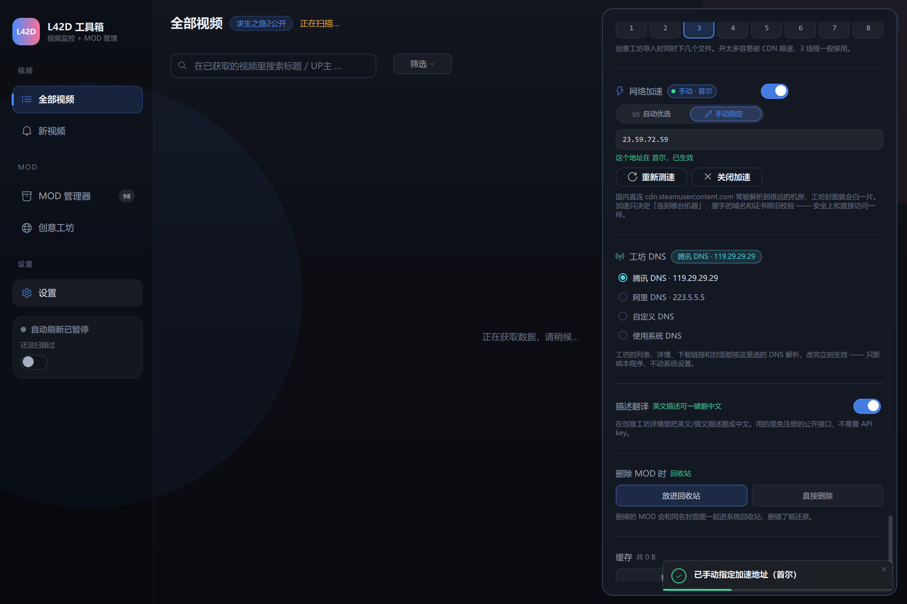

| 操作 | 说明 |
| --- | --- |
| 总开关 | 关掉就不指定机器，交给下面的 DNS |
| 自动优选 | 后台并发测速，**自动选最快的那台**，实测 254ms（东京） |
| 手动指定 | **自己填一个 IPv4 / IPv6**（自建服务器、指定节点都行），填完回车即生效 |
| 重新测速 | 重新并发测一遍，把当前用的是哪台刷新出来 |
| 关闭加速 | 一键回到「不指定机器」 |

- 自动优选的结果**只按地名说**：东京 / 新加坡 / 大阪 / 首尔 / 台北……
  界面上不会摆出地址；但「手动指定」是你自己填的，输入框里当然就是你自己写的那个地址。
- 地址只在程序内部连机器时用（存在配置 `workshop_cdn_ip` 里）。
- 手动填的地址会先校验（IPv4 逐段 ≤255、IPv6 走标准解析），
  填错只提示不写入，原来生效的那个不会被改掉。
- 节点池来自公开的 IP 优选服务（`lytvpk-get-ips.laoyutang.cn`），拉不到就用内置的兜底。
- 判定「连得上」用的是 TCP 握手耗时，测速结果同时给「自动优选」用。

> **实现上有个坑**：把域名换成 IP 之后，TLS 的 **SNI 必须仍然发域名**，
> 否则服务器返回的证书对不上，Python 会直接 `SSLCertVerificationError`。
> 所以是「连 IP、`server_hostname=域名`、`Host` 头也写域名」三件套，
> 证书校验照常通过，安全性不打折。

### 工坊 DNS（设置里）

工坊的**列表、详情、下载链接、封面**都要解析 `steamcommunity.com`、
`steamusercontent.com` 这些域名，走哪个 DNS 由你选：

| 模式 | 说明 |
| --- | --- |
| 腾讯 DNS（默认） | `119.29.29.29`，国内解析这些域名通常最稳 |
| 阿里 DNS | `223.5.5.5` |
| 自定义 DNS | 自己填一个 IPv4 / IPv6 服务器地址 |
| 使用系统 DNS | 交给系统的解析设置 |

- 只影响**本程序**：程序自己发 DNS 查询报文（含 CNAME 追踪、结果按 TTL 缓存），
  不动系统设置，也不用管理员权限。
- 自定义地址填错会提示「地址还没填对」，此时解析**不会瞎猜**，先按系统 DNS 走。
- 自定义 DNS 查询失败会自动回落系统解析并写日志，不会让工坊直接打不开。
- 改完立刻生效：新发起的请求就用新 DNS，不用重启。
- 例外：**如果系统里配了 HTTP(S) 代理**（环境变量或 Windows 的代理设置），程序会把
  请求交给代理、这一节选的 DNS 就不再起作用（代理自己解析域名），日志里会写一行说明。
  代理优先级高于 DNS 是有意的——配了代理还硬走直连，只会连不上。

### 简介与翻译（在创意工坊详情里）

工坊 MOD 的简介来自详情接口（中转给的字段是 `file_description`，官方是 `description`），
里面是 BBCode，程序会用 `_plain_desc()` 收拾成能读的纯文本（`[h2]`、`[url=…]`、`[list][*]`
这些换成对应符号或删掉），再显示在详情面板的「简介」下面。

描述大多是英文/俄文，**详情面板里点「译成中文」就翻**（点「看原文」切回去）：

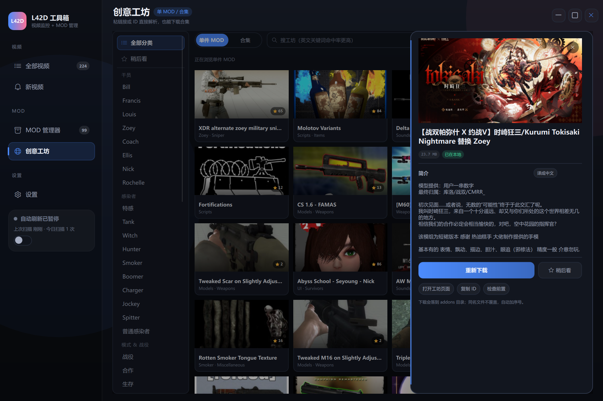

| 项 | 说明 |
| --- | --- |
| 入口 | 创意工坊详情面板「简介」右边那颗小按钮（设置里那颗总开关已经撤掉，翻译改成按需动手翻） |
| 接口 | 免注册、免 API key 的公开接口。先试 **MyMemory**，失败再试**腾讯交互翻译**（transmart） |
| 语种自动判断 | `detect_lang()` 按字符占比猜原文是日语/韩语/俄语/中文/英文，再按猜出来的语种发音译请求（以前一律按英文发，日文韩文简介根本翻不动） |
| 智能跳过 | 本来就是中文的描述不翻译（直接标「skipped」）；带假名/谚文的不会被当成中文 |
| 混合语种 | 一次翻不干净（译完还剩假名/谚文 ≥40%）就换下一个候选语向重试，所以「日文标题 + 英文正文」这种也能翻掉 |
| 分段 | 长描述按行切成 ≤480 字符分段翻（MyMemory 单次上限 500） |
| 失败不糊弄 | 翻译失败会**明确报错**，不会把原文当译文返回 |
| 没简介 | 详情里写「（这个 MOD 没写简介）」，那颗按钮不出现 |

> 实测：`Replace the shotgun with a modern tactical version.`
> → `将霰弹枪替换为现代战术版本。`
> 日语简介：`モロトフのバリエーションを追加します。` → `添加燃烧瓶的变种。`（`src=ja`）

#### 「翻译 HTTP 403」是怎么回事（修过的坑）

这个报错有**两个**根因叠在一起：

**一、MyMemory 超长时返回 HTTP 200，但 body 里是 403。**
它的 `q` 参数上限是 **500 字符**，超了**不返回 4xx**，而是回：

```json
{"responseStatus": 403,
 "responseDetails": "QUERY LENGTH LIMIT EXCEEDED. MAX ALLOWED QUERY : 500 CHARS"}
```

旧代码只判 `resp.status != 200`，于是这种情况被当成成功继续走，
最后要么把那句 `QUERY LENGTH LIMIT` 当译文显示，要么被当成「语向不对」
反复重试。现在两道闸都补上了：先按 500 字符硬校验，再逐个检查 body 里的
`responseStatus` / `quotaFinished`，最后才相信 `translatedText`。

> 顺带一提：额度用完时它是 **HTTP 429 + `MYMEMORY WARNING`**，
> 同样会被旧代码当译文。一并处理了。

**二、兜底的 Yandex 接口已经彻底停用。**
2026-11 实测：

```
srv=android  → 403  {"code":405,"message":"Session is invalid"}
去掉 srv     → 410  {"code":410,"message":"Yandex.Translate API v1 is no
                    longer active. Please migrate to API v1.5"}
```

v1.5 要 API key + 计费，不是「免注册」能用的东西。所以 MyMemory 一失败，
用户看到的就是那句 Yandex 的 403 —— 这就是「翻译 HTTP 403」的来源。

现在兜底换成**腾讯交互翻译**（`transmart.qq.com/api/imt`）：免 key、国内直连、
自动识别语种（中英日韩都实测可用）、单块上限 6000 字符。请求要点是
`source.text_list` **必须是数组**（写成 `source.text` 它会回
`Invalid value of source.text_list`），成功与否看
`header.ret_code == "succ"` 而不是 HTTP 状态码。

回归测试 `tools/translate_test.py`：超长文本必须能翻完、
MyMemory 打瘸后腾讯要能顶上、两边都挂时最终报错里不许再出现「403」。

## 服务器（收藏 + A2S 直查）

左边是收藏的服务器，右边是选中那台的检查面板。页面上的名字、地图、模式、人数都是
**自己发 UDP 包问服务器**拿到的（Valve 的 A2S 协议），不经过任何第三方接口 ——
所以看到的是服务器此刻的真实状态，不是某个网站缓存的数据。


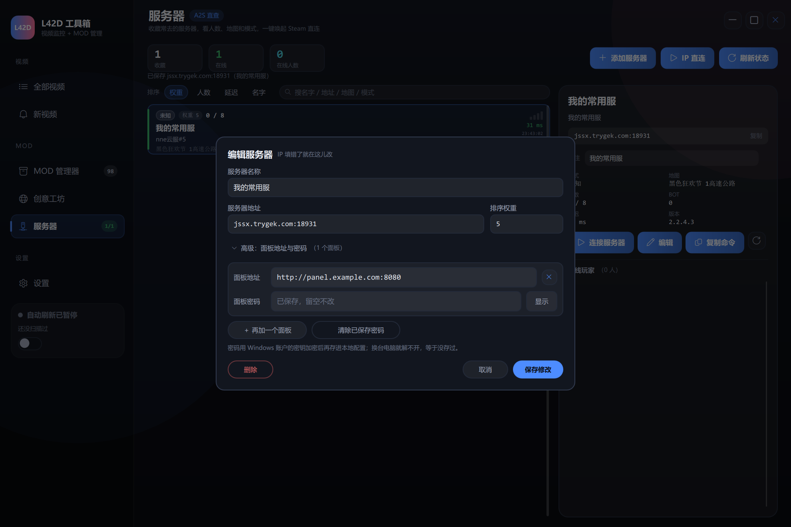

### 地址怎么写

| 你粘的 | 认出来的 |
| --- | --- |
| `42.193.137.24` | `42.193.137.24:27015`（没写端口就补 27015） |
| `82.156.195.10:27016` | 原样，端口按你写的 |
| `steam://connect/46.174.51.126:27015` | 砍掉 `steam://connect/` 前缀 |
| `connect 42.193.137.24` | 砍掉 `connect` 命令前缀 |
| `[2001:db8::1]:27015` | IPv6 去掉方括号 |
| `steam://connect/1.2.3.4:27015/密码` | 只留地址，密码段丢掉 |
| `不是地址` | 拒收，提示「主机名看着不像 IP 或域名」 |

同一个地址收两次只会留一条（收藏里有去重）；收藏的名字可以随时改（面板「备注」行，回车保存）。

### 加一台服务器：名称、权重、面板

右上角「**添加服务器**」只填两样就能用：**服务器名称**（自己起，方便认）和**服务器地址**
（IP、IP:端口、`steam://connect/...` 都认）。地址填错了不用删了重加 ——
在列表里选中那台，点面板上的「**编辑**」就能改（改地址时如果撞上列表里另一台会明确拦住）。

| 字段 | 干什么的 |
| --- | --- |
| 服务器名称 | 显示在卡片上的名字（留空就显示服务器自己报的名字，再没有就显示地址） |
| 服务器地址 | 上面那张表里的任意写法，保存时会规范化成 `ip:port` |
| 排序权重 | 整数，越大越靠前。默认按权重排，权重一样再按人数排 |
| 高级：面板地址 | 这台服有商店/面板网页就填进来，**可以加多条**（一条一行）；不写协议自动补 `http://` |
| 高级：面板密码 | 每行一个。**用 Windows 账户的 DPAPI 加密后再存**，配置文件里看不到明文；旁边的「显示」可以把刚敲的内容亮出来核对，点开已保存的行不会回显明文 |
| 高级：清除已保存的密码 | 勾上就清空这台服存过的所有面板密码 |

> 为什么密码要加密：`config.json` 是明文 JSON，直接写密码等于把密码摊在桌面上。
> 用 DPAPI（`CryptProtectData`）绑当前 Windows 账户加密，换台电脑或换个账户就解不开 ——
> 那时候程序会说「重新填一次吧」，而不是崩。点开一条已保存的面板行也不会回显明文。

### IP 直连（不进收藏）

右上角「**IP 直连**」是给「就进这一次」准备的：粘个 IP（端口不写就是 27015），
下面立刻显示「会连到 `ip:27015`」，点「连接」直接唤起 Steam 进服；
想留下来就点「存进列表」，它会顺手把地址带进「添加服务器」的表单里。

填**域名**（`jssx.trygek.com:18931` 这类）也能用，但程序会先自己把域名解析成 IP——
Steam 的 `steam://connect/` 只吃字面 IP，喂它域名它会停在 `ExecCommandLine:` 那一行不动。
所以下面那行预览显示的是**解析后的 IP**，不是原样的域名。

### 连接到底怎么发出去的（这轮返工的重点）

上一版把一切都押在 `QDesktopServices.openUrl("steam://connect/...")` 上，
于是有四种「点了没反应」，而且**一种都不报错**：

| 情况 | 上一版的表现 | 现在怎么办 |
| --- | --- | --- |
| 没装 Steam | `openUrl` 返回 `False`，界面什么都不说 | 直接提示「没找到 Steam」 |
| 装了 Steam 但没装 550 | `openUrl` 照样返回 `True`，Steam 静默丢掉 | 查 `appmanifest_550.acf` / 游戏目录，没装就明说 |
| 地址是**域名** | Steam 不认，停在 `ExecCommandLine:` 不启动 | 自己 `getaddrinfo` 解析成 IP 再交给 Steam |
| **游戏已经在跑** | 老写法 `steam://connect/<ip>:<port>` 被当成「又启动一次 550」，`WaitingPrevProcess` 然后 Completed，**看起来点了没反应** | 改用 `steam://connect/<ip>:<port>/rungameid/550`，**已经在跑的进程会接住并直接连过去** |

> ★ **「游戏开着就进不去」是错的**（用户实测指出）。关键在于 URL 里要带 `/rungameid/550`：
> 带上 appid 之后，Steam 把它当成「给 550 传一条启动参数」，正在运行的实例会接住；
> 不带 appid 才会走「再启动一次 → 等前一个进程 → 什么都不做」。
>
> 现在**两条路都用同一个 URL 形状**（游戏没跑也是它，Steam 照样带 `+connect` 起游戏），
> 只有系统真的没把 URL 交出去时，才退回到「`connect ip:port` 塞剪贴板 + 提示去控制台粘」——
> 那是最后的兜底，不是主路径。`connectUrl()` / `parseAddress()` 返回的链接也都带上了 appid。

> 关于兜底那条：Source 引擎确实没有「从外部让运行中的进程执行控制台命令」的口子。
> 试过 `Steam.exe -applaunch 550 +connect ip:port`，Steam 回的是
> `>>> command not found: connect`；直接再跑一次 `left4dead2.exe +connect` 也不会把命令
> 送进已经在跑的那个实例。所以真正的解法是上面那个带 appid 的 URL，而不是让玩家手粘。

判定依据都来自实测日志（`D:\Steam\logs\console_log.txt`）：

```
[20:58:40] ExecCommandLine: "Steam.exe -- steam://connect/42.193.137.24:27015"
[20:58:41] Game process added : AppID 550 "...left4dead2.exe" -steam +connect 42.193.137.24:27015 …   ← IP 好使
[21:10:24] ExecCommandLine: "Steam.exe -- steam://connect/jssx.trygek.com:18931"                        ← 域名到此为止
[21:15:12] ExecCommandLine: "Steam.exe -applaunch 550 "+connect 112.20.185.178:18931""
[21:15:12] >>> command not found: connect                                                               ← applaunch 不行
```

### 后端这几个槽

| 槽 | 干什么 |
| --- | --- |
| `saveServer(payload)` | 添加 / 改一台（`addr/oldAddr/name/weight/panels/clearPassword`）；`oldAddr` 为空时同地址再存一次就是「原地改」 |
| `serverDetail(addr)` | 给编辑对话框回填：名称、权重、面板地址、`hasPassword`（**不回明文**） |
| `revealPanelPassword(addr, index)` | 用户主动点「看密码」时才 DPAPI 解密一次 |
| `clearPasswords(addr)` | 清这台服存过的密码（返回清掉条数） |
| `parseAddress(text)` | IP 直连的实时校验：`{ok, addr, steamTarget, command, url}`；`steamTarget` 是解析后的 IP |
| `directConnect(text)` | 校验后连服（分支和 `connectResult` 一样） |
| `connectResult(addr)` | 连一台收藏，返回 `{ok, how, steamTarget, command, message}`；`how` 是 `steam`（拉起了游戏）或 `console`（游戏在跑，命令已复制） |
| `connectServer(addr)` | 同上，不给返回值（给「点了就走」的按钮用） |

`_connect_target(addr)` 是这一层的核心：把地址整理成 Steam 认的形式，域名在这里被解析掉。

### 导出 / 导入配置（分享给朋友）

攒了几十台服务器想分享时，不用一个个手抄地址 —— 服务器页工具条右侧有两颗图标按钮：

| 按钮 | 干什么 |
| --- | --- |
| 导出 | 存成一个 `.json`（默认后缀就带好），内容是「地址 + 名称 + 权重 + 面板地址 + **合集名**」；**多选模式下只导出勾中的那些** |
| 导入 | 选 `.json`（**可多选**，也可以**直接把文件拖进服务器页**），单个文件先预览「将导入 N 台（M 台已存在会跳过）」，多个文件直接批量导入并汇总一条提示 |

导出文件长这样（带 `_kind` 标记，导入时用它确认「这是本程序的配置」）：

```json
{
  "_kind": "l42d.servers",
  "_version": 2,
  "exportedAt": "2026-11-20 03:15:49",
  "count": 2,
  "groupNames": { "1.2.3.4:27015": "黑喵服群" },
  "servers": [
    { "addr": "1.2.3.4:27015", "name": "宿舍服", "weight": 5,
      "group": "黑喵服群",
      "panels": [ { "url": "http://panel.a.com:8080", "pw": "" } ] }
  ]
}
```

**合集名一起导出、导入时自动还原**（`groupNames` 是「地址 → 手动合集名」）：

- 只导出本次真正带手动名的地址，不会是空字典；
- 导入时只给**这次真的导进来的**地址补名字，**不覆盖**本机已有服务器的自定义名；
- 每台服务器还额外带一个 `group` 字段做兜底（老文件没有 `groupNames` 时也能认出分组）。

> **★ 面板密码绝不导出**。密码是用本机 Windows 账户密钥（DPAPI）加密的，
> 换台电脑根本解不开 —— 导出密文只会让对方拿到一串废数据，还多一层误会。
> 所以导出时 `pw` 一律清空，导入时也不采信对方的 `pw` 字段。

**拖拽导入**：把 `.json` 直接拖到服务器页面上，整页会出现高亮提示框，松手即导入。
可以一次拖多个（`DropArea` → `handleDropped` 剥掉 `file://` 前缀 → `importConfigs`）。

导入的三条原则：

1. **只加不删** —— 不会动你现有的列表；
2. **重复地址跳过** —— 不会把同一个地址加两遍，也**不覆盖**本机那台已有的名字和密码；
3. **坏条目跳过、好条目保留** —— 文件里有一条地址写错了，其余照常导入；多个文件里坏一个，其余照常导入。

兼容性上做了两处宽容：

- 直接给一个 JSON **数组**（`["1.2.3.4", {...}]`）也认，不强制要外层那个对象；
- 地址会自动规范化（`1.2.3.4` → `1.2.3.4:27015`），面板地址不写协议会自动补 `http://`。

后端这几个槽：

| 槽 | 干什么 |
| --- | --- |
| `exportConfig(path, addrs)` | 写文件；`addrs` 有值时只导这些地址，返回 `{ok, count, groups, error}` |
| `previewImport(path)` | 只读不写，返回 `{ok, total, fresh, duplicate, names}` |
| `importConfig(path)` | 真导入（含合集名还原），返回 `{ok, added, skipped, groups, error}` |
| `importConfigs(paths)` | 批量导入多个文件，返回 `{ok, added, skipped, failed, groups, error}` |

### 玩家列表：在线时长要看得清

原来「时长 + 分数」是**一行挤在一起**：`text: timeText + "   " + score + " 分"`，
9px、`Theme.textMute`、等宽字体，压在半透明条纹底上 —— 一串 `01:23:45` 几乎糊成一团
（用户报的「在线时长的字体不好看清楚」）。

现在拆成两个**独立小胶囊**：

| | 字号 | 颜色 | 底 |
| --- | --- | --- | --- |
| 在线时长 | 10（加大）+ DemiBold | `Theme.textDim`（比 textMute 亮一档） | `scrim(0.07)` 淡底圆角 |
| 分数 | 9 | `Theme.textMute` | `scrim(0.04)` 更淡 |

行高 26 → 28 给胶囊留出上下空隙；两块各有 `objectName`（`srvPlayerTime` / `srvPlayerScore`），
回归测试能直接定位。

### 分享给好友（复制一段文本）

不用再手抄 IP：服务器详情面板右下角的 **分享** 图标（列表卡片上也有），
点一下就把这台服务器写成一段人话塞进剪贴板，同时弹个框让你看一眼再发：

```
【Yumi的L4D2工具箱】求生之路2 服务器
名字：周末开黑
服务器：某某服 · 战役
地址：5.6.7.8:27016
地图：死亡中心 | 旅馆 [1/4]
模式：战役
状态：在线 8/12 · 46 ms
直连：connect 5.6.7.8:27016
把这段发给我，我用「从文字导入」一键加进收藏。
```

> 只写**地址和最基础的信息**，面板密码、收藏权重这些私人数据都不在分享文本里。

### 从文字导入（粘贴一段话就行）

工具条最右边那颗 **粘贴** 图标：把聊天记录里的一整段话粘进去，
程序自己把里面的服务器地址抠出来，**实时**告诉你「找到 N 台，其中几台已经在收藏里」，
确认了才加。

认得的写法（都从同一段文字里混着找）：

| 写法 | 结果 |
| --- | --- |
| `1.2.3.4:27015` | ✅ 1.2.3.4:27015 |
| `connect 1.2.3.4:27015` | ✅ 同上 |
| `steam://connect/5.6.7.8:27016` | ✅ 5.6.7.8:27016 |
| `l4d2.example.com:27015` | ✅ 域名也认（连接时会解析成 IP） |
| `3.3.3.3`（只有 IP，附近有「服务器 / ip / 连接」这类字眼） | ✅ 补默认端口 27015 |
| `版本 1.3.2.4 更新了` | ❌ 不误判成 1.3.2.4:27015 |
| `看 github.com 上的项目` | ❌ 纯域名不认，不然任何一句话都能「导入」 |

> **为什么要「附近有字眼」这个条件**：`1.3.2.4` 和 IP 长得一模一样，
> 只写四段数字的时候，光看字符串分不出是服务器还是版本号。
> 带了端口（`ip:port`）就足够确定，不需要这条 —— 它只用在「只给 IP」的情况下。

### 剪贴板检测（复制到地址就问你一句）

这是上面两件事的自动化：**你在别处复制了一段带服务器地址的文字，切回本程序时会问你要不要导入**。

- 弹的框里列出找到的地址、几台是新的，按钮是「一键导入 / 不用 / 以后别问」
- 点「以后别问」= 关掉 `clipboard_servers`，之后程序**不再读剪贴板**（不是只不弹框）
- 想开回来：设置页 ① 监控与提醒 里的「剪贴板服务器检测」开关

#### 触发条件：只认「新的复制动作」

| 情况 | 会不会弹 |
| --- | --- |
| 开软件前剪贴板里就躺着一段服务器地址 | ❌ **不弹**（只记成基线） |
| 复制了一段新内容（含服务器地址），切回本窗口 | ✅ 弹 |
| 复制的这段里那台服务器**已经在收藏里**（全重复） | ❌ **不弹**（没有可导入的东西，弹出来只是打扰） |
| 复制的这段里**既有新的也有重复的** | ✅ 弹，文案说明「其中 N 台不在收藏里」 |
| 复制的新内容里根本没有服务器地址 | ❌ 不问（静默记成已处理） |
| 同一段内容，来回切窗口 | ❌ 只问一次 |
| 点了「不用」/「一键导入」之后 | ❌ 同一段不再问 |
| 复制 A → 复制 B → 又复制回 A | ✅ 问（确实是新的一次复制，哪怕内容一样） |
| 点本程序自己的「分享 / 复制地址 / 复制命令」 | ❌ 不算用户复制（写剪贴板前打了自身写入标记） |

实现上分三层，缺一层就会退化成「每次开软件都弹」或「复制了不弹」：

1. **启动基线 + 宽限期**：`watch_clipboard()` 在窗口建好时就把当前剪贴板记成
   `_clip_baseline`，并开启 `CLIP_STARTUP_GRACE`（2.5 秒）的宽限窗口。
   Windows 上 Qt 起来时系统会自己抛一次 `dataChanged`（剪贴板所有权交接），
   不挡掉的话程序一启动就把旧剪贴板当成「刚复制的」。
2. **真实复制事件**：挂 `QClipboard.dataChanged`，每次真有复制就把 `_clip_seq` +1；
   `changed` 由「`_clip_seq` 和已处理的 `_clip_seen_seq` 不一样」决定。
3. **自身写入标记**：`_clipboard()` 写剪贴板前把 `_clip_self_writes` +1，
   对应的事件直接吞掉 —— 否则点「分享」之后切回来会弹自己的框。

> **为什么不用「文字内容变没变」当唯一依据**：复制 A → 复制 B → 复制回 A 时
> 内容「和上次一样」，但那确实是新的一次复制，用户会期待被问。
> 反过来，靠内容比较又没法区分「新复制的」和「程序启动前就有的」——
> 所以必须用 `dataChanged` 事件当主依据，文字比较只在收不到事件时兜底。

> **别用 `win.active` 当硬门槛**：原来 `checkClipboardServers()` 里有
> `if (!win.active) return`，结果「从托盘唤起 / 远程桌面 / 窗口是前台但系统没给
> 焦点」时 `active` 一直是 `false`，用户复制完切回来永远等不到提示。
> `active` 现在只用来决定**什么时候查**（`onActiveChanged` 触发一次），
> 不再是能否弹框的前提；真正该挡的是「有模态框挡着」。

#### 其余收敛

| 约束 | 为什么 |
| --- | --- |
| 窗口获得焦点时查 + 30 秒低频兜底 | 覆盖「切回来」和「一直停在窗口里用手机复制」两种用法 |
| 被播放器 / 详情面板 / 设置页 / 别的弹窗挡住时**先记着不插队** | 正在看东西的时候不该被打断；挡路的关掉后 `clipRetry` 会补问 |
| 同一段只问一次（`noteClipboardHandled()` 对齐计数） | 不然每次切窗口都弹一遍 |

| 槽 | 干什么 |
| --- | --- |
| `shareServer(addr)` | 复制分享文本，返回 `{ok, text, error}` |
| `shareText(addr)` | 只生成文本（不碰剪贴板，测试用） |
| `parseShareText(text)` | 只解析不写入，返回 `{total, fresh, duplicate, addrs, freshAddrs}` |
| `importFromText(text)` | 真导入，返回 `{ok, added, skipped, error, addrs}` |
| `scanClipboard()` | 读剪贴板并解析，**不写剪贴板**；`changed` = 「打从上一次看过之后真的有新复制」 |
| `watch_clipboard()` | 挂上 `QClipboard.dataChanged`（`main.py` 调一次），复制动作才开始计数 |
| `noteClipboardHandled()` | 用户处理过当前这段（点了不用 / 导入了 / 直接关框），对齐计数，别再问 |
| `resetClipboardSeen()` | 忘掉基线（关掉监听时调），下次重新从当前内容算起 |

#### 两个实现上的坑（都踩过）

**① QML 要调的方法必须加 `@Slot()`**

不加的话 QML 会抛 `TypeError: Property 'xxx' of object ... is not a function`，
更坑的是这个异常会**中断整个 `onClicked` 处理函数**，后面的语句一条都不执行 ——
「一键导入点了没反应」就是这么来的：`noteClipboardHandled()` 抛异常，
紧跟着的 `importFromText()` 永远没跑到。

> 已经加了 `tools/qml_slot_check.py` 守这类问题：它扫描 QML 里所有
> `core.servers.xxx(` 调用，逐个比对 `staticMetaObject` 里真正暴露的槽名。
> 加新方法忘了装饰器，这个脚本会直接报出来。

**② 关框也算「处理过」**

提示框的 `onClosed` 里必须同时调 `noteClipboardHandled()`。
以前只有 `clipAskOpen = false`，于是「点✕关掉、没点任何按钮」时后端计数还记得
「有新复制没消费」，下次焦点一变又弹一遍 —— 就是「同一段内容反复提示导入」。
放在 `onClosed` 而不是三个按钮各自处理，是因为按钮点完都会先关框，一处兜住最稳。

**③ 全重复就静默，但计数必须消费**

`checkClipboardServers()` 里「有地址但没有一台是新的」（`fresh <= 0`）直接 return、
不弹框，同时**仍要调 `noteClipboardHandled()`**。
漏了这一步，后端会一直认为「有新复制没消费」，下次焦点一变又跑一遍这段逻辑。

### 名字、模式、地图

| 显示 | 从哪儿来 |
| --- | --- |
| 名字 | A2S 回包里的服务器名，控制字符清零 |
| 地区标签 | 名字里的 `【CN】` 这类方括号标签，抽出来单独上色（`0.无限火力【CN】` → 徽章 `CN`） |
| 模式 | 先看 tags 里的 `m:coop` / `m:versus` / `m:realismversus` …；再看 tags 里的关键字；最后看**服务器名里的中文**（`对抗` / `写实` / `无限火力` / `多特` / `战役` …）；都不中显示「未知」 |
| 地图 | A2S 的 `map` 字段（如 `c1m1_hotel`）→ 中文名接口 `l4d2-maps.laoyutang.cn` 给出 `死亡中心\|旅馆 [1/4]`，查一次缓存 7 天；服务器自己就给中文名（有些模组服会这么干）就直接用 |
| 人数 | `players / maxPlayers`，BOT 数单独一行 |
| 其他 | 版本号、VAC、要不要密码、UDP 往返毫秒（4 格信号按 <80 / <150 / <260 上色） |

> **为什么不能只看 tags**：实测国内一堆模组服的 tags 字段是二进制垃圾
> （`b1 87 69 0f 90 71 9f 27 …`），只看 tags 会整排都显示「未知」。
> 所以 `parse_mode()` 是三层兜底，最后一层专门认服务器名里的中文。

### 直连的两种方式

- 双击卡片 / 点面板「连接服务器」→ 唤起 `steam://connect/ip:port`，Steam 直接连过去。
- 点「复制命令」→ 拿到 `connect ip:port`，进游戏按 `~` 打开控制台粘进去。

### 玩家列表

点开一台服务器，右边会列出在线玩家（A2S_PLAYERS）：名字、分数、在线时长（`1 小时 4 分`）。
有的服禁掉了玩家查询，会明确写「这个服不提供玩家列表」，不会转圈到死。

### 为什么没有「公开服务器列表」

Steam 的 master 服务器列表（`hl2master.steampowered.com`）现在域名都不解析了，
几个历史 IP（`208.64.200.39` 等）也全部超时 —— 所以这一页以**收藏**为主：
把你常去的服粘到右上角就行。

> 协议上还有个小坑：现在很多服务器对 A2S_INFO 会先回一个 `0x41`（challenge）包，
> 必须把它带回的 4 字节**原样**附加在请求后面再发一次，才会给 `0x49` 的正式回包；
> 不带 challenge 直接问，101% 只能拿到 `0x41`。

## 播放器怎么工作的

**不是下载整份文件再播**，而是：

```
QMediaPlayer ← http://127.0.0.1:随机端口 ← 本地流代理(带 Referer) ← upos CDN
```

为什么这么做：B 站 CDN 校验 Referer，而 QMediaPlayer 不允许自定义请求头。
本机起一个极简 HTTP 代理转发，就能实现真正的**流式边下边播**，磁盘不落整份视频。

> 为什么不嵌网页播放器：PySide6 自带的 Qt WebEngine **不含 H.264 解码**
> （实测 `canPlayType('avc1')` 返回 `NO`），B 站网页播放器会直接报
> "当前浏览器不支持 HTML5 播放器"。所以用 QtMultimedia（内置 FFmpeg 7.x）。

关闭播放器会同时 `setSource(空)` + 停止流代理，**不会后台继续播放/拉流**。

### 音量与静音

控制条右下角是**喇叭 + 音量滑块 + 百分比**，**常驻显示**，不需要悬停才出来：

- 拖滑块调音量，右边数字实时跟着变（静音时显示「静音」两个字）
- 点喇叭切换静音
- **只有一个喇叭图标**（以前 IconButton 有一颗、滑块里又有一颗，等于两个）

**音量大小和静音状态都会被记住**（存在 `data/config.json` 的 `player_volume` /
`player_muted`）：

- 上次静音了 → 下次打开任何视频还是静音
- 上次把音量调到 40 → 下次还是 40
- 滑块拖到 0 以上会自动解除静音（不用再点一下喇叭）

> 拖动过程中只改声音、**不写盘**（`previewVolume`），松手才落盘一次，
> 避免拖一下滑块写几十次配置文件。

## 置顶评论预览

视频详情里会显示 UP 主置顶的评论（有就显示，没有就不占位置）：

- 头部：置顶标记 + 评论者昵称 + 点赞数
- 正文：可拖选、可滚动，长评论不会把面板撑爆
- **置顶评论里如果发了网盘，也会被提取出来**，显示成可点的网盘行（左键打开 / 右键复制提取码）

> 置顶评论不在 `replies` 列表头部，而是单独放在 `data.top.upper`（UP 置顶）和
> `data.top.admin`（管理员置顶）里，所以要专门调 `/x/v2/reply/main` 并带 WBI 签名，
> 否则会 -352。查不到就静默跳过，不影响详情其它内容。

> **每次打开详情都会重新拉一遍简介和置顶评论。** 以前「已经查过简介就直接用缓存」，
> 只在没查过置顶评论时才补一次，于是 UP 主后来改了简介、换了置顶评论，你这里永远
> 显示第一次抓到的旧内容；评论区当时被风控（-352）查空了，之后也不会再补。
> 现在改成：先拿缓存**立刻**显示（不白等），同时后台重拉一次，回来了再原位替换。
> 拉回来是空的时候**不会**把已有内容刷没（接口偶尔不回字段，不能因此把好数据清掉）。

## 网盘链接提取

B 站简介常见防和谐写法：

```
链接: https://pan.删除baidu.com/s/1mLRDkcit中文c2Sz05w6EwbKaA?pwd=6sg4
```

自动清洗成：

```
百度网盘  https://pan.baidu.com/s/1mLRDkcitc2Sz05w6EwbKaA?pwd=6sg4   码 6sg4
```

> 提取码**保留原始大小写**——蓝奏云/夸克是区分大小写的，统一转大写会让用户粘进去打不开。

### 干扰词插进 URL 内部（连协议名都拆开）

比上面更狠的一种写法，是把干扰词插到**每一个**可能被平台识别的位置，
连 `https` 都不放过：

```
htt【删】ps://pan.ba【除】idu.com/s/18【文】VHP-PnAp7t3【字】dksJSOoU【谢】ww?pwd=【谢】tvrk
       提取码: tvrk  长期有效
```

正确结果是：

```
百度网盘  https://pan.baidu.com/s/18VHP-PnAp7t3dksJSOoUww?pwd=tvrk   码 tvrk
```

> **这个坑的关键是「清洗和匹配的先后顺序」**。
> 旧实现是「先在原文里用 `https?://[^\s]+` 找协议头 → 再 `_clean_url` 清洗」。
> `_clean_url` 本身完全能清掉 `【删】`，但那时已经晚了：
> `https` 被插成 `htt【删】ps`，正则**压根匹配不上**，整条链接直接被漏掉。
> 现在改成 `_url_matches()`：**按空白切 token → 先清洗整个 token → 再在清洗后的串里找协议头**。
> 清洗会改变长度，所以 token 在原文里的起止位置要单独带出去 ——
> 提取码和文件说明都是按「链接在原文中的位置」就近推断的。

顺带修掉一个同类问题：以前 `[删]` 这种方括号干扰被删掉后，括号本身还留在 URL 里
（`.../s/1AbCdEfG[]?pwd=z9y8`，打开就是 404）。现在 `_CJK` 的过滤字符集里
把 `[]【】〔〕〖〗「」『』《》〈〉()（）` 都算上了。

真实库（331 个视频）上跑过：这次修复多抓回 **5 个原本完全漏掉**的网盘链接，
其中就包括上面这条。回归脚本 `tools/link_test.py` 加了 5 个插字用例。

还会判断**网盘里装的是什么**，例如：

```
AK47和三连发：
https://pan.qu【删】ark.cn/s/e0066df91f26?pwd=5jiy
提取码：5jiy
```

显示为「夸克网盘 · **AK47和三连发**」。判断顺序：链接同行前置标签 → 上一行短标签 →
附近文件名（`xxx.vpk`）→ 附近武器/内容名词 → 视频标题兜底。

### 蓝奏云可以直接下载

其它网盘（百度 / 夸克 / 阿里…）点一下就是「在浏览器打开」——它们的直链要登录态，
程序拿不到。**蓝奏云是唯一能真正解析出直链的**，所以点蓝奏云那条会先弹一个选择：

```
┌─────────────────────────────┐
│ 本地下载（解析直链）          │  ← 程序自己换出直链，下到 downloads/pan/
├─────────────────────────────┤
│ 在浏览器打开                  │  ← 老行为，永远可用
└─────────────────────────────┘
```

#### 四条硬要求（缺一条就失败，全部实测）

这一节是本模块返工最多的地方。早期版本只做「找一个 href」，对现在的蓝奏云完全无效；
后来照着 `E:/mrxz/蓝奏云直链下载.zip`（一份可用的 PHP/JS 实现）逐条对齐，
又用你库里的 **13 条真实分享链接**验过，才定下这四条：

| # | 要求 | 不做的后果 |
| --- | --- | --- |
| 1 | **每次请求带随机 `X-FORWARDED-FOR` / `CLIENT-IP`** | 被 ESA 按来源 IP 风控，回 `{"url":"?SignError"}`，而且会**持续**（换域名/换 cookie 都没用） |
| 2 | Cookie 带 **`down_ip=1`**（取跳转那一步） | 被当作未验证，拿不到跳转 |
| 3 | **真直链在 302 的 `Location` 头里**，必须不跟随重定向去读 | 只能拿到「验证并下载」的 HTML；`urllib` 默认自动跟随 302，所以专门写了 `_NoRedirect` handler |
| 4 | 分享页有**两种结构**，都要认 | 只处理一种会漏掉另一大批 |

第 4 条展开：

| 结构 | 特征 | 怎么做 |
| --- | --- | --- |
| **密码页** | `function down_p` / `id="passwddiv"` | 取 `var isngis` 当 sign，POST `action=downprocess&sign=…&p=<密码>&kd=1` |
| **普通页** | 页面里 `<iframe src="/fn?…">` | 进 iframe 取 `var wp_sign` 和 `var ajaxdata`，POST `action=downprocess&websignkey=<ajaxdata>&signs=<ajaxdata>&sign=<wp_sign>&websign=&kd=1&ves=1` |

表单地址**不在分享页那个域名**：`https://apifile.woozooo.com/ajaxfile.php?file=<数字>`
（页面里可能只给相对路径，要补全）。中转地址是 `dom + "/file/" + url`
（`url` 以 `?` 开头，漏掉 `/file/` 就是「文件未授权」）。

再加上 ESA 挑战：页面里 `var arg1='<40位hex>'` 时，按固定置换表 + XOR 固定 key
算出 `acw_sc__v2` cookie 重试（`acw_sc_v2()`，确定性算法，不用跑 JS）。

#### 实测结果（13 条真实链接）

| 结果 | 条数 | 说明 |
| --- | --- | --- |
| ✅ 解析出 CDN 直链 | **7** | 全部下载验证通过（文件头是真 7z/zip，大小对得上） |
| 提取码不对 | 2 | 我从视频简介里猜的密码不准 —— **参考实现测同样两条也是「密码错误」** |
| 文件夹分享 | 2 | 一个链接装多个文件，要人工挑 |
| 空壳页 | 2 | 提取码错或分享已失效 |

> 用另一份**已知可用**的参考实现交叉验证过：同样这 13 条它也是 7 条成功，
> 失败原因一字不差。所以这不是「我的实现不行」，而是剩下的本来就解析不了。

> **关于 IP 风控**：要求 1 存在的原因就是它。之前不带假 IP 时，
> 我这台机器请求几十次之后被永久标记，13 条全部 `SignError`；
> 加上每请求随机假 IP 之后立刻恢复正常 —— 这也是「原来一直失败」的真正原因。

#### 「点本地下载没反应」是怎么回事（修过的坑）

这个是**独立于解析**的 bug，而且比解析失败更难受 —— 连报错都没有。

根因是一行装饰器：

```python
@Slot(str, result="QVariantMap")      # ← 收字符串
def addPanFile(self, info: dict): ...
```

QML 那边传的是 JS 对象 `{url, name, code, label}`。Qt 按签名把对象**强转成字符串**
（`"{url: ...}"` 这种），进到 Python 就变成
`AttributeError: 'str' object has no attribute 'get'`。

而 **QML 调 Python 槽是同步的，异常被 Qt 吞掉** —— console 里能看到一行错误，
界面上什么都不显示。用户看到的就是「点了没反应」。

改了三处，缺一不可：

| 位置 | 改法 |
| --- | --- |
| 槽签名 | `@Slot(str, ...)` → `@Slot("QVariantMap", ...)`，并且**兼容裸字符串**（老调用方/手动测试） |
| 函数体 | 整个包一层 `try/except`，任何异常都转成 toast + 状态栏，绝不再静默 |
| QML 调用点 | `addPanFile(link)` → 检查返回值，成功弹「已加入下载」，失败弹具体原因 |

> 顺手把全项目同类隐患扫了一遍：QML 里传对象字面量的方法一共三个
> （`append` / `push` / `saveServer`），只有 `addPanFile` 写错了签名，
> `saveServer` 本来就是 `QVariantMap`，没问题。

> 教训：**QML ↔ Python 的槽签名写错不会报编译错，只会静默失败**。
> `tools/lanzou_test.py` 里有专门的断言盯着
> 「`addPanFile` 的签名必须是 `QVariantMap`」+「传 dict/字符串/空对象都不炸」。

#### 万一还是拿不到最终跳转

程序会明确告诉你，而不是静默：

> 拿到文件信息（xxx.7z，31.9 M），但没拿到最终跳转地址。
> 请过一会儿再试，或直接在浏览器打开这条链接下载

返回里带 `needManual: True`，界面据此引导到浏览器而不是让你反复点。

#### 其它几种「解析不了」也都是说清楚原因

| 情况 | 提示 |
| --- | --- |
| 文件夹分享（一个链接装好几个文件） | 「这是文件夹分享…请在浏览器打开，挑需要的那个」 |
| 页面空白（提取码错 / 分享失效） | 「分享页是空的…提取码可能不对」 |
| 密码错误 | 直接转述蓝奏云的话「提取码不对（蓝奏云说：密码错误）」 |
| 页面结构变了 | 「分享页里没找到下载框（页面结构可能变了）」 |

#### 两个实现细节

> **防和谐链接**：B 站简介里到处是
> `https://wwbgv.删除lanzoul.com/文字b01giasjhg` 这种写法。
> `clean_lanzou_url()` 会去掉「删除」「【删】」「文字」这些整词，再剔掉所有非 ASCII。
> 注意**不能**只「保留 http 到第一个非 ASCII」—— 那样 `lanzoul.com` 会被截成 `lanzou`，域名就废了。

> **域名判断**用「含 `lanzou`」而不是写死：蓝奏云换过
> lanzou.com / lanzoui / lanzoux / lanzoup / lanzouu / lanzout / lanzouc /
> lanzoul / lanzoum / lanzoue 好几茬，写死必漏。

回归脚本 `tools/lanzou_test.py` 盯着上面这些点（不联网 —— 反复请求只会把自己限流）。


支持百度、夸克、蓝奏云、阿里、123、天翼、迅雷、115、微云等。

> **每个链接前面都有网盘图标**：一个用该网盘主题色填充的圆角小方块，里面是网盘名的
> 首字（夸/百/蓝/爱/阿…），一眼就能区分是哪个网盘。

> **爱发电链接也支持。** 识别 `afdian.com` / `afdian.net`，显示为「爱发电」（橙色图标），
> 点击直接跳转到创作者主页，**无需提取码/密码**（它本来就是公开赞助页）。

> **Steam 创意工坊链接也支持。** 识别 `steamcommunity.com/sharedfiles/...` 和
> `steamcommunity.com/workshop/...`，显示为「Steam 创意工坊」（深蓝图标），
> 点击跳转到工坊详情页，**同样无需提取码**。简介和置顶评论里的都能识别。

> **无码平台不会被别人的提取码污染。** 爱发电 / Steam 工坊这类公开跳转页，即使简介里
> 紧挨着写「百度网盘 提取码 aaaa」，也不会把 aaaa 错误分配给爱发电 —— 每个链接只认
> 属于自己的提取码。

**左键**点链接直接打开；**右键弹出菜单**，可以选「复制链接」「复制提取码」（有码才显示
这一项）「在浏览器打开」，不再是一股脑直接复制提取码。

### 分享视频

详情面板底部有个「**分享**」按钮，点一下把整段内容复制到剪贴板，直接粘到群里就行：

```
【求生之路2】XXXX 替换 XXX
https://www.bilibili.com/video/BV1xxxxxxxxx

网盘：
百度网盘 https://pan.baidu.com/s/1abc 提取码 6sg4（AK47和三连发）
夸克网盘 https://pan.quark.cn/s/xyz 提取码 5jiy
```

- **标题 + 视频链接**必带；网盘那一段只在确实提取到链接时才出现，
  没网盘的视频就是干净的「标题 + 链接」两行。
- 网盘清单 = **简介里的 + 置顶评论里的**，两边会合并去重（同一个链接不会出现两次）。
- 每个网盘后面跟着自己的提取码和文件说明；爱发电 / Steam 工坊这类无码平台不会硬塞一个码。
- 复制成功会弹提示，并告诉你这次带上了几个网盘链接。

---

# 二、MOD 管理器

## 界面长什么样

### 窗口按钮（最小化 / 最大化 / 关闭）

这窗口是**无边框**的（自己画的圆角 + 拖动区），所以有两件事要特别处理：

1. **任务栏点击要能最小化**。只写 `Qt.Window | Qt.FramelessWindowHint` 时，
   Windows 会把它当成一个「不可最小化的工具窗」—— 点任务栏图标没反应（用户报的）。
   现在显式带上 `WindowMinimizeButtonHint | WindowMaximizeButtonHint |
   WindowSystemMenuHint | WindowCloseButtonHint`，系统才认它是个正常窗口。

2. **窗口按钮只有一份**。以前四个页面（视频 / MOD / 创意工坊 / 服务器）页头**各写了一套**
   最小化+最大化+关闭：改一处要改四遍，而且各页头的 `rightMargin` 略有差异，
   切页时按钮会轻微错位 —— 看起来就像「每个界面的窗口按钮是独立的」（用户报的）。
   现在抽成 `qml/components/WindowButtons.qml`，只在窗口右上角放一份（`z: 200`），
   所有页面共用。各页头右侧的内容按 `win.winButtonsReserve` 留白，不会压到按钮底下。

左边一条侧栏，中间一片卡片墙，右边（点开某个 MOD 后）是详情面板：

```
┌──────────┬───────────────────────┬──────────────────┐
│ 状态      │  搜索 筛选 选择 导入 …  │  MOD 详情        │
│  全部模组 │  共 96 个 · 合计 5.1GB │   封面           │
│  已启用   │  ┌────┐ ┌────┐ ┌────┐ │   标题           │
│  未启用   │  │封面│ │封面│ │封面│ │   分类/体积/日期  │
│  创意工坊 │  └────┘ └────┘ └────┘ │   订阅/浏览      │
│  本地     │  ┌────┐ ┌────┐ ┌────┐ │   简介           │
│  我的收藏 │  │封面│ │封面│ │封面│ │   [启用][收藏]   │
│  可更新   │  └────┘ └────┘ └────┘ │                  │
│ 分类      │                       │                  │
│  武器 42  │                       │                  │
└──────────┴───────────────────────┴──────────────────┘
```

> 侧边栏里原来那两块「组合（一键切换）」的提示文案已经删掉了 —— 这个功能根本没做，
> 留着纯占地方，还容易让人以为「是不是有个开关我没找到」。

- **卡片**：封面 + 左上角「已启用/未启用」胶囊 + 右上角收藏星 + 标题
  + 底行小字 `分类 · 体积 · 替换内容`（如 `武器 · 18.4 MB · 高尔夫球杆`）
  + 有新版时右下角一个「可更新」小标
- **左侧「状态」**：全部模组 / 已启用 / 未启用 / 创意工坊 / **本地** / 我的收藏 / 可更新，
  各带数量，点一下即筛选（选中的那行左边有红色竖条、数字变红）。
  「创意工坊」和「本地」是互补的两个筛选：前者只留 `addons/workshop` 里的云 MOD，
  后者只留 `addons` 根目录里真正属于你的本地 MOD
- **左侧「分类」**：见下
- **左侧底部**：「创意工坊MOD」（在资源管理器里打开 `addons\workshop`）／
  「本地MOD」（在资源管理器里打开 `addons`）
- **顶部右侧**（视频页）：↻ 立即检查新视频（`F5`）／ ✓ 全部标为已读／「暂停 / 自动」胶囊

> 左下角显示「上次扫描 X 分钟前 · **今日扫描 N 次**」。以前是「共扫描 N 次」，
> 数字只会一直往上堆，越看越没意义；现在按自然日算，换一天自动归零。
- **右侧详情**：点任意卡片打开，内容是封面、标题、徽标行、体积/替换内容/**导入日期**/
  **工坊更新**/工坊发布/作者/订阅/浏览、工坊 tags、简介（**可拖动选中**）、
  以及「禁用MOD / 启用MOD」、收藏、打开目录、工坊页、**检查MOD**、**转换到本地MOD**、删除。
  作者一栏显示 **Steam 昵称**（取不到昵称才显示 `SteamID xxx`），可以点，直接打开他的
  Steam 主页；面板内容超出高度时可以滚动

### 服务器页长什么样

侧栏「服务器」是第四页（视频 / MOD 管理器 / 创意工坊 / 服务器），故意没做成 MOD 那种卡片墙 ——
它更像一张「值班台」：

```
┌──────────────────────────────────────────────────────────────┐
│ 服务器   [A2S 直查]                                            │
│ 收藏常去的服务器，看人数、地图和模式，一键唤起 Steam 直连         │
│ ┌────┐┌────┐┌─────┐                        ┌──────────┐┌────┐ │
│ │ 收藏││ 在线││在线人│  [ ip:port 或 steam://… ] │ + 收藏   ││刷新│ │
│ └────┘└────┘└─────┘                        └──────────┘└────┘ │
│ 查完了：4/4 个在线                                            │
│ 排序 权重 人数 延迟 名字  🔍[ 搜名字 / 地址 / 地图 / 模式 ] 2/4 │
│ ┌──────────────────┐    ┌───────────────────────────────┐    │
│ │▎战役 CN 19/24  ▁▃▅ │    │ 无限火力                       │    │
│ │ 海外社区            │    │ 0.无限火力【CN】               │    │
│ │ ORE-SS::US Coop    │    │ [82.156.195.10:27015]   复制   │    │
│ │ 死亡中心·街道 [2/4] │    │ 模式 自定义   地图 消逝|地下…   │    │
│ └──────────────────┘    │ 人数 24/24   BOT 0  延迟 188ms │    │
│ ...                     │ [连接服务器][复制命令]  ↻       │    │
│                         │ 在线玩家（24 人）               │    │
│                         │ 喵帕斯      1 小时 10 分   129  │    │
│                         │ 搞屎棍珊珊仔 1 小时 47 分    58  │    │
│                         └───────────────────────────────┘    │
└──────────────────────────────────────────────────────────────┘
```

- 左边每张卡：状态细边（在线绿 / 查询中黄 / 离线红）+ 模式胶囊（按模式上色）+ 地区标签 +
  权重胶囊（非 0 才显示）+ `人数/上限` + 标题（名称优先）+ 实时名副行 + `地图 · 地址` +
  右侧 4 格信号与延迟
- 右边是「检查面板」：实时名、地址（可复制）、**备注行（回车改名称）**、元数据网格、
  「连接服务器 / 编辑 / 复制命令」、在线玩家（名字 / 时长 / 分数）
- 元数据网格（模式 / 地图 / 人数 / BOT / 延迟 / 版本）**按内容分字体**：
  含中文的（模式、地图、版本）走 UI 字体，纯数字的（人数、BOT、延迟）走等宽。
  以前这一格**全部**用等宽字体 Consolas，而 Consolas 没有中文字形 —— 中文要靠系统回退字体补，
  于是「黑色狂欢节 1高速公路」这种中英混排的字重和基线全不一致，看着又细又飘（用户报的）。
  现在中英同一套字形，中文字段额外用 DemiBold 拉齐视觉重量。
- 工具条三颗：**添加服务器**（名称/地址/权重/高级面板）、**IP 直连**、刷新状态
- 单击选中、双击直连；卡片悬停或选中时右下角浮出「连接 / 编辑 / 移出收藏」
- 空列表时中间给一句「还没有服务器，点右上角「添加服务器」存一个」，
  并提示「只想进一次的话，右边那颗「IP 直连」填个 IP 就行」

### 搜索（和排序同一行）

服务器多了以后翻列表很烦，所以排序胶囊右边挂了一个搜索框：

| 行为 | 说明 |
| --- | --- |
| 搜什么 | **名字**（你起的备注 + 服务器自报名）、**地址**、**地图**（代码 + 中文名 + 章节）、**模式**、**地区标签** |
| 不搜什么 | 权重、延迟、人数这些数字 —— 那是排序的活，混进搜索只会更难找 |
| 分词 | 空格分隔的多个词是「都要命中」：`周末 混战` 能中，`周末 宿舍` 不会中 |
| 大小写 | 不敏感（统一转小写比对） |
| 计数 | 输入后框里直接显示 `命中数/总数`，一条都没中是黄色 |
| 清空 | 框尾的 ×、`Esc`、或空结果里的「清空搜索」按钮 |
| 快捷键 | `Ctrl+F` 在服务器页直接聚焦搜索框并全选（别的页还是老行为：回视频页） |
| 空结果 | 单独一套提示「没有匹配「xxx」的服务器」，和「还没有服务器」是两回事 |

> 搜索把当前选中的那台筛掉时，右边的详情面板会一起取消选中 —— 否则就成了
> 「列表里看不见、详情还开着」的悬空状态，看着像卡住了。
> 这里有个 QML 坑：在 `onQueryChanged` 里读依赖 `query` 的绑定（比如 `visibleServers`）
> 拿到的是**重算之前的旧值**，所以那段代码是直接调 `filterServers()` 重算一遍。

> **输入框不能绑 `page.query`**（这轮修的「打字字还在/被顶回去」）：
> 写成 `text: page.query` + `onTextChanged: page.query = text` 就是个双向绑定 ——
> 用户敲一个字母，`text` 变 → 把 `page.query` 也改 → 绑定又把 `text` 写回旧值，
> 表现就是「打字母，字不跟着走 / 被打回去」。
> 现在输入框的文本由它自己管，程序侧要改（清空 / 恢复）时通过一个
> `Connections { onQueryChanged }` **单向**同步进去，而且只在内容真的不一样时才写
> （不然会把用户正在输入的光标位置顶掉）。

> 以前这里还有一颗「加几个示例看看」，会把 3~4 个公开服灌进收藏列表。
> 那些服的状态一天一个样（今天在线、明天关服），而且名字看着像用户自己收藏的东西，
> 容易让人分不清哪些是真的、哪些是程序塞的 —— 所以整颗按钮和背后的 `EXAMPLES`
> / `addExamples()` 全部删掉了，列表里现在只会出现你自己加的那几台。

> **进这一页会自动刷新一次状态**，省得每次手动点。
> 但有防抖，不会「一直刷」：
> - 本次运行只自动刷**第一次**进页面，来回切页不会反复查；
> - 30 秒内重复进出也不重查；
> - 正在查询时（`busy`）不叠加；
> - 列表为空时不查（否则会刷出「先加一个服务器地址吧」这种噪音）；
> - 手动点「刷新状态」**永远**立刻生效，不受防抖影响。
>
> 其余时机：点「刷新这台」只查那一台；刚添加/编辑完一台，后端会给这一台补一次状态
> （新行本来什么都没有）。`tools/ws_download_test.py` 盯着「进页面查一次 + 防抖 +
> 手动不受限」这三件事。

### 下载页（左下角那颗下载图标）

所有下载都进同一个队列，看进度、取消、重试都在这一页：**MOD**（创意工坊 / MOD 面板）
和 **B 站视频**（详情面板的「下载」按钮）都算。

入口在侧栏最下面（设置下面），和设置并排 —— 它不是每天都要切的主功能，
所以不占正文位置。旁边那颗角标显示**进行中的数量**；有任务在跑时图标会轻轻呼吸。

> **创意工坊点「下载」之后发生什么**（这轮修的「一直显示处理中」）：
> 创意工坊页**只负责把活交出去，然后立刻恢复可用**，不再自己转圈等下载结束。
> 后端 `downloadWorkshopAsync()` 现在**先 emit 一句「已收到」**再去做耗时的事：
>
> ```
> 立刻回话 (0.4 秒内)  →  后台线程展开合集 + 逐个排进下载队列
>       ↓                            ↓
> 页面解除「下载中…」            进度全部在下载页里看
> ```
>
> 以前 `_expand_collections()` 是**同步**跑在 emit 之前的：合集几百个成员要先拉一次
> 完整 children、再 100 个一批问详情，几十秒里 UI 一直停在「下载中…」——
> 用户看到的就是「创意工坊一直显示处理中」（真实反馈）。
> 现在按钮点完就恢复，排队成功的 toast 会指路「进度在下载页看」。

| 列/操作 | 说明 |
| --- | --- |
| 状态细边 | 下载中=强调色、排队中=灰、已完成=绿、失败=红、已取消=暗灰 |
| 类型徽章 | `MOD` / `视频`，一眼分清在等什么 |
| 进度条 | 只有下载中会动；已完成是绿色满格，失败/取消是灰色 —— 不会把「下完了」和「没下成」混在一起 |
| 速度 | 下载中显示实时速度（`3.4 MB/s`），按 0.2 秒一节算，不会每 64 KB 抖一次 |
| 筛选 | 全部 / 进行中 / 已完成 / 失败·取消，带各自数量 |
| 取消 | 协作式的：标记后下载循环在每个 chunk 回调查一次，**不用等整个文件下完** |
| 重试 | 失败/取消的任务原样再排一次（新任务，旧记录留着） |
| 打开文件夹 | 定位到这个任务下载到的目录 |
| 清空已结束 | 一次性收掉所有非进行中的记录 |
| 快捷键 | `Ctrl+J` 直接切到下载页（和浏览器肌肉记忆一致），再按一次回视频页 |
| `Esc` | 从下载页退回视频页 |

#### 压缩包一键导入 MOD

从网盘下下来的东西九成是压缩包（`.7z` / `.zip` / `.rar`），里面才是 `.vpk`。
以前得自己解压、再把 vpk 拖进 MOD 管理器 —— 太绕。现在：

**下完的如果是压缩包，那一行右侧会多一颗「导入 MOD」按钮。**

点它先**查包**再问，不会闷头解压：

- 包里没有 `.vpk` → 直接说「里面没有 .vpk，没什么可导入的」，不解压
- 包里有 `.vpk` → 弹确认框，写明「里面有 N 个 MOD，M 张封面会一起导入」，
  并把前 5 个 vpk 名字列出来，你确认了才动手
- 打不开 / 不是压缩包 → 明确报错

导入时只挑**该导的东西**：

| 导入 | 不导入 |
| --- | --- |
| `.vpk` | 说明文件（`.txt` / `.md`） |
| 和某个 `.vpk` **同名**的封面图 | 无关截图、包里其它杂图 |
| 子目录里的 vpk（会递归找） | —— |

所以 addons 里不会多出一堆垃圾文件。

> **同名文件按既有规则不覆盖**：`import_files()` 一直是「绝不覆盖用户已有的 MOD」。
> 所以重复导入同一个包时，提示会写「addons 里已经有这 N 个 MOD 了」，
> 而不是报「失败」—— 那是保护，不是错误。

> **解压用什么**：Windows 自带的 `tar.exe` 是 **bsdtar + libarchive**，
> 原生认 zip / 7z / rar / tar，**不用装 7-Zip 或 WinRAR**，也不引新依赖。
> `.zip` 额外用标准库兜底（更可靠，还能防路径穿越 `../../xxx`）。

> **封面只算同名的**：`inspectTaskArchive()` 数 `images` 时只数「和某个 .vpk 同名」
> 的图。包里常有一堆截图，全算进去会害得提示写「有 20 张封面」而实际导不进去 ——
> 那属于骗人。

回归脚本 `tools/archive_import_test.py` 造 zip / 7z / 只有图片的包 / 坏包
四种真实情况逐条验（含「无关文件不导入」「同名不覆盖」）。

后端两个槽（`app/downloads.py`）：

| 槽 | 干什么 |
| --- | --- |
| `inspectTaskArchive(tid)` | 只**读目录**不解压：返回 `{isArchive, mods, images, names}`，界面据此决定显不显示按钮、弹窗里写什么 |
| `importTaskArchive(tid)` | 真解压 + 挑文件 + 导入。返回 `{ok, copied, skipped, locked, errors}` |

> **为什么不做参考项目那种「解析 + 任务列表」双标签**：那边的「解析」是因为它要
> 从链接里解析工坊 ID；这边的解析入口已经长在创意工坊页和 MOD 面板里了，
> 再搬一个过来只会让两处逻辑分叉。下载页只负责「把队列看清楚、能操作」。

> **为什么取消是协作式的**：`WorkshopDownloader.cancel()` 其实早就有了，
> 但界面一直调不到。现在每个任务自己起线程跑，线程在进度回调里查取消标记并抛
> `Cancelled` 收尾 —— 否则点取消要等到 300 MB 下完才生效，等于没做。

> **MOD 下完的后处理搬到了队列里**：以前「重新扫目录 + 补工坊标题/封面」长在
> `ModManager.downloadWorkshop()` 里，下载改由队列接管后必须跟着搬，
> 否则下完的 `.vpk` 在列表里还是一串数字、没有封面。现在在
> `_after_mod_done()` 里做，且只在**这一批 MOD 全结束**时补一次。

> **侧栏在矮窗口下的取舍**：最小高度 640 时侧栏本来就紧，多一行下载入口会把
> 底部监控卡片顶出可视区（实测）。所以窗口高度 ≤ 720 时监控卡片自动收起 ——
> 它是「参考信息」，而下载入口是「要点的东西」，优先级更高。

> 卡片上那排小按钮在 QML 里专门加了 `z: 2`：以前它们和整卡的点击蒙层是兄弟节点，
> 蒙层声明在后、盖在上面，点「移出」会被当成「选中这张卡」，表现就是**怎么点都删不掉**。


排序不再单独占一个按钮，而是**并进了「筛选」面板的最上面**（工具条位置有限，
筛选和排序本来也常一起用）：

| 档位 | 效果 |
| --- | --- |
| 默认排序 | 启用优先、有封面优先、再看标题 |
| 优先看启用 | 同上，语义更明确 |
| 优先看禁用 | 未启用的排前面，方便一次性收拾掉不用了的 |
| 优先看收藏 | 收藏过的往前站 |
| 字母排序 | 纯按标题 A→Z |
| **最近导入** | 按**导入日期**倒序（刚导进来的排最前），禁用的仍然沉底 |

**不论选哪一档，未启用的一律沉到后面**（只有「优先看禁用」反过来），
所以不用担心排序之后要用的 MOD 被挤到看不见的地方。

> **「重置」会把排序也退回默认**（这轮修的）。
> 上一版这里刻意不动排序（docstring 还写着「排序不动」），但「重置」在用户心里
> 就是「一切都回原样」—— 排序胶囊还亮着「最近导入」而筛选按钮已经不亮了，
> 看着就是没重置干净。现在 `resetFilters()` 连 `_sort_mode` 一起清零；
> 而且「只改了排序」时点重置也会生效（老代码在那种情况下会直接 `return`）。

### 筛选与排序会记住（跨重启）

关掉软件再打开，筛选和排序**还是上次那样**：

| 记住的 | 配置键 |
| --- | --- |
| 搜索词 | `mod_filter` |
| 体积区间 | `mod_min_mb` / `mod_max_mb` |
| 侧边栏状态（全部/已启用/创意工坊…） | `mod_status_filter` |
| 分类 | `mod_category` |
| 排序档 | `mod_sort_mode` |
| 导入日期（快捷档 + 自定义区间） | `mod_import_days` / `mod_import_from` / `mod_import_to` |
| 本地/云端标签页 | `mod_tab` |

以前这些只活在内存里，每次重开都要重设一遍。现在初始化时从 `config.json` 读回，
各 setter 末尾写回（`_remember_filters()`）。

> 只在**真正改动**时写盘，不在 `_apply_filter()` 里写 —— 那个函数每次重扫盘都会跑，
> 写得太频繁。写失败（磁盘满/只读）也不抛：记住偏好是锦上添花，不该让筛选点不动。
> 配置被手改坏了（比如 `mod_sort_mode` 写成 `abc`）会回落默认值，不会起不来。

### 按导入日期筛选
筛选面板里除了体积，还能按**导入日期**挑：

| 档位 | 效果 |
| --- | --- |
| 不限 | 不按日期筛（默认） |
| 近一天 / 近七天 / 近一个月 / 近半年 | 只留下这段时间内导入的 |
| 自定义区间 | 两个日期框（`YYYY-MM-DD`），填「开始 ～ 结束」；留空表示那一端不限 |

- 快捷档和自定义区间**互斥**：选快捷档会清掉日期框，反过来填日期框会清掉快捷档。
- 起点终点**填反了会自动换过来**，不会筛出 0 个让人以为坏了。
- 结束那天算**一整天**（到 23:59:59），所以选「到今天」不会把今天导入的漏掉。
- 面板里会实时显示「当前：近七天 · 已挡掉 N 个」，知道自己筛掉了多少。
- 导入时间取的是 `data/modimports.json` 里记的真实导入时间，没记过的退回文件 mtime。

## 选择模式

卡片左下角平时没有勾选框——点工具条上的「选择」才进入选择模式，
这时候每张卡左下角出现方框，底部也会弹出批量操作条（启用 / 禁用 / 全选 / 清空 / 删除）。
再点一次「选择」退出，并自动清空已勾选的。

> **选择模式下点整张卡就是勾选/取消勾选**，不用非得戳那个小方框。
> **选择模式下点卡片不会打开 MOD 详情**——那时候是在挑东西，不该顺手把右侧详情换掉；
> 想先看某个 MOD 的详情，退出选择模式再点。
> 同时选择模式会顺手把右侧的 MOD 详情收起来——选东西的时候不需要它，免得两件事打架。

> 以前勾选框是常驻的，还会和卡片左下角那行 `分类 · 体积` 叠在一起、而且因为压在整卡的
> 点击区域下面根本点不动，现在这两件事一起修了。

## MOD 详情面板

点卡片会从右边滑出一个详情面板：封面、标题、分类 / 启用状态 / 工坊 ID、体积、
**导入日期**、工坊更新/发布时间、作者（Steam 昵称）、订阅数、浏览数、工坊 tags、
可拖选的标题与简介，以及操作按钮（禁用MOD、收藏、打开目录、工坊页、检查MOD、
转换到本地MOD、删除）。

> **为什么显示「导入日期」而不是「修改日期」**：文件 mtime 只反映「什么时候拷进来的」，
> Steam 重下、复制粘贴都会把它刷成今天，参考价值不大。现在改为显示这个工具真正
> 导入/转换过来的时间（记在 `data/modimports.json`），没记过的才退回文件 mtime。
> **检测更新仍然比的是文件 mtime**，只是不再把那个日期显示出来。

> **它是"停靠"的，不盖住任何卡片。** 打开详情时网格的右边界会让开面板宽度，
> 卡片墙从 4 列变 3 列、每张卡大小不变，工具条和状态行始终完整可见。
> 面板最右侧留了 18px 给滚动条，所以滚动条不会压到按钮上。

### 简介可以译成中文

简介那块标题右边有一颗「**译成中文**」：很多工坊 MOD 的简介是英文/俄文/日文，
看不懂就只能瞎猜装不装。

- 只在**有简介且还没翻过**时出现（本地自制 MOD 没简介，不占这个位置）
- 翻译时标题右边写「正在翻译…」，**不卡界面**（后台线程跑）
- 翻完默认显示译文，旁边多一个「**看原文 / 看译文**」可以来回切
- **换一个 MOD 会自动清掉上一个的译文** —— 否则会把 A 的译文安到 B 头上
- 翻译服务不通时弹 toast 说明原因，不会静默

> 后端和创意工坊详情**共用同一条链路**（`translateTextAsync` → `translationReady`），
> 没有复制一份逻辑 —— 两个地方的翻译行为、失败提示、provider 都一致。
> 简介区域自己滚自己的，滚到头也不会带着整个详情跑。

> **滚动条有自己的位置。** 详情内容右边留了 18px，长简介需要滚动时，
> 滚动条不会压在「打开目录 / 工坊页」这些按钮上。

> **操作按钮排在简介上面，位置固定。** 简介是异步加载的，长的简介能撑开 160px 上下；
> 以前按钮排在简介后面，一选中 MOD 就被往下推一大截，矮窗口里直接掉出可视区，
> 表现为「第一次点按钮没反应、得先往下滚一下」。现在按钮紧跟在徽标行下面，
> 换 MOD 时详情还会自动滚回顶部，同一个 MOD 的刷新（收藏、检查更新）不打断阅读位置。

## 转换到本地MOD（原「云 MOD 移植」）

创意工坊下载的 MOD 本质上是 Steam 订阅管理的，退订就没了。想把某个看中的
MOD 长期留在本地，就用详情面板里（或选择模式下批量条里）的「**转换到本地MOD**」：

- 把 `addons\workshop\<工坊ID>.vpk` **复制**到 `addons\` 根目录，**连同它的同名封面图**
- 工坊那一份**保持不动**（不是 move —— 挪走 Steam 会认为订阅丢失并重新下载整份文件）
- 点之前会弹确认框告诉你「要转换 N 个 MOD 吗」
- **游戏正在运行时会额外警告**：被占用的文件会导致转换失败，建议先完全退出游戏
- 被占用的 MOD **只跳过它自己**，其余照常转换；跳过的那批不会丢封面图
  （早期实现是逐个 move，vpk 跑了、图片被占用没跑，结果封面丢了）
- 批量条上的「转换到本地MOD (N)」只出现在选中的里面有创意工坊 MOD 的时候，
  而且只转换那部分，本地 MOD 会被自动忽略

> 工具条上原来的「**全部移植**」按钮已经去掉了 —— 一次性把所有订阅都复制到本地
> 意义不大，还容易把 5GB 的库翻倍。现在只在明确选中某几个 MOD 时才转换。

## 分类是怎么来的

优先用**创意工坊自己的 tag**（`ISteamRemoteStorage/GetPublishedFileDetails` 返回的 `tags`），
认不出来再退回**标题关键词**。

工坊返回的 tag 是**无序**的，所以内部有一张固定优先级表，按「武器 → 特感 → 地图 → HUD →
生还者 → 音效 → 脚本 → 动作/模型」的顺序取第一个命中的，保证同一个 MOD 每次归到同一类。

`Co-op / Single Player / Realism / Miscellaneous / Textures` 这些**玩法/素材标签故意不参与分类**
（几乎人人都有，留着会让「2019 (Anniversary Edition)」因为带 Co-op 被归成「生还者」）。

**标题/文件名里带 `L4N`、`随机生还者`、`random survivor` 的优先归到「L4N平台」**——
这类是给 L4N 平台写的，哪怕工坊把它标成了「武器」也还是 L4N 平台的东西。
这条判断优先于工坊 tag。

本地 96 个 MOD 实测分布：武器 42 / 感染者 15 / 其他 14 / 生还者 9 / 地图 5 / HUD 3 /
脚本 3 / L4N平台 2 / 动作 2 / 音效 1。

## 目录约定

```
<L4D2安装目录>\left4dead2\addons\          ← 本地 MOD
<L4D2安装目录>\left4dead2\addons\workshop\ ← Steam 创意工坊下载的云 MOD
```

**目录的检测与修改挪到「设置」面板里了**（MOD 页不再占一行放目录条）：

- 自动从注册表 + `libraryfolders.vdf` + 常见盘符探测 Steam 库
- 设置里点「检测」重新自动找，点「选择目录」手动挑
- 选到 L4D2 根目录 / `left4dead2` / `addons` 都行，会自动纠正到 `addons`

## 启动游戏

工具条右边那颗「**启动游戏**」按钮已经搬到**侧栏左下角**（播放三角图标）。

理由：启动游戏是**全局动作**，不该只在 MOD 页出现 —— 在视频页、工坊页想开游戏还得先切回 MOD 管理器。
而且它原来占着 MOD 工具条一个位置，把「检查 MOD 文件 / 刷新」挤窄了。
现在它是左下角一颗实心强调色按钮（`▶ 启动游戏`），点一下：先找 `left4dead2.exe` 直接运行（启动最快）；
找不到就退回 `steam://rungameid/550` 交给 Steam。启动结果会在状态栏里说明。

## 检查 MOD 文件

工具条上的「**检查 MOD 文件**」（以前叫「识别云 MOD」）会把**所有**纯数字命名的
工坊 MOD 拿去 Steam 官方接口 `ISteamRemoteStorage/GetPublishedFileDetails` 查一遍：

```
132381280.vpk   ← 文件名就是创意工坊 ID
132381280.jpg   ← 同名封面（Steam 自己会下）
```

查到的东西：

- 真实名称（如 `132381280` → `2019 (Anniversary Edition)`）
- 封面图（本地没有就自动下载到 `data/modcache/`）
- 描述、文件大小、发布时间、**订阅数 / 浏览数**
- **创意工坊 tags**（用来做分类，见上一节）
- **工坊最后更新时间**（用来判断有没有新版，见下）

所以在列表里你能直接看到「**2019 (Anniversary Edition)**」而不是「132381280」。

它**同时**会报「发现 N 个可能有更新」，左侧「状态」里的「可更新」也会跟着有数
（见下面「怎么判断有没有新版」）。

单独一个 MOD 用详情面板里的「检查MOD」即可，不会重排整个列表。

> ★ **「有工坊 ID 却检查不了」的坑（已修）**：工坊 ID 有两个来源 ——
> ① 文件名是纯数字（工坊下载的 `<ID>.vpk`，靠 `M.workshop_id_of()` 认）；
> ② 列表里这一条**已经带着 `workshopId`**（上次识别出来的 / 从工坊目录推断的）。
> 以前 `identifyOne()` 只用了第一个，于是把 MOD 改成中文名、或者手动挪过位置之后，
> 详情里明明显示着工坊信息，点「检查MOD」却提示「这个 mod 不是工坊 ID 命名，没法识别」。
> 现在加了 `_workshop_id_of_path()`：按 **path / id / stem / basename** 四种键去已加载的
> 列表里反查工坊 ID，查到了就照常检查。回归测试 `tools/round21_test.py` 有 4 条断言
> 盯着中文文件名 / 只给 basename / 没有 ID / 不存在的路径这几种情况。

> 识别不出来的（工坊已删除 / 私有 / 网络没连上）会保持原样，不会写错信息；
> 「检查 MOD 文件」跑完的状态栏会写清 ok / 补封面 / 跳过 / 可疑更新各多少。
> 这条链路的确定性部分有回归脚本 `tools/mod_update_test.py` 盯着：工坊时间比本地 mtime
> 新才算「可更新」、本地文件更新过不误报、单条「检查MOD」不会整盘重扫（否则会把用户
> 刚点的那一行弹回列表顶部）。

> 工坊简介原始文本里全是 BBCode（`[h1]`、`[b]`、`[url]`…），直接显示会满屏方括号，
> 程序会先清洗成纯文本再展示。

> **本地已经有图的 MOD 不会再去工坊下封面。** 图片的优先级是：同名图
> （`132381280.jpg / .png / .webp / .bmp`）→ `data/modcache/` 里的工坊封面缓存。
> 两者都没有时才下载，检查完的状态栏会写清楚「下载封面 N 张，本地已有封面跳过 M 张」。

> 非纯数字命名的（如 `逆战飓风之锤.vpk`）本来就是中文名，不需要识别，程序不会误判。

## 作者名：优先 Steam 昵称

工坊接口只给作者的 **64 位 SteamID**（`creator` 字段），昵称得另外查。程序按这个顺序取：

1. **本地缓存**（`data/authors.json`，查过就不再请求）
2. `steamcommunity.com/profiles/<id>/?xml=1`（国内经常被重置，失败很快）
3. `steamid.io/lookup/<id>`（第三方，页面底部按钮里带着最近的昵称）

三条都拿不到就显示 **`SteamID 76561198...`**，点一下能进他的 Steam 主页看昵称。
查询在**扫描完成后的后台线程**里做，不阻塞界面，也不会让列表跳回顶部；
查失败的 ID 会记一笔，24 小时内不再重复撞墙。

## 怎么判断有没有新版

拿两个时间戳比：

```
工坊的 time_updated   vs   本地 .vpk 文件的修改时间
```

**工坊更新时间明显比本地文件新**（留了 60 秒余量，免得刚下完就提示要更新），
就认为「可能有新版本」：

- 卡片右下角出现一个黄色的「可更新」小标
- 左侧「状态 → 可更新」里能筛出来
- 详情面板**徽标行**里，工坊 ID 右边多一个黄色「**可更新**」图块，点它直接跳工坊页

> **没有新版时详情里什么都不显示。** 以前这里会挂一大段
> 「工坊更新时间和本地文件对得上，看起来是最新的。」——既没信息量，又把下面的
> 按钮往下挤，已经删掉了。「已经有最新版」这件事，本来就不需要专门说一遍。

> 注意这是**猜**：本地 mtime 只反映「文件什么时候拷进来的」。如果你刚把一批 MOD
> 从别处拷进来（mtime 是今天），那即使工坊上周刚更新也不会提示——这种情况点
> 「检查MOD」看详情里的两个日期对比最准。

## 其它功能

| 功能 | 说明 |
| --- | --- |
| 导入 MOD | 文件选择器筛 `.vpk` + `.zip`（可切全部文件），支持多选 |
| 拖拽导入 | 直接把文件拖进窗口；**会先弹确认框**列出将要导入的文件，确认后才复制；游戏在跑时会额外提醒 |
| 导入压缩包 | 选 `.zip` 也能直接导：先解到临时目录，只挑出里面的 `.vpk` 和封面图，按普通导入流程复制，结束后临时目录一定删掉 |
| 导入确认框 | 标题显示**真正的文件数**（压缩包会展开后计数），文件名最多列 5 个、其余用「…… 等 N 个文件」带过；来自压缩包时额外标出压缩包名 |
| 自动带上图片 | 选中 `1122.vpk` 时，同目录的 `1122.jpg/png` 会**自动一起复制** |
| 全选 / 反选 | 进入选择模式后，批量条里的「全选」一键勾上当前筛出来的全部 |
| 筛选 MOD | 点工具条「筛选」：按**体积区间**（最小 / 最大 MB，或「小于 1M」「1-50M」「大于 100M」快捷档）过滤 |
| 排序 | 在「筛选」面板最上面选 5 档（默认 / 优先看启用 / 优先看禁用 / 优先看收藏 / 字母排序），见上文 |
| 选择模式 | 点工具条「选择」才出现勾选框与批量操作条，见上文 |
| 检查更新 | 「检查 MOD 文件」会顺带比对工坊更新时间与本地 mtime，报「发现 N 个可能有更新」 |
| 收藏 | 卡片右上角的星星（或详情面板里的「☆ 收藏」），收藏后左侧「我的收藏」里能筛出来 |
| 启动游戏 | 直接跑 `left4dead2.exe`，找不到就交给 Steam |
| 批量启用/禁用 | 选中多个 MOD 一次开关，改 `.vpk.disabled`（一次性应用，不逐个弹窗） |
| 批量删除 | 选中多个 MOD 一次删除（有二次确认，同样按设置走回收站或真删） |
| 启用 / 禁用 | 单个 MOD 改扩展名为 `.vpk.disabled`，游戏就不加载了 |
| 删除 | 默认放进**回收站**（连同名封面图一起），删错了能还原；设置里可改成直接删除 |
| 全部标为已读 | 视频页右上角的 ✓ 按钮，把「新视频」全部标记为已读（设置里的旧按钮已挪走） |
| 转换到本地MOD | 把选中的工坊 MOD（连同封面图）复制到本地 `addons/` 根目录，被占用的自动跳过 |
| 在文件夹显示 | 直接定位到文件 |

## 创意工坊导入（按 ID 下载）

工具条上的「**创意工坊导入**」按钮：不用先订阅、不用开 Steam，粘个链接或 ID 就能把
MOD 直接下到 `addons/`。**单个 MOD 和合集都支持。**

| 操作 | 说明 |
| --- | --- |
| 输入 | 工坊链接（`.../filedetails/?id=3829533320`）、合集链接、或直接填数字 ID，三种都认 |
| 解析 | 点「解析」：显示标题、体积、文件名，并列出**前置物品**。合集会列出全部成员 |
| 勾选 | 本体/合集成员默认勾上；**前置默认不勾**（可选，想一起下就自己勾） |
| 批量 | 条目多时用「全选 / 全不选」 |
| 下载 | 点「下载」按设置的线程数并发下载，完成后自动刷新列表 |

**解析是异步的，不会卡界面**：解析丢到后台线程，弹窗里显示转圈 + 「正在解析合集 3/10…」
这样的进度。合集的每个子项都要单独查一次下载站（约 2 秒/个），所以子项也是**并发**查的
—— 10 个成员的合集约 11 秒解析完，串行的话要 2 分多钟。

**下载链路**：走第三方站 `steamworkshop.download`（国内可连）。往它首页 POST
`url=<工坊链接>`，它会跳到 `/download/view/<id>`，页面上直接给出
`cdn.steamusercontent.com` 的**直链**、标题、文件名、体积。程序解析出这些字段后
下载。文件名优先用站点上报的（比如 `时崎狂三 替换 zoey.vpk`），
重名会自动加 `(1)`，**不会覆盖**你已经有的 MOD。

> 实测：23.7MB 的 MOD 约 3 秒下完，落盘大小和 Steam 官方 API 报的
> `file_size` 完全一致（24857027 字节）。

**合集**靠 Steam 官方 `GetCollectionDetails` 识别（返回 `children` 列表），
这个接口国内稳定，所以合集识别和展开**不依赖工坊页面**。

**已经装过的 MOD 会提示**：解析完如果发现有条目已经在这个 `addons/` 里，
会弹一个确认框问「要不要重新下载」——列表里标「已安装」且默认不勾。
选「重新下载」才会把它们勾上。

> 重新下载**不会覆盖**原文件，而是新增一份带 `(1)` 的副本，游戏里可能出现两个同名
> MOD。所以弹窗里会提醒；游戏正在运行时还会额外警告「可能导致重新下载失败
> （文件被占用）」。

**前置物品（依赖）**是怎么回事：

- Steam 官方 API 的 `GetPublishedFileDetails` **不返回依赖字段**，
  依赖只存在于工坊页面的 HTML 里（「Required items / 必需物品」区块）。
- 所以程序用**双路**：先拿 API 的标题/体积（国内稳定），
  再尝试抓工坊页面解析依赖。
- `steamcommunity.com` 在国内经常被重置（`WinError 10054`），
  **抓不到时不会让下载失败**，只在界面上写一句
  「⚠ 工坊页面连不上，没能检查前置物品（不影响下载本体）」。
  这一句是刻意保留的——不能假装「没有依赖」。
- 前置**不是必选项**：默认不勾，你可以只下本体。

**下载线程**：设置面板里「下载线程」可选 **1 / 2 / 3 / 4 / 6 / 8 / 12 / 16**，默认 4。

上限从 8 提到 16 的理由：下载站给的是 Steam CDN 直链，同一 IP 并发 16 条实测不被限速；
而工坊 MOD 多是「几十个小文件」而不是「几个大文件」，并发高收益明显。再往上就没意义了 ——
每个 MOD 还要先现解析一次直链（走下载站，几秒一次），线程超过 16 之后瓶颈全在解析，
反而更容易被下载站限流。老机器照样可以选 1~4。

### 文件被占用时怎么办

游戏跑着的时候，`left4dead2.exe` 会**独占打开**它已经加载的 `.vpk`（和同名的封面图），
这时候复制/改名/删除都会失败。程序的处理方式是「**能做的先做，做不了的跳过**」：

| 场景 | 行为 |
| --- | --- |
| 转换到本地 MOD | 被占用的那个 MOD **整个跳过**（vpk + 封面图都不动），其余照常转换 |
| 导入 MOD | 被占用的文件跳过，其余照常导入 |
| 删除 MOD | 被占用的文件跳过，其余照常删除 |

跳过之后会弹一条**黄色**提示，并告诉你该怎么重试：

- 游戏正在运行 → 「游戏正在运行，请先完全关闭 Left 4 Dead 2 再重试」
- 只是某个文件被别的程序占着 → 「请先关闭占用了这些文件的程序（或禁用该 MOD）再重试」

> 被占用的 MOD 是**整组跳过**，不会出现「vpk 复制过去了、封面图没过去」的半套
> ——那正是早期版本封面图莫名丢失的原因。

### 提示浮层（Toast）

以前所有反馈都是状态栏上贴一行字，经常根本没注意到。现在是**右下角**弹出的
深色小卡片（Windows 11 那种样式）：

```
┌─────────────────────────────────┐
│ ✓  已导入 3 个文件            ✕ │
│ ━━━━━━━━━━━━━━━━━━━━━━━━━━━━    │  ← 进度条走完就消失
└─────────────────────────────────┘
```

- 左侧一个**语义色圆环图标**（✓ / ⚠ / ✕ / ⓘ），底部一条同色进度条
- **悬停不做任何事**（不暂停、不重置）；点卡片或点右上角 ✕ 可以立刻关掉
- 光标保持**默认箭头** —— 提示只是通知，不该摆出「可点击」的手型
- 最多同时叠 3 条，新的排在下面；右侧不会盖住滚动条
- **同一条文案连续触发不会叠一堆**：已经在屏幕上那条直接重新计时

> **提示一定会消失。** 这里连踩过三个坑，值得记一下：
>
> 1. 每条提示的身份标记（`stamp`）用 `Date.now() + Math.random()` 生成，是个 double；
>    而 delegate 里把它声明成 `int`，取出来时被截断成整数，于是关闭时拿截断值去列表里
>    比对原始 double，**永远找不到对应项** —— 提示就永远挂在屏幕上。现在改成计数型字符串。
> 2. 「鼠标悬停暂停」的第一版，`resume()` 里调的是 `lifeTimer.start()`，那是**从头重新计时**，
>    不是接着走。鼠标一碰就重置、永远走不完。
> 3. 改成按剩余毫秒续上之后**还是有问题**：用户的鼠标经常就停在右下角，于是提示一直卡着
>    不走，看起来像在反复弹。
>
> **最终结论：干脆不做悬停暂停。** 提示就是通知，到点就走；想细看就重新触发一次同样的
> 操作（同一条文案会原地重新计时，不会叠出第二条）。底下那个 `Timer` 是唯一的裁判，
> 不依赖动画的 `onFinished`（那个被悬停打断后不一定会触发）。

颜色按语义区分：

| 颜色 | 图标 | 用于 |
| --- | --- | --- |
| 绿 `ok` | ✓ | 成功：导入完成、转换完成、已复制、已启用、已收藏 |
| 黄 `warn` | ⚠ | **可挽回**：放进回收站、被占用跳过、游戏正在运行 |
| 红 `error` | ✕ | **不可挽回 / 失败**：永久删除、删除失败、转换失败 |
| 蓝 `info` | ⓘ | 一般信息：取消收藏、已禁用 |

> **删除的文案和颜色是跟着设置走的**：默认「放进回收站」→ 黄色 +「删错了能还原」；
> 设置里改成「直接删除」→ 红色 +「已永久删除」。

> **收藏是按「工坊 ID 或文件名」记的，不是按完整路径。** 因为启用/禁用会让文件改名，
> 按路径记的话一禁用收藏就丢了。收藏存在 `data/favorites.json`。

> 本地和创意工坊的 MOD **合并在同一片卡片墙里**显示（不再分 tab），
> 「本地 N 个，云 N 个」在标题栏上单独写着，用左侧「创意工坊」也能单独筛。

> **MOD 详情常驻，点卡片只刷新内容，不跳行。** 这是最终的、也是最简单的方案：
> 详情面板**始终显示**在右侧，网格列数固定（恒为 3 列），卡片从不会因为开/关详情
> 而重排。点任意卡片只会更新右侧详情内容，列表滚动位置纹丝不动。
>
> 为什么之前一直有「跳行 bug」：详情面板原本是开合式的，一开网格就从 5 列挤成 3 列、
> 所有卡片重排，刚点的那个就「消失」了，于是又加了跳行逻辑试图把它滚回来 —— 结果
> 跳行本身又带来「滚过头 / 顶部大片空白 / 点两下才正常」这一串新 bug。**根子不在
> 跳行算法，而在「详情开合导致网格重排」这个设计**。把详情改成常驻后，网格不再
> 重排，跳行就整个不需要了，那串 bug 也一起消失。
>
> 详情没选中时显示「点左侧任意一张卡片查看 MOD 详情」的占位提示，**下面没有任何
> 信息、封面或按钮**（被一块同色面板完全盖住，也不会误触）。详情面板**没有关闭按钮**
> （它一直开着，也不需要关）。
>
> **界面尺寸重新分配过**：详情从 336px 收到 280px、侧边栏从 178px 收到 160px，
> 让出来的空间全给了 MOD 卡片墙。卡片最小宽度也从 154px 调到 118px，网格从 3 列
> 变 **4 列**，一屏能看到的 MOD 更多（约 16 个，原来约 11 个）。
>
> 选中态用**红框 + 红底 + 外圈光晕**表达（描边单独抽一层 `z:6` 画在封面之上）。

> **选择模式（勾选）的状态持久化。** 之前勾选只存在合并模型里，一旦筛选 / 打开详情
> 触发模型重建，勾选就全丢（「选择 MOD 用不了」）。现在勾选按 path 存在独立的
> `_checked_paths` 集合里，模型重建时回填，怎么刷新都不会丢。

> **滑入为什么现在顺了。** 分两步改的：
>
> 1. 以前是 animate 详情面板的 `width`（0 → 336px），宽度每变一帧，里面整个 Column
>    都要重新布局：简介文字重排、按钮重新算位置、阴影跟着重锚定……所以看着一顿一顿的。
>    现在**宽度恒定**，内部布局只算一次；网格右边距也不做动画（每帧改它会让所有卡片重排）。
> 2. 定位方式从 `x = parent.width - width` 改成 **`anchors.right` + `rightMargin`**。
>    写 `x` 的版本有个隐藏 bug：**拖动窗口改宽度时会穿帮** —— `parent.width` 一变，
>    `x` 还在动画里追，中间那一刻面板就从右边缘露出一截（配合 `visible: x < parent.width - 2`
>    更明显）。锚定右边缘之后，窗口宽度怎么变都只会整体平移。
> 3. **外层容器必须 `clip: true`。** 关闭时面板是被推到自身右边界**之外**的，而 Qt 的
>    `Item` 默认**不裁剪**子项；`ModPanel` 外面又留了 24px 边距，面板只推出去 8px，
>    剩下那 16px 就从缝里露出来了（就是截图里右边那条窄条）。现在根节点加 `clip: true`，
>    关闭时的推出量也加到 `width + 24`，双保险。
>
> 曲线 `OutCubic` 220ms，阴影层用 `x` 跟随而不是 `anchors.right: detail.left`。

> 启用/禁用、以及「检查MOD」，**列表都不会跳回顶部**——早期实现是"改完就整表重扫"，
> 模型被 `beginResetModel` 重置，滚动位置直接没了；「检查MOD」还会因此把你刚点开的
> 那张卡刷走。现在改成**原位更新受影响的那几行**（`dataChanged` 只通知被改的项），
> 滚动位置、勾选状态、当前选中的 MOD 全部保持不变。
> 代价是不会按新标题重新排序，想重排就点「刷新」。

### 筛选面板

工具条上的「筛选」按钮，生效时按钮会变成「筛选 ·」并高亮：

- **排序**：面板最上面 5 档（见上文「排序怎么用」），点一下立刻生效、面板不关
- **体积**：输入最小/最大 MB（写反了会自动交换），或点快捷档（小于 1M / 1-50M / 大于 50M）
- 点「应用」就生效并**自动关掉面板**，不用再点别处关
- 底部会提示「当前有 N 个 MOD 被筛选挡住」
- 「重置」会一并清空搜索框和所有筛选条件（快捷键 `Ctrl+F` 也能清空）

> 启用状态以前也在筛选面板里（全部 / 只看已启用 / 只看已禁用），后来删掉了——
> 左侧「状态」栏已经能筛这个，两处重复容易互相打架。

左侧栏的「状态」和「分类」也能筛选，而且**可以叠加**（比如「创意工坊 + 武器 + 大于 50M」），
叠加时状态行会一直显示「被筛选挡住 N 个」，不会让你以为 MOD 丢了。
状态、分类、体积筛选叠在一起时，排序仍然生效。

### 关于"禁用"

禁用的做法是把 `xxx.vpk` 改名成 `xxx.vpk.disabled`（游戏不会加载这种文件），
**文件本身还在原地，随时可以启用回来**。

> ⚠️ 早期版本有个 bug：扫描时只认 `.vpk` 结尾，导致**批量禁用后这些 MOD 会从列表里
> 彻底消失、再也无法在界面里启用回来**。现已修复——被禁用的 MOD 依然显示在列表里，
> 只是带一个「已禁用」标记和半透明遮罩，点一下就能恢复。

---

## 页面导航

左侧栏分三组：

- **视频**：全部视频 / 新视频
- **MOD**：MOD 管理器
- **设置**：设置抽屉

点了哪边就显示哪边。当前所在页的导航项会高亮，**进 MOD 页时视频分组的高亮会自动取消**
（之前有个 bug 是切到 MOD 页后「全部视频」还亮着，已修）。

## 界面细节

- **滚动条加宽到 12px**（原来是 5~7px，很难拖），鼠标移上去会变亮，按下更深
- **列表行悬浮**：鼠标移开行体、落到右侧的播放/复制/已读图标上时，图标不会消失
  （原来的实现会形成"图标消失 → 点击落空"的闪烁循环，已修）
  > 同一个坑在**服务器卡片**上又踩了一次（连接 / 分享 / 编辑 / 移出四颗小按钮狂闪）。
  > 通病是：**用「下层 MouseArea 的 containsMouse」来驱动「子按钮的 visible」** ——
  > 鼠标一压到按钮上，按钮自己的 MouseArea 吃掉 hover，下层 `containsMouse` 立刻变
  > false → 按钮行隐藏 → 鼠标落回卡片 → 变 true → 又显示，每帧来回切。
  > 修法：显隐改由**卡片自己的 `HoverHandler.hovered`** 决定。
  > `HoverHandler` 只看指针是否落在该 Item 的几何范围内，子项里别的 MouseArea
  > 抢 hover 不会让它变 false，所以不会和按钮自己的 hover 打架。
  > 卡片底色同理（原来也是 `cardMa.containsMouse`，鼠标移到按钮上底色跟着闪）。
  >
  > ```qml
  > // 卡片里
  > readonly property bool hovered: cardHH.hovered
  > HoverHandler { id: cardHH; blocking: false }   // blocking:false 不抢指针事件
  > // 按钮行
  > visible: srvCard.hovered || srvCard.picked
  > ```
  >
  > 排查同类问题：`grep "visible:.*containsMouse"`。剩下的都是 `ToolTip.visible`，
  > 那是安全的 —— ToolTip 不参与命中测试，不会反过来影响 hover。
- **按钮点击反馈**：按下时缩小 + 变色 + 水波纹，不再是"点了没反应"
- **加载转圈放慢到约 2.4 秒一圈**（原来是 1.6 秒，14px 的小圈转起来像在闪）
- **设置面板加宽到 430px**、分组间距放宽，长文字不再挤在一起
- **设置里的滚动条有自己的位置**：它是挂在外面的独立 `ScrollBar`，贴着抽屉右边缘，
  不再压在开关和按钮上。给 `Flickable` 挂 `ScrollBar.vertical` 是会自动贴到它右边缘
  **盖在内容上面**的（右侧那排开关的右半截被压住就是这么来的），所以必须挪出来。
  > 顺带修了 `position` 的分母：应该是「可滚距离」（`contentHeight - height`），
  > 写成 `contentHeight` 的话滚到一半滑块才走到 0.167，永远拖不到底。
- **拖动滑块能真的拖到底**（原来只能拖到一半多一点，剩下得靠滚轮）：
  Qt 的 `ScrollBar` 自己把 `position` 夹在 `[0, 1 - size]` 里（滑块底端最多贴到轨道底端），
  所以手写滚动条时不能拿 `position` 直接乘可滚距离，得先归一化到「可拖行程」`1 - size`：

  ```qml
  readonly property real dragRange: Math.max(0.0001, 1 - size)
  function contentFromPos(p) { return (p / dragRange) * scrollableY }
  ```

  这个抽屉的滑块占 33.5%，旧算法拖到底只能到 1076px（还差 542px，约 34%）——
  看着就是「拉不动了，但内容明明还有」。另外拖动会打断普通绑定，
  所以跟随用 `Binding { when: !pressed }` 写，松手后滚轮/代码滚动照样带着滑块走。
  回归脚本 `tools/scroll_drag_test.py`（真开窗口按住滑块拖到底，量 `contentY`），
  顺带审计全项目：独立手写的 `ScrollBar` 只有这一个，其余都是附件式的（Qt 自己管换算）。
- **滚轮不会穿透**：在简介/网盘区里滚动，滚到头也不会带动后面「全部视频」列表一起滚
  （做法是在弹层根部垫一个只吃 `onWheel` 的透明 `MouseArea`，`z:-1` 保证内层 Flickable 先收到事件）
- **详情面板不会和别的东西叠在一起**：切页、切到 MOD、打开设置时，详情面板都会自动收起
  （原来切页后详情还挂在那儿，再开设置就两层糊在一块）
- **鼠标在详情面板上时，后面的列表行不会显示悬浮样式**：详情遮罩的 `MouseArea` 加了
  `hoverEnabled: true`，把悬停事件吃掉，不再穿透到下面的列表行
- **批量启用/禁用后自动清空勾选**：操作完成即取消选中，底部不再一直挂着「已选中 N 个」
- **MOD 卡片墙**：封面、启用状态、收藏星、分类/体积/替换内容一屏看全；
  卡片宽度自适应，窗口拉宽就自动多排一列
- **MOD 详情面板**：点卡片从右侧滑出，是**停靠**的——网格右边让开面板宽度
  （4 列变 3 列，卡片大小不变），所以不盖住任何卡片；工具条与状态行始终完整可见；
  内容右边留 18px，滚动条不会压到按钮；简介自己滚自己的，滚到头不会带着整个详情跑
- **删除方式可选**：默认送进回收站，设置面板「删除 MOD 时」可以改成直接删除，
  删除确认框的文案会跟着变（回收站 / 永久删除）
- **全部标为已读挪到了视频页右上角**：跟「立即检查新视频」并排，选中/未读为 0 时置灰；
  旁边那颗自动刷新开关改成「暂停 / 自动」文字胶囊（原图标字形缺失，会渲染成方框）
- **Esc 逐层关闭**：筛选面板 → 作者卡片 → 播放器 → 详情面板 → 设置
- **点视频看详情不会再跳回列表顶部**：详情拉回简介/封面后，只把那一行原位刷新
  （`dataChanged`），不再 `beginResetModel`。以前 `_detail_worker` 结尾会调 `_rebuild()`，
  模型一重置 `contentY` 就归零，点哪个视频都会瞬间弹回开头（已修，见 `tools/scroll_test.py`）
- **点击有反馈**：MOD 页左侧「状态」「分类」每一行按下会变色、选中时左侧有红色竖条、
  数字变红；工具条的「选择」开着时显示为「选择中」并高亮
- **删除走回收站**：MOD 文件连同名封面图（`469986973.vpk` + `469986973.jpg`）一起
  送进系统回收站，删错了能直接还原；设置里选了「直接删除」或回收站实在用不了时才真删
- **选择模式下勾选框不会和文字打架**：进选择模式后卡片底行 `分类 · 体积` 自动右移 22px
  给勾选框让位；以前勾选框常驻、和这行字叠在一起，而且因为压在整卡的点击区域下面根本
  点不动（勾选框和收藏星现在都是 `z: 2`），这两个问题一起修了
- **创意工坊页的输入框都是工字光标**：搜索框、「ID 直达」框、设置里的地址框悬上去都是
  工字形（`HoverHandler { cursorShape: Qt.IBeamCursor }`），不再是一把箭头
- **工坊卡片悬浮只留一层提示**：整卡浮出一层半透明遮罩 + 「查看详情 ›」，
  点哪都是开详情（以前浮层里还有「稍后看」，和整卡的点击区域打架，而且多余）
- **工坊页有自己的滚动条**：左侧分类栏、卡片墙、稍后看、详情浮层各挂一条，
  用的是 Qt 的附加 `ScrollBar`（`AsNeeded`），拖到哪亮到哪
- **「单件 MOD / 合集」开关里不再有方框**：原来那个字形在系统图标字体里没有，
  渲染成 tofu 方块，现在只留滑动胶囊本身
- **设置里「网络加速」和「工坊 DNS」分成两段**：前者管「连哪台机器」
  （自动优选 / 手动填 IPv4·IPv6），后者管「谁来解析域名」（腾讯 / 阿里 / 自定义 / 系统）；
  两段用不同图标和配色区分，界面上一律按地名说，不摆地址
- **工坊详情不再「一直转圈」**：单件 MOD 不再当场查下载直链（留到下载时现解析，
  详情接口白送的 `file_url` 能用就直接用），合集走 lite 快通道（只列前 60 个成员、
  不逐个查直链）—— 875 个成员的合集
  从「20 分钟也出不来」变成 5 秒左右，第二次点开是缓存里的 0 秒
- **工坊列表不会再混进「合集」**：只看 `file_type == 2`，不再拿 `num_children`
  当判据（普通 MOD 也会带这个字段，早先因此误挂「合集 N」角标）
- **工坊往下加载不再跳回最开头**：列表走 `ListModel` 镜像，追加只 `append`；
  只有换筛选 / 换排序（第 1 页）时才回到顶部（`tools/ws_scroll_test.py` 盯着）
- **滚轮穿透全修完了**：设置抽屉、工坊详情浮层也各垫了一层只吃 `onWheel` 的透明
  `MouseArea`（跟简介 / 网盘区同一套写法）。以前在这三处滚动，滚到头会带着后面的
  视频 / MOD 列表一起滚 —— 连"滚动条旁边那点空白"都算在内
- **加载顺序：深色模式下看得见滚动条了**：`aoFlick` 那条原来写死成半透明黑
  （`Qt.rgba(0,0,0,0.35)`），暗色主题下等于隐身；现在和工坊页一样跟着主题走
  （按下 `Theme.accent`、悬浮 / 常态两级 `Theme.scrim`）
- **加载顺序：关掉之后不再保留上次的进度**：以前按 Esc 或点对话框外面会绕过
  `closeAddonOrder()`，没保存的改动和「缺失 N」这些状态一直留在内存里，下次打开
  还显示上次的进度；现在 `Popup.onClosed` 里统一 `resetAddonOrderState()`（重读 + 清
  dirty / 拖拽 / 跳转状态）
- **加载顺序里「文件是 .disabled」的会写「禁用」**：后端 `build_view()` 新增
  `fileDisabled`（只有在 `<名字>.disabled` 里才找到文件时为真），标签四态变成
  缺失 / **禁用** / 本地 / 云 —— 以前这种会显示成「本地」，看着像开着
- **工坊搜索框：点哪都能输入、Esc 能退出、文字不会再和程序脱节**：原来只有那截
  `TextInput` 能聚焦（点图标区 / 右侧留白没反应）；`text: page.query` 的绑定又会在
  用户输入或点「清除」时被打断，之后程序改 `page.query`（重置 / 换筛选）输入框不跟着
  变。现在改成 `Connections.onQueryChanged` 单向同步 + 铺一层点击聚焦 + `Keys.onEscapePressed`
- **工坊详情的长简介有自己的滚动条**：简介以前是「高 210 但不裁剪」，4435 字的简介会
  直接压到「下载到 addons / 稍后看」按钮上；现在套了 `clip: true` 的 Flickable +
  附加 `ScrollBar`（`tools/shot.py ... workshop-detail 3839961551` 就是用它复现的）
- **视频详情里的简介不会被网盘链接挤没**：统计区下面原来三块（网盘 / 置顶评论 /
  简介）各占各的上限（150 / 132），网盘一多简介就被算成 0 高。现在按剩余高度做预算
  （`belowStats` / `linkBudget` / `commentBudget`），简介至少留 132px，谁也不吃掉谁
- **合集成员能返回上一级**：从合集点进某个成员后，详情顶部出现「返回合集：xxx」，
  回去时连滚动位置、重复统计、统计数字都一起还原（`detailStack` 存快照）
- **合集里重复的 MOD 会标出来**：作者把同一个 MOD 放两次的话，成员行挂一颗黄色
  「重复」，进度行写「其中 N 个重复」—— 下之前就知道，免得多下一份
- **工坊详情能看到多张封面 + 真实统计**：作者贴在简介里的效果图会被后端
  `_desc_images()` 抠出来，和工坊封面合成 `images`；详情封面左右箭头 + 下方缩略图条
  切换，角标显示「2 / 3」。浏览 / 订阅 / 收藏 / 发布 / 更新这五个数字只有官方接口有，
  打开详情后异步补（`requestWorkshopStats` → `workshopStatsChanged`），拿不到就不显示

  > **缩略图条必须是可横向滚动的**（用户报的「超过 7 张预览图藏在后面不显示」）。
  > 抽屉宽度只放得下 7 张（每张 58px + 6px 间距），原来那条是**不能滚的 `Row`**，
  > 第 8 张往后直接被裁在可视区外，既看不到也没法点。
  > 现在换成横向 `Flickable`（`clip: true` + `contentWidth: coverRow.width`），
  > 挂了横向 `ScrollBar`，还支持用**鼠标滚轮**左右滚 —— 一排图的直觉操作。
  > 下面多一行「共 N 张图（横向滚动 / 滚轮可看全部）」，免得用户以为就这么几张。

  > **关掉详情后迟到的解析结果不许把面板弹回来**（用户报的「点开一直没加载出来、
  > 退出后它加载好又弹出来」）。根因：解析在后台线程跑，结果经信号排队回主线程，
  > 排队期间用户已经关掉了抽屉，而 `onProbe` 拿到结果后照样把 `detailOpen` 设回 true。
  > 现在每次解析带一个自增 **`seq`**，`closeDetail()` 调 `cancelWorkshopProbe()`
  > 把序号再 +1；`onProbe` 先判 `detailOpen`、再比 `seq`，对不上直接丢弃。

  > **这轮修的：「多张图只加载出封面」**。
  > `_desc_images()` 原来只认 `[img]…[/img]` 一种写法，而作者贴图的手法五花八门 ——
  > Steam 简介字段里 BBCode 和 HTML 是**混着出现**的：
  >
  > | 写法 | 以前 | 现在 |
  > | --- | --- | --- |
  > | `[img]https://x/1.jpg[/img]` | ✅ | ✅ |
  > | `[img width=800]…[/img]` | ✅ | ✅ |
  > | `` | ❌ 漏 | ✅ |
  > | `` markdown | ❌ 漏 | ✅ |
  > | 裸图片链接 | ❌ 漏 | ✅ |
  >
  > 只认一种必然漏掉大半，表现就是「只有封面能看，其它图一片空白」。
  > 现在四种写法都抓，去重后最多留 12 张。
- **分享文案带上 UP 主和发布日期**：现在是「标题 → 视频链接 → UP：昵称（主页链接）→
  发布：2026-11-10 12:00 → 网盘清单」，和「复制简介」的格式对齐
- **启动时没有新视频，会自动关掉「只看新的」**：以前开着这个筛选、库存里又全看过了，
  一开软件列表就是空的，看着像视频都没了。现在启动那一次扫描发现「0 条新视频 + 库里有
  东西」就把筛选关掉并重新列一遍，状态栏写明「没有新视频，已自动关掉「只看新的」」。
  只对启动那一次生效 —— 你自己在监控过程中开的开关不会被反复关掉
- **「稍后看」里点「全部分类」能回列表了**：`clearTags()` 开头原来有
  `if (activeTags.length === 0) return;`，而稍后看里标签本来就是空的，于是点了没反应；
  现在标签空但还在稍后看里时也会清筛选、退出稍后看
- **日文 / 韩文简介也能翻译了**：以前 `langpair` 写死成 `en|zh`，日韩简介被当成英文发出去
  （接口要么原样吐回、要么报语言对无效）；而且 `looks_chinese()` 只数汉字，日文（汉字多）
  会被判成「已经是中文」直接跳过。现在 `detect_lang()` 按字符占比判断语种
  （假名 / 谚文 / 西里尔 / 汉字），译完还有假名 / 谚文就换个语向重试
- **工坊详情的统计数字排成两行，不再顶出抽屉**：五个胶囊（浏览 / 订阅 / 收藏 / 更新 /
  发布）原来挤在一个 `Flow` 里，五个加起来比抽屉内容宽，最后一个被挤到滚动条上。
  现在数字三枚一行（`statChips()`）、日期两枚一行（`statDateChips()`），胶囊宽度有上限
  （168px）且过长会 `ElideRight`；顺带踩了个坑 —— 给胶囊文字同时设 `anchors.left/right`
  会让 `implicitWidth` 变成「已省略后的宽度」，胶囊越缩越短，所以改成
  `width: Math.min(implicitWidth, 140)` 自己算
- **顺手修了一个签名坑**：`fetch_details("3829533320")` / `fetch_stats("3829533320")`
  这样直接传一个 ID 字符串时，以前会被当成"一串字符 ID"逐个去查（结果一个都查不到），
  现在两个函数都会把字符串当成单个 ID

---

# 二·五、设置页（不是抽屉）

设置现在是**普通一页**（侧栏「设置」→ section 5），像视频页/MOD 页一样占满主区域。

以前它是「右侧滑出的 430px 抽屉」，压在内容上面：
改设置时看不到背后的页面，而且它和各种弹层抢 z 序，焦点容易乱。
改成内嵌页之后：

- 侧栏一直能点（页面只占主区域，把侧栏那 224px 让出来）
- 进出页统一用淡入淡出（不再是横向滑入）
- 主区域在设置页显示时整体收起（`visible: win.section !== 5`），
  底层页面不会继续接滚动/点击事件
- 代码里所有 `settingsOpen` 都换成了 `section === 5` —— 只留一个状态，不再两套并存
- **头部那颗「×」关闭按钮删掉了**：那是抽屉时代的遗物（抽屉要能收起来）。
  设置现在是普通一页，退回上一页走侧栏或 `Esc` 就够了 —— 再挂一颗 × 既多余，
  又和窗口右上角的关闭按钮撞脸（用户报的「残留关闭按钮」）

### 排版：四个分区 + 宽度放开

以前 13 个区块**竖着堆一列**，而且内容宽度写死 `Math.min(760, ...)`：

- 1080p 上右边空出一大片，内容又窄又长，滚好几屏才找得到「主题色」「缓存」
- 13 个区块之间只有一条 1px 分隔线，没有层次，一眼看不出哪块管什么

现在：

| 改动 | 说明 |
| --- | --- |
| 五个分区标题 | ① 监控与提醒 / ② 外观与主题 / ③ 目录与网络 / ④ 数据与缓存 / ⑤ 关于，带强调色竖条 |
| 宽度 | 760 → **980**（窄窗口仍然自适应铺满） |
| 间距 | 22 → 18，分区内部更紧凑、分区之间更分明 |

> 本来想做成**两列**，试了一版放弃了：按缩进切块会切断嵌套组件
> （QML 直接报 `Property value set multiple times`，页面加载失败）。
> 设置里每个区块内部都有多层 `Column/Row/Grid`，靠文本缩进判断「块边界」太脆 ——
> 最后改用**纯插入分区标题**：不动任何已有区块的内部结构，风险最低、效果也够。

### ⑤ 关于

设置页最底下的一张卡片：应用名 + **作者 Yumi** + 版本号，下面是仓库地址
**`https://github.com/Yumivvv/YumiL4D2`**——整行可以点（直接开浏览器），
旁边还有「复制链接」和「打开数据目录」两颗按钮，卡片底部多一颗
**「检查更新」**按钮，最底一行说明按 GPL-3.0 发布、可以去仓库提 issue。

> 这几个字都来自 `app/core.py` 里的 `APP_AUTHOR` / `APP_HOMEPAGE` / `APP_VERSION`
> 和 `core.about*` 属性，QML 只负责排版 —— 以后换仓库地址或改版本号只改一处。

点「检查更新」弹出一个小窗，显示四种状态之一：

| 状态 | 界面表现 |
| --- | --- |
| 正在检查 | 状态圆点灰色，按钮显示「正在检查…」，不可重复点 |
| 发现新版 | 圆点蓝色，写出「发现新版本 X.Y.Z」，下方日志区逐条列出本次改了什么，按钮变「下载并更新」 |
| 已是最新 | 圆点绿色，写「当前已是最新版本」，按钮变「重新检查」 |
| 检查失败 | 圆点黄色，直接显示失败原因，日志区隐藏，按钮变「重新检查」 |

> 版本号比对的是 **GitHub Releases**（`https://github.com/Yumivvv/YumiL4D2/releases`）：
> 先打 GitHub 官方 API 拉 release 列表，拿到最新 tag 和所有**比当前版本新**的 release 说明，
> 按版本从旧到新聚合成日志；**直连不通时自动退到镜像站**（gh-proxy.com / ghfast.top 等
> 8 个前缀，只认跳转后的 URL 里有没有 `/tag/`，因为镜像对 API 返回 403 网页，不能靠状态码判断）。
> 更新包直接下 `.exe` / `.zip`，下完把当前 exe 改名 `.old` 再替换，失败会回滚。
> 代码在 `app/updater.py`，后端方法 `core.checkUpdate()` / `core.downloadUpdate()`。

> 「下载并更新」是**真下载真替换**，所以只在用户明确点的时候跑；检查本身不下载。
> 检查更新和下载都放在后台线程，不会卡界面，结果通过 `core.updateInfo` 推给 QML。

**设置页的「自动检测更新」开关**：打开后，每次启动软件会自动检查一次 GitHub 有没有
新版本，发现新版就右下角弹一条「发现新版本…，可在「关于」里查看更新」，不自动下载。
默认是关的 —— 觉得每次启动都要等一下的人可以保持关闭，只在想看的时候手动点「检查更新」。

# 三、缓存与空间

设置面板底部可以查看和管理占用：

- **封面缓存**：工坊 MOD 封面图（`data/modcache/`），清了会自动重下
- **一键清理全部缓存**

> **「视频缓存」这一格已经删掉了**（用户发现的摆设）。
> 以前设置里有「视频缓存 0 B —— 点一下清空」，但程序**从来没有往
> `cache/video/` 写过任何文件**：视频是直接流式播放的（QtMultimedia 自己管缓冲），
> 那个目录只在「统计大小」和「清空」时被读一次，永远是 0 B。
> 留一个永远为 0、点了也没东西可清的按钮只会让人以为功能坏了，所以整块去掉
> （`Core.videoCache` / `clearVideoCache` / `VideoPlayer.cacheSize` / `clearCache` 一并处理）。
> 真要做「边下边存」得自己实现分段下载，那是另一个功能，不该用一个永远为 0 的标签冒充。

## 快捷键

| 键 | 作用 |
| --- | --- |
| `F5` | 立即检查新视频 |
| `Esc` | 关闭筛选面板 / UP 主卡片 / 播放器 / 简介面板 / 设置面板（按这个顺序） |
| `Ctrl+F` | 清空搜索与筛选、回到「全部视频」 |
| `Space` | 播放器打开时：播放 / 暂停 |

## 文件说明

```
Yumi的L4D2工具箱/
├─ 启动.cmd            日常使用
├─ 调试启动.cmd        带控制台，报错时用
├─ 打包.bat            一键打包成单文件 exe
├─ main.py             入口（窗口、托盘、单实例）
├─ app/
│  ├─ bili.py          B 站接口：搜索 / 详情 / 封面 / 视频流 / UP 主卡片
│  ├─ player.py        流式播放器（本地代理 + QtMultimedia）
│  ├─ panlink.py       网盘链接提取 + 文件说明推断
│  ├─ mods.py          MOD 扫描 / 导入 / 转换到本地 / 工坊查询 / 作者昵称
│  ├─ modmanager.py    给 QML 用的 MOD 管理器
│  ├─ workshop_net.py  工坊列表接口 / CDN 节点优选（按地名）/ 翻译
│  ├─ workshop_dl.py   工坊详情、下载直链、下载线程池
│  ├─ workshop_dns.py  工坊 DNS（自己发查询报文，可自定义服务器）
│  ├─ imageproxy.py    本机封面压缩代理（Pillow 缩放 + 内存/磁盘缓存）
│  ├─ servers.py       服务器：A2S 直查、收藏、模式/地图解析、Steam 直连
│  ├─ core.py          业务逻辑 + 数据模型
│  ├─ store.py         配置与视频库持久化
│  ├─ notifier.py      Windows Toast 通知
│  ├─ sound.py         自定义提示音（播放 / 导入 / 列表）
│  └─ util.py          工具函数
├─ qml/
│  ├─ Main.qml         主界面（视频页 / MOD 页 / 创意工坊 / 服务器切换）
│  ├─ L4D2/Theme.qml   配色字号统一管理
│  └─ components/      列表、详情、播放器、UP 主卡片、MOD 面板、创意工坊、服务器、
│                      主题色通道滑块（ChannelSlider）等组件
├─ sounds/             提示音效（默认 bbb.mp3，可自己往里放）
├─ backgrounds/        自定义背景图（导入的图片都放这儿）
├─ tools/             开发调试脚本（run_all.py 跑全量回归；build.spec 单文件打包、build_folder.spec 文件夹版）
├─ data/               运行时数据
│  ├─ config.json      设置
│  ├─ library.json     视频库
│  ├─ favorites.json   MOD 收藏
│  ├─ modmeta.json     工坊 MOD 元数据缓存（名称/标签/订阅数…）
│  ├─ authors.json     工坊作者 Steam 昵称缓存
│  ├─ modimports.json  MOD 导入日期台账
│  ├─ modcache/        工坊封面缓存
│  ├─ covers/          B 站视频封面
│  ├─ cache/covers/    工坊封面的压缩小图（本机代理写这里）
│  └─ logs/            日志
```

> `data/` 的**位置**可以用环境变量 `L4D2_DATA_DIR` 整个指到别处。测试就是靠它把运行时
> 数据隔离到临时目录的，所以**跑测试永远不会动你真实的 `config.json` / `library.json`**
> （以前会，主题色和音量被测试改掉过，就是那会儿发现的）。
>
> 打包之后这套结构就搬到 **exe 旁边**（`data\` / `sounds\` / `backgrounds\`），源码目录里这份
> 只在开发模式生效 —— 两者的分界在 `app/util.py` 的 `USER_ROOT`。

## 跑测试

```bat
python -X utf8 tools\run_all.py            :: 全量回归（推荐）
python -X utf8 tools\run_all.py bg_test    :: 只跑某几个
```

`run_all.py` 会在开跑前把 `data/` 里那几个文件备份、跑完（无论成败）还原，
double 保险：每个测试自己也用 `tools/guard.py` 把数据目录指到临时沙盒。

和工坊页直接相关的几个脚本：

| 脚本 | 盯什么 |
| --- | --- |
| `workshop_page_test.py` | 骨架、无限滚动、稍后看、网络加速 / 工坊 DNS、封面代理、快速解析、单件列表里没有真合集 |
| `ws_scroll_test.py` | **往下加载不跳回最开头**（真开窗口滚一遍，追加前后比 `contentY`）、换排序才归位 |
| `workshop_dl_test.py` | 下载站直链、合集解析、并发下载、重名保护、失败不留空文件、下载命名用 `<ID>.vpk` |
| `mod_delete_test.py` | **删完不等扫盘列表就已经少一行**、同名封面图与 `modcache/` 里的工坊封面一起清掉 |
| `mod_update_test.py` | **更新检查的判据**（工坊时间比本地 mtime 新才算可更新、本地更新过不误报）、单条「检查MOD」不整盘重扫、没有工坊 ID 时给提示 |
| `video_detail_test.py` | **网盘链接很多时简介还在**（网盘/置顶评论/简介三块的高度预算，简介不被挤没） |
| `scroll_drag_test.py` | **滚动条拖到底要真的到底**（真按住滑块拖，量 `contentY` 是否等于 `contentHeight - height`）、手写滚动条审计 |
| `onefile_paths_test.py` | **单文件 exe 的用户数据要落在 exe 旁边**（不是临时解包目录）：`USER_ROOT`/`DATA_DIR`/`SOUNDS_DIR` 指向 exe 目录、`ROOT` 指向 `_MEIPASS`、首运行建目录 + 铺默认音效 + 搬老 `config.json`、开发模式行为不变 |
| `servers_test.py` | 服务器页：地址规范化与拒收、收藏增删改与去重、模式/地图解析、`connect` 命令与 `steam://connect/`、真实 A2S 查询与玩家列表（连不上自动跳过） |
| `readme_check.py` | 这份 README 的代码块闭合、段落不重复、关键内容没被删掉 |

> 单跑某个测试也可以，它们各自都会 `from guard import protect_user_data`，
> 所以在 `tools/` 目录下或项目根目录跑都安全。
>
> **注意**：跑测试前先关掉正在运行的「Yumi的L4D2工具箱」窗口（托盘里的也要退）。
> 程序开着的时候内存里有一份配置，它退出/保存时会整份写回磁盘，
> 把测试期间的变化又盖一遍 —— 看起来像是「测试没隔离干净」，其实是两个进程在抢同一个文件。

## 常见问题

**Q：没检测到 L4D2 目录？**
打开**设置**面板里的「MOD 目录」，点「选择目录」，选到
`...\Left 4 Dead 2\left4dead2\addons` 就行（选 `Left 4 Dead 2` 或 `left4dead2` 也能自动纠正）。

**Q：MOD 归错类了？**
分类优先取创意工坊的 tag，认不出才看标题。工坊作者没打过合适的 tag、标题里也看不出
替换了什么的，会落到「其他」。点「检查 MOD 文件」可以刷新一遍标签数据。

**Q：云 MOD 识别失败？**
`api.steampowered.com` 国内有时连不稳，程序会自动重试 4 次。
失败的话过一会儿再点「检查 MOD 文件」，已识别过的有本地缓存，不会重复查。

**Q：为什么「可更新」一直是 0？**
这个判断拿工坊的更新时间和本地 `.vpk` 的修改时间比。如果你是刚把 MOD 从别处拷进来的，
本地 mtime 就是今天，比工坊最后一次更新还新，自然不会有提示——这是正常的。
点开任意一个 MOD 的详情面板，里面「导入日期」和「工坊更新」两个日期摆在一起，
一眼就能看出到底谁新。

**Q：播放器一直转圈？**
取流 + 建代理需要几秒。若长时间失败，可能是直播/番剧/付费内容拿不到 MP4 合并流，
点"在浏览器中打开"即可。

**Q：提示"被 B 站限流了（412）"？**
请求太频繁，等几分钟；或把刷新间隔调长。

**Q：数据会传出去吗？**
只会请求 B 站公开接口和 Steam 官方 API，数据都在本地 `data/`。

## 跨机器兼容性（不只是开发机能跑）

这个程序在开发机（Win11）上一切正常，但换台电脑可能完全不一样。
下面这些问题都是「只在本机成立」造成的，已逐个修掉，并且有测试盯着：

| 问题 | 根因 | 修法 |
| --- | --- | --- |
| **图标全部消失**（Win10） | 图标字体写死 `Segoe Fluent Icons`，那是 **Win11 独占** | 启动时用 `QFontDatabase` 检测，顺序 Fluent → **MDL2**（Win10 自带）→ 兜底 |
| **界面一片黑**（Win10） | 无边框 + `transparent` 在 Win10 某些驱动下合成失败 | 按 `build >= 22000` 判断：Win11 透明，Win10 用不透明底色 |
| **第一次启动必 412** | 暖场只 GET 首页，**实测拿不到任何 Set-Cookie**（buvid 在 JS 里种） | 改调 `/x/frontend/finger/spi` 主动领 `buvid3`/`buvid4`；412 还会换 cookie 重试一次 |
| **MOD 封面出不来** | 坏图（0 字节/被截断）也算「有封面」，于是永远不补 | 要求文件 > 1KB 才算有；VPK 封面文件名加路径哈希，避免同名 vpk 互相覆盖 |
| **设置页拖不动窗口** | 只有设置页没挂拖动区 | 补一条只吃左键的拖动带 |
| **字体缺失乱码** | — | 雅黑 / Consolas 都有回退链（雅黑→SimHei，Consolas→Cascadia→Courier） |

> 用到的 59 个图标码位实测在 Segoe Fluent Icons 和 Segoe MDL2 Assets 里**都存在**，
> 所以只需换字体名，不用替换任何图标。

### 三个体检脚本

```bat
python tools\win10_compat_test.py     :: 字体/透明窗口/路径/环境变量/Python 版本
python tools\cross_machine_audit.py   :: 「只在本机能跑」的地方静态扫描
python tools\portability_test.py      :: 图标码位覆盖 + buvid + 封面坏图 + 文件名撞车
```

> 还有一个 `tools/console_utf8.py`：Windows 控制台默认 GBK，
> 测试打印非 GBK 字符（服务器名里的日文/俄文）会抛 `UnicodeEncodeError`，
> 让测试崩在中途、看起来像功能坏了。它把 stdout 换成 UTF-8 并容错。

### 批量添加 / 端口遍历（服务器页）

**批量添加已经并进「添加服务器」**：弹窗右上角有「单条 / 批量」切换，
不再有独立的批量按钮 —— 入口只有一个，不用纠结「批量和添加有什么区别」。
批量模式下一整段粘进去，实时告诉你「找到 N 个地址，其中 M 个可以添加」。

**端口遍历**（工具条上的放大镜图标）：扫某台主机的端口范围，只列出**真的有回应**的服务器，
扫完可全选/逐个勾选后一键存进收藏。上限 1000 个端口。

> **粘 `IP:端口` 会自动拆**：填 `1.1.1.1:25000` 时，主机自动变成 `1.1.1.1`，
> 起始端口 `25000`、结束端口 `25099`（+99）。从聊天记录复制一整条地址粘进来就能直接扫。

> **关掉弹窗 = 终止扫描**。以前只关界面、后台还在扫，再点进来还在继续
> （`_scan_running` 没清）—— 现在 `onClosed` 一律 `cancelScan()`，
> 后端也立刻把状态清掉，工作线程看到取消位后安静退出、不再发 `scanFinished`
> 覆盖新结果。

### 服务器自动分类

服务器按**名字里的提示词**自动归类，列表上方出现一条分类筛选栏
（「全部分类 4 / 写实对抗 1 / 对抗 1 / 写实 1 / 战役 1」），只列出**确实有服务器**
的类目，空的不会占位。

| 类目 | 命中的词（举例） |
| --- | --- |
| 写实对抗 | 写实对抗、realism versus |
| 对抗 | 对抗、versus、pvp、对战 |
| 写实 | 写实、realism |
| 战役 | 战役、coop、合作、剧情、通关 |
| 生存 / 清道夫 / 突变 / 死守 / 跑酷 / 射击禁区 | 对应中文和英文名 |
| 模组服 | 模组、插件、魔改、自定义、custom、mod |

匹配是**按顺序**的：`写实对抗` 排在 `写实` 和 `对抗` 前面，所以「xx服 写实对抗 #1」
不会被拆成「写实」或「对抗」。全都不命中就归「其他」。

> **加/删服务器后列表不再跳回开头**。根因：`model` 绑的是每次 `serversChanged`
> 都重新算出来的新 JS 数组，ListView 拿到「全新 model」会把 `contentY` 归零。
> 现在记一个「视口顶部那台服务器的地址」当锚点，**只在行数变化时**（真的增/删了）
> 按地址滚回去；只是刷新人数/延迟（行数没变）完全不动。

### 多选删除服务器

工具条上的「多选」图标（那个方框加勾）进入选择模式：

- 每张卡片左边出现勾选框，单击卡片就是勾选/取消（**不会**跳去详情页）
- 底部浮出操作栏：「已选 N 台 / 全选 / 取消 / 删除选中」
- 「全选」只作用于**当前可见**的那些 —— 筛了分类或搜了关键词之后，
  不会把看不见的也一起选上
- 删除前弹确认框（`移出 N 台服务器？`），确认后才真的删

> 后端加了 `removeMany(addrs)`：一次移出多台，地址大小写/前后空格都容错，
> 不存在的地址自动忽略（不会因为一条脏数据整批失败）。

### 工具条布局

服务器页工具条分两组，中间一条分隔线：

```
[添加服务器] [IP 直连] [刷新状态] │ [导出] [导入] [从文字导入] [端口遍历] [多选]
 ─── 常用动作（文字）───           ─── 工具类（图标，靠右）───
```

> 以前「端口遍历 / 多选」两颗图标夹在「添加服务器」和「IP 直连」中间，
> 一排按钮中间插图标视觉上断开，看着别扭。现在所有图标工具都排在右侧。

### 弹窗开着时不弹剪贴板导入

`checkClipboardServers()` 除了播放器/详情/设置，现在还会检查服务器页那几个弹窗
（`scanOpen` / `formOpen` / `directOpen` / `pasteOpen` / `selectMode`）。

> **为什么必须有这条**：在端口遍历里粘贴 IP 时，剪贴板检测会把那个 IP 当成
> 「新复制的服务器地址」，弹出模态的导入确认框 —— 而模态框会把扫描弹窗挤到后面，
> 用户看到的是「我想扫描，结果一直弹导入，扫都扫不了」。

### 「添加服务器」里的三种模式（单条 / 批量 / 扫描）

弹窗右上角一个三档切换器，端口遍历不再单独占一个工具条按钮、也不再是独立弹窗：

| 模式 | 用途 |
| --- | --- |
| **单条** | 加一台：名称 / 地址 / 权重 / 可选面板 |
| **批量** | 粘一整段文字，实时显示「找到 N 个地址，其中 M 个可添加」 |
| **扫描** | 填主机（可带端口）遍历端口范围，勾选后一键存 |

> **三种模式必须互斥**。`formMode` 是按 `formScan ? 2 : (formBulk ? 1 : 0)` 算的，
> 所以 `switchToBulk()` / `switchToSingle()` 里**一定要把 `formScan` 清成 false**。
> 漏了这一步的表现就是「从扫描点单条/批量没反应、界面还停在扫描面板」——
> 因为 `formScan` 还是 true，`formMode` 永远是 2。
> 切走时还会顺手 `stopScan()`，别让后台线程跟着跑到别的模式里去。

> **布局坑**：切换器原来在 `Row` 里用 `parent.width - 250` 当占位，
> 标题+副标题+占位+切换器加起来超过对话框宽度 560，切换器就**浮到框外**了。
> 现在改成锚点（切换器 `anchors.right`，标题占剩余宽度并 `elide`），与文字长度无关。
> 项目里 `Row` + 固定宽度占位的写法都要警惕这个（「读剪贴板」按钮也栽过一次）。

### A2S 解析的起始偏移（曾经吃掉服务器名第一个字）

真实案例：`159.75.85.68:40080` 自称「**药**抗小分队」，客户端显示「抗小分队」——
名字的第一个字节没了。

根因是 `_parse_info()` 里的起始偏移写成了 `pos = 6`，而正确值是 **5**：

```
FF FF FF FF | 49('I') | protocol(1B) | name\0 | map\0 | folder\0 | game\0 | ...
 0  1  2  3     4          5
```

多跳的那 1 字节导致：

- `protocol` 读到的是 **name 的第一个字节**（「药」的 UTF-8 首字节 `0xE8` = 232）
- `name` 从第二个字节开始读 → **每个服务器名都少第一个字节**

> **为什么很难发现**：`map` / `folder` / `game` / `appid` / 人数这些字段是按 `\0`
> 或固定宽度往后读的，错位 1 字节后它们**碰巧还能读对**（多跳的字节被名字和地图
> 之间的 `\0` 吃掉了）。唯一症状就是「名字第一个字消失」，而英文服务器名丢一个
> 字母很不显眼，中文丢一个字节会变成替换字符或整字没掉。

回归测试 `tools/a2s_info_test.py` 用**构造的字节流**离线覆盖：中文名、英文名、
protocol、map/folder/game/appid/人数/版本、Valve 彩色控制字符、方括号标签。

> 顺带修了一个测试环境问题：`theme_test.py` 的日期筛选用例在 `_status_filter`
> 残留（比如上次点过「只看收藏」）时会全部失败，因为假数据 `favorited=False`。
> 现在用例开头会先把所有筛选重置干净。

### 服务器卡片：人数和地图更醒目

以前人数挤在第一行的小灰字里（`players / maxPlayers`，11px），地图还跟地址混在
同一行 —— 扫一眼抓不到重点。现在右侧单独一块：

- **人数**：20px 粗体等宽数字，按状态上色
  - 满员 → 橙色（一眼看出进不去）
  - 有人 → 绿色
  - 空服 / 未查询 → 灰色
- **地图**：单独一行、字色提亮到 `textDim`，能显示到「章节 [x/y]」
- 左侧只留名字 / 地址，信号格和延迟挪到左下角，不再和右侧抢位置

> **布局坑**：人数那行原来写的是 `Row { anchors.right: parent.right }`，
> 里面再用 `anchors.baseline` 对齐大小两个数字 —— Row 没宽度时宽 0，
> baseline 锚定又让它推算不出尺寸，整块**塌成 0 宽**、文字溢出到卡片外，
> 界面上就"看不到人数"。改成 `x: parent.width - width` 让 Row 自己撑开。

### 服务器分组（同系列 / 同机器收进一个合集）

一整个服群（「天域1服 / 天域2服 / 天域·对抗」）或同一台机器的多个端口，
都收进同一个合集。

两条归类依据，**取并集**（不是先按名字再补 IP）：

1. **名字前缀**：去掉数字尾巴、括号标签后取公共部分
   - 「天域1服」「天域2服」「天域·对抗」→ **天域**
   - 「【天域】3号线」→ **天域**（方括号里的标签优先当组名）
   - 「4人纯净写实专家 1服」→ **4人纯净写实专家**
2. **同一 IP**：同机器不同端口的服连成一组（哪怕模式/名字完全不一样）

实现是**并查集**：同前缀 ≥2 的连边、同 IP ≥2 的连边，两条边取并集后
算连通分量。这样「A、B 同 IP，B、C 同前缀」会传递合并成一组，
不会出现「各自算一轮 → 谁都没凑够 2 台」的漏网。

组名取成员里**出现次数最多**的名字前缀（平票取更长的、再按字典序）；
但那个前缀**至少要有 2 台共用**才配当组名 —— 一台一个名字的机器
用 IP 当组名，否则会把某一台的私人名字当成整组的名字。
组名太通用（「服务器」「模式」）或者只有一个编号（「3号线」）时不认前缀。

成员 ≥ 2 才成组（一台服分组没意义）。

回归测试 `tools/server_group_test.py`。

### 服务器卡片：四行分区布局（修重叠）

以前卡片只有 92px 高，却塞了模式胶囊 / 权重 / 名字 / 自报名 / 地址 / 信号格 /
延迟 / 检查时间 / 人数 / 地图 / 悬浮按钮 —— 各元素用不同锚点（左上、左下、
右侧居中、右下）定位，互相压住，名字长了还会和右侧人数贴在一起。

现在改成**严格四行**，每行固定高度：

```
┌─ 第1行 18px：模式胶囊 标签 密码 权重 查询中/离线
│  第2行 18px：服务器名（超长省略）
│  第3行 13px：自报名（和备注不同时才占位）
└─ 第4行 14px：地址                    信号格 延迟 时间
                                     ┌─────────────┐
                                     │  12 /30     │  ← 人数 20px 粗体
                                     │ 死亡中心·旅馆│  ← 地图
                                     └─────────────┘
```

左侧信息列的 `anchors.right` 就是右侧数据区的左边，两者从结构上不可能重叠。
卡片高度提到 96px。

### 合集选择器（独立一列，不是折叠展开）

一整个服群（「天域1服 / 天域2服」）或同一台机器的多个端口，不再铺满整屏，
也不再靠「折叠 / 展开」—— 那样收起时看不到组里有什么、展开又把列表撑得很长。

现在列表**左边单独空出一列**选合集：

```
合集
├ 全部服务器  4 台
├ 未分类      2 台      ← 凑不成 2 台的散服
├ 天域        2 台      ← 名字前缀相同
└ 2.2.2.2     2 台 · 同 IP
```

点哪个右边就只显示哪一组，主列表永远是一列干净的服务器。没有合集可选项时
（只有「全部」），整列自动收起不占地方。

> **切换合集必须把分类复位成「全部」**（用户报的「某个合集没有战役，切到另一个合集
> 就什么都不显示」）。根因：分类停在「战役」上，而新合集里一台战役服都没有 →
> 列表被「合集 + 分类」双重过滤成空，看起来像这个合集坏了。
> 合集是主筛选条件，换组就该从头看，所以 `selectGroup()` 里把 `category` 重置。

> **名字排序用自然序**（用户报的「黑喵0 → 黑喵10 → 黑喵1」）。
> 纯字符串排序里 `'黑喵10' < '黑喵1服'`（`'0' < '服'`），10 就跑到 1 前面了。
> 现在 `natural_sort_key()` 把连续数字切成整数段再比：
> `黑喵1` 的键是 `('黑喵',1,'')`、`黑喵10` 是 `('黑喵',10,'')`，自然按 1 < 10 排。
> 用 `(type_rank, value)` 元组保证数字段和文字段不会互相比出 `TypeError`（中英混排也安全）。

两条归类依据**取并集**（并查集：同前缀 ≥2 连边、同 IP ≥2 连边，算连通分量）：

1. **名字前缀**：「天域1服 / 天域2服 / 天域·对抗」→ **天域**；
   「【天域】3号线」→ **天域**（方括号标签优先当组名）；
   「4人纯净写实专家 1服」→ **4人纯净写实专家**
2. **同一 IP**：名字对不上但 IP 一样的（同机器不同端口）→ 合成一组

> 两条依据必须**同时**连边再做连通分量。各算一轮再拼的话，「前缀不同但
> IP 相同」的服会各自成 1 台的小组，既进不了前缀组也进不了 IP 组 ——
> 用户要的「IP 一样端口不一样也算在里面」就落空了。

组数据带 `kind` 字段区分来源（`name` / `ip`），另带 `host` 字段 =
全组同一台机器时给 IP（否则空串），选择器里据此标「· 同 IP」。
回归测试 `tools/server_group_test.py`。

### 两个「看着没坏但点了没反应」的坑

**① 分类点了没反应 —— `category` 属性被删了**

分类条的选中态是 `page.category === modelData.key`，过滤是
`filterByCategory(rows, page.category)`。这个属性一旦没声明，
`page.category` 就是 `undefined`：

- 分类条里**一个都不高亮**（`undefined === "all"` 为 false）
- 点任何分类都走进「不过滤」分支，列表纹丝不动

> **QML 里给未声明的属性赋值不会报错**（会当成动态属性），
> 所以这个坑非常隐蔽：界面画得出来、控制台干干净净，就是点了没反应。
> 现在 `property string category: "all"` 显式声明，回归测试盯着这一行。

**② 延迟 / 时间停在卡片中间**

信号格 + 延迟 + 检查时间原来放在左侧信息列的第 4 行（地址右边）。
但那一列的 `anchors.right` 是 `bigInfo.left` —— 也就是**卡片中间**（右侧
120px 是人数/地图区），所以"靠右"只靠到了中间，视觉上就很怪。

现在整组挪进右侧数据区（`bigInfo`），用 `x: parent.width - width` 贴住卡片右端，
和上面的人数、地图同一条右对齐线。卡片高度相应从 96 提到 108，三块之间留 3px。

### 视频库上限（自动清理旧视频）

设置 → ① 监控与提醒 里的「视频库上限」：**50 / 100 / 200 / 500 / 1000 / 不限**，
默认不限。

- 超出上限时按**发布时间从旧到新**删
- **未读的优先保留**：排序键是 `(is_new, pubdate)`，「带新标记」的整体排在前面，
  所以还没来得及看的新视频不会被自动清掉
- 改完**立刻**裁剪一次，不用等下次扫描；扫描结束后也会自动裁一次
- `limit = 0` 表示不限，什么都不删（这种情况下 `trim()` 直接返回，零开销）

后端在 `Library.trim(limit)`（返回被删的 bvid 列表），Core 里是
`videoLimit` 属性 + `setVideoLimit()` 槽。回归测试 `tools/video_limit_test.py`。

### 服务器合集：名字前缀 + 同 IP，两条都算

早先这里写着「只按名字分组，IP 相同也不成组」。**那是把用户的意见读窄了。**

用户原话：「服务器去掉纯IP合集，只有服务器名的合集，如果少于2个**同名类似服务器
或IP**那么弄到未分类里面」—— 意思不是「IP 不能作为归类依据」，而是
「**别把 IP 直接当组名**」（截图里那列「2.2.2.2 2 台」看着莫名其妙）；
「或 IP」本来就在归类条件里，凑不够 2 台的才进未分类。

所以现在的规则是：

| 情况 | 归到哪 |
| --- | --- |
| 同前缀 ≥ 2 台 | 合集「前缀」 |
| 同 IP ≥ 2 台、名字前缀不同 | 也成一组合集，组名取台数最多的前缀（≥2 台共用才配） |
| 同 IP 但只有 1 台、前缀也凑不够 2 台 | 未分类 |

实际踩到的例子：`1.70.33.241` 上 8 个端口，收藏名分别是
「4人纯净写实专家多特 2~6服」「4人纯净战役 7服」「4人绝境求生 8服」和一个空名。
按名字切出三个前缀（5 / 1 / 1 台），后两个加空名那个就掉进未分类 ——
用户看到的正是「明明同一台机器，为什么这两个没分类进去」。
现在 8 台全在「4人纯净写实专家 8 台 · 同 IP」里，未分类消失。

> 「散服」这个叫法仍然保留在文档里做口语说明，界面上统一叫「未分类」。

#### 方括号前缀里的数字也要去掉（否则同一个服群被拆成两组）

用户报的：「服务器扫描完后导入合集显示 IP 的问题，这个是有前缀的比如
`【黑喵0】多人多特` / `【黑喵】多人战役#0`」。

根因：`name_prefix()` 有两条分支 —— 走「分隔符切分」那条会把**尾部数字**去掉，
但走「方括号标签」那条**忘了去**。于是：

| 名字 | 修前 | 修后 |
| --- | --- | --- |
| `【黑喵0】多人多特` | `黑喵0` | `黑喵` |
| `【黑喵】多人战役#0` | `黑喵` | `黑喵` |

两个前缀对不上 → 每组只有 1 台 → 都凑不够 2 台 → **全掉进未分类**，
界面上看到的就是一堆 IP。修法是在方括号分支里同样剥掉 `\d+(服|号|区|线|#)?`，
并且方括号允许 16 个字符（原来是 12，长一点的服群名会被判成「不是标签」）。

#### 手动改合集名（自动识别不出来时的兜底）

合集栏每一项右边有个小铅笔（悬浮才显示），点开可以自己给合集起名字：

- 名字存进 `config.json` 的 `server_group_names`（`{addr: 组名}`），**整组共用**；
- 组里任何一台有手动名，整组就用这个名字，`kind` 标成 `manual`、key 变成 `m:` 开头；
- **清空并确定 = 恢复自动识别**，不用去改配置文件；
- 改完自动跳回「全部服务器」，因为 key 变了，留在旧组会看不到东西。

> 为什么要存 `{addr: 组名}` 而不是「组 key → 组名」：组的 key 本身就是**算出来的**
> （前缀/IP 变了 key 就变），存下来第二天就失效了。按地址存最稳，成员增减也不影响。

#### 分类条的数字必须跟着合集走

用户报的：「点进合集，分类的数字还是显示有，但点进去一个都没有」。

根因：`categories`（分类条的数据源）恒按**全部**服务器统计，而列表又按合集过滤过 ——
两个数字是两套来源。现在：

- 界面切换合集时调 `mgr.setGroupFilter(key)`，后端记住当前合集；
- `categories` 只统计**当前合集里**的服务器，数字和列表永远一致；
- 合集 key 失效（被删空 / 存了旧 key）时退回「全部」，绝不显示空列表。

回归测试 `tools/round22_test.py` 造了「甲服战役 ×2 + 乙服对抗 ×2」两组，
断言切到甲服后分类总数从 4 变 2、只剩「战役」、且**分类数字之和 == 该合集里的真实台数**。

#### 分类要和卡片上的「模式」对得上

用户报的：「明明是战役服显示，但是分类在其他的问题」。

根因：分类（`server_category`）和模式（`parse_mode`）用的是**两套独立的词表**，
同一台服可能卡片上写「战役」、分类条里却落进「其他」。现在加了一条兜底：
名字猜不出分类时，用 `parse_mode()` 已经算好的 mode 去映射分类
（`category_key_for_mode()`，`coop → coop`、`versus → versus`…）。
名字能判出来的时候仍然以名字为准，mode 只在猜不出时兜底。

### 悬浮快捷按钮不再压住右侧数据

卡片上鼠标悬浮会出现四颗快捷按钮（连接 / 分享 / 编辑 / 移出）。它们原来锚在
卡片**右下角**（`bottomMargin: 8`，高 22 → 占 y∈[78,100]），而右侧数据区
（人数 / 地图 / 信号行）垂直居中，也压在同一块 —— 鼠标一悬浮就互相盖住。

现在给底部留一条**专属操作带**：

- 卡片高度 108 → **118**，底部 26px 只放悬浮按钮
- 右侧数据区改成「顶部对齐 + 底部止于操作带之上」（`anchors.bottom: srvCardTopActionBar.top`）
- 左侧信息列同样在底部让出这条带
- 操作带在 hover / 选中时有一层淡底，视觉上是一整条而不是几个孤立图标

用几何验证而不是看截图（`tools/hover_overlap_test.py`）：

```
卡片高 = 118
按钮    y = 94 .. 116     ← 底部操作带内
数据区  y = 8  .. 94      ← 止于操作带之上
垂直重叠 = 0
```

> 卡片里有个 `srvCardTopActionBar` 占位 Item 定义操作带上边界，
> 内容区锚到它的 `.top` 就行 —— 以后改操作带高度只改一处，不用同步算两遍 y。

### 用户协议（首次启动强制阅读）

首次启动弹不可跳过的协议窗，**把正文滚动读到底、或等 10 秒倒计时走完**，
才能勾选「我已知悉」；勾选后才能点「开始使用」。没有 Esc、没有点外面关闭 —— 只能同意或退出。

倒计时是 10 秒：刚弹窗时不勾选，勾选框灰着、底部提示「请把上面的内容滚动读到底，或等待倒计时结束（还剩 N 秒）」，
每过一秒 N 减一；**读到底可以立刻勾，不用等倒计时**，倒计时归零也自动解锁。
弹窗关掉再打开，倒计时重置回 10。

正文按**六节条款式**写（对应正式的协议草案），不是一段散文：

| 节 | 内容要点 |
| --- | --- |
| 1. 这是什么工具 | 第三方开源工具，非 Valve/Steam 官方，与 MOD 作者无隶属关系；源码按 LICENSE 授权，本协议只约束「使用行为」；开源 ≠ 可以拿去赚钱 |
| 2. 禁止贩卖和营利 | 不得出售/出租/收费授权；不得包装成收费服务；列出 5 种具体禁止行为（代找/代下收钱、与收费网盘捆绑、改名收费发行、转卖 MOD、塞进商业产品引流）；不得用名称图标做商业推广 |
| 3. 禁止违法和违规使用 | 不得用于侵权/诈骗/恶意软件；不得绕过工坊访问控制与反滥用机制；不得批量抓取作者明确禁止转载的内容 |
| 4. MOD 链接功能说明 | 只按公开规则显示位置，不托管/不存储/不缓存/不再分发 MOD；拿到链接≠拿到授权；尊重作者意愿，可联系开发者处理；下载后果自负 |
| 5. 责任限制 | 按「现状」提供；不担间接损失；违反 2/3/4 条造成开发者被索赔需担责并可被追偿 |
| 6. 协议修改 | 可随功能/法律修改并公布；不影响 LICENSE 赋予的源码权利 |

最后单独用强调色框突出**尊重创作者**那一段（三连支持、不要冒名、不要移除作者信息），
并给出 GitHub 联系方式。

实现要点：

- 版本号存 `config.json` 的 `agreement_version`。
  **改协议正文就把 `Core.AGREEMENT_VERSION` +1**，老用户下次启动重新看到，不用写迁移。
- 「读到底」判定：`contentY + height >= contentHeight - 24`（24px 容差，内容不足一屏也算读完）。
- 解锁条件 = **读到底 或 倒计时归零**：根对象上有 `readonly property bool agreementReady: agreeFlick.atBottom || agreeLeft <= 0`，
  勾选框 `enabled: win.agreementReady`，`Timer` 每 1000ms 把 `agreeLeft` 减 1，弹窗关闭时重置回 10。
- 未读完：勾选框不可点 + 斜杠光标 + 底部「还剩 N 秒」黄色提示。
- **QML 属性作用域坑**：`agreeLeft` / `agreementReady` 必须声明在**窗口根对象**上，
  不能写在 `agreementDlg` 里面 —— QML 里实例自己的属性名**传不进它的 `contentItem` 子节点**，
  写在弹窗里 QML 直接 `ReferenceError: agreementReady is not defined`；弹窗内引用要加 `win.` 前缀。
- 弹窗 640 宽、可视区 460 高，正文约 1100px，滚两下能读完。

> **两个布局坑**（都已修）：
> ① 标题区原来是「固定高 56 + 大标题 verticalCenter + 副标题 bottomMargin:10」，
>    两者只差 8px，17px 和 10px 两种字号挤在一起就叠住了 —— 改成 Column 自然堆叠。
> ② 底部勾选框/按钮行写 `width: parent.width`，但父 Column 有 22px 左右 padding，
>    子项拿到的仍是整宽，整块往右溢出 22px 冲出弹窗 —— 改用 `parent.width - 44`。

回归测试 `tools/agreement_test.py`（32 项断言，覆盖倒计时递减、`agreementReady` 的「到底 / 归零」两个解锁条件、
提示文案已从「还剩 N px」改成「还剩 N 秒」，测试结束还原配置，可重复运行）。

### 软件更新（检查更新 / 自动检测）

后端 `app/updater.py`，方法全部挂在 `Core` 上（`checkUpdate()` / `downloadUpdate()` / `autoCheckUpdate` 属性与
`setAutoCheckUpdate()`），QML 只通过 `core.updateInfo`（6 键：`has_update / current / latest / note / url / error`）、
`core.updateChecking`、`core.updateDownloading` 三个属性读结果，`updateChanged` 信号触发刷新。

**检查时不弹任何窗口**：点「检查更新」只在后台跑，`core.updatePrompt` 信号只在**确实发现新版本**时才发，
QML 收到才打开弹窗提示去下载（见 `Main.qml` 里的 `onUpdatePrompt`）。手动检查时如果已是最新 / 检查失败，
只用右下角 toast 回一句；启动自动检查则完全安静。

- **版本解析**取字符串里**第一段 `x.y.z`**，不足补 0，所以 `工具箱_1.0.10` 能正确解析（注意不能用「把所有数字抓出来」的写法，
  会被标题里的 `L4D2` 的 4、2 搅乱）。
- **更新日志**：聚合所有**比当前版本新**的 release，每条格式 `【tag】\n正文`，按版本从旧到新排。
- **选包**：优先 `.exe`，其次 `.zip`；空列表要判空，别直接取 `[0]`。
- **安装**：下载到临时目录 → 校验前 2 字节是 `PK`（是 zip 就解开找 `.exe`，裸 exe 直接用）→ 当前 exe 改名 `.old` →
  新文件 `os.replace` 回去，任何一步失败都回滚 `.old`。
- **自动检测**：`config["auto_check_update"]`，启动 2 秒后在后台线程检查一次；发现新版只弹提示，**不自动下载**。

#### 为什么以前「检查更新」一直转圈（已修）

★ **两个独立的原因叠加，实测都能复现。**

**原因一：8 个镜像站是串行探测的。** 排除后实测各源耗时（超时 8 秒）：

| 源 | 耗时 | 结果 |
| --- | --- | --- |
| `gh-proxy.com` | **9.4s** | 读超时 |
| `ghproxy.net` | **9.8s** | 读超时 |
| `ghproxy.cxkpro.top` | **8.4s** | 断连 |
| `ghfast.top` | 2.7s | 断连 |
| `hk.gh-proxy.com` | 3.2s | 500 |
| `gh.acmsz.top` | 4.2s | 200（唯一可用） |

按原顺序要挨到第 5 个才成功，**累计约 26 秒**——用户看到的就是「一直加载」。
现在改成 `ThreadPoolExecutor` **并发探测全部镜像**，`as_completed` 拿到第一个成功结果立刻返回，
慢源直接放弃（`shutdown(wait=False)`），不再等它们超时。

**原因二：证书校验。** 国内常见的 GitHub 加速工具（Steam++ / Watt Toolkit 等）会在本机做 MITM，
把自己的根证书装进 **Windows 证书库**。浏览器信、Go 程序（参考实现 lytvpk 就是 Go）也信，
但 Python 的 `requests` 默认只信 `certifi` 里那份列表——于是 `api.github.com` 直接
`SSLCertVerificationError`（0.2 秒就失败），只能退回慢镜像。
现在 `/app/updater.py` 自建 SSLContext：`ssl.create_default_context()` 先加载**系统证书库**，
再 `load_verify_locations(certifi.where())` **追加** certifi 的 CA，两边都信；
并用一个全局 `requests.Session` 复用 TLS 连接（第二次起免握手）。

改造后实测：`check_update` 端到端 **2.4 秒**，其中直连 API **0.7 秒**就拿到真实 release 数据。

> 参考实现 `C:\Users\ZengDeRong\Desktop\lytvpk-master\internal\app\update.go` 之所以「秒查」，
> 是因为它用 Go 的 `http.Client`（默认走系统证书库，MITM 环境也能直连），
> 且它的 `TestMirrorsLatency` / `GetMirrorsWithLatency` 用 `go func` + `sync.WaitGroup` **并发探测**所有镜像。
> 我们之前既用了 certifi 又串行遍历，两个坑一起踩了。

回归测试：`tools/update_check_test.py`（含「证书与统一 HTTP 出口」4 条 + 版本解析 + 选包 +
直连/镜像/全失败 + **并发竞速 8 条**：慢镜像不拖慢直连、快镜像不等慢直连、全失败不空等超时 + 下载替换与回滚）、
`tools/update_ui_test.py`（6 节，覆盖按钮与弹窗四种状态、几何不越界、开关写配置、
**检查过程不弹窗 / updatePrompt 才弹**）。
两个测试脚本开头都把扫描 worker 换成空操作，避免退出时后台线程还在跑、踩到「ModListModel 已析构」的崩溃；
`update_check_test` 还会把 `latest_tag_via_mirror` / `assets_via_page` 默认 patch 掉，保证测试不联网。

### 置顶评论总是显示（不依赖有没有网盘）

详情面板里「网盘链接」和「置顶评论」共用统计区下方的剩余空间。以前是**固定比例**
分配：链接 55%、评论 45%。问题在于：

- 视频没有网盘时，链接那块高度是 0，但它那 55% 的空间**白白闲置**，
  评论仍然只拿 45%
- 窗口一矮，`shareRoom` 变小，45% 就接近 0 —— **整块置顶评论被压没**

用户看到的现象是「有网盘才显示置顶评论，没网盘就不显示」，但真正的触发条件是
**窗口高度**，「有网盘」只是巧合（有网盘的那些视频往往是在大窗口下看的）。

现在改成按需分配：

| 情况 | 分配 |
| --- | --- |
| 只有置顶评论 | 评论拿**全部**余量 |
| 只有网盘 | 网盘拿全部余量 |
| 两样都有且装得下 | 各取所需，谁也不截断 |
| 两样都有但装不下 | 按 55/45 分，且评论**不低于 52px 保底** |

52px 保底是关键 —— 置顶评论通常就一两行字，宁可稍微压缩简介的显示区域，
也不让它整块消失。实测在界面最小尺寸（1040×640）下，评论仍能稳定显示。

回归测试 `tools/comment_budget_test.py`：从真实库里挑一个「有置顶评论但完全没网盘」
的视频，用**最小窗口**打开详情，断言 `topCommentBox` 可见且高度 > 40px。

### B 站登录 + 三连支持创作者

设置页 ④「三连支持创作者」里扫码登录后，视频详情面板会出现**三连**按钮，
一键给 UP 主点赞 / 投币 / 收藏（按设置里的开关），也可以关注作者。

**登录方式：扫码**（B 站网页版那套）

1. 后端调 `/x/passport-login/web/qrcode/generate` 拿 `qrcode_key` + 二维码 URL
2. 用 `qrcode` 库把 URL 画成 PNG（版本按内容自适应、纠错 M 级、带安静区）
3. 轮询 `/x/passport-login/web/qrcode/poll`：`86101` 未扫码 → `86090` 已扫码待确认
   → `0` 成功 → `86038` 过期
4. 成功后从 Set-Cookie 提取 `SESSDATA` / `bili_jct` / `DedeUserID`

> **只存这三个 cookie**，不存整份 cookie jar（里面一堆无意义的追踪 cookie）。
> `bili_jct` 就是 csrf token，所有写操作都要带。凭据只存在本地 `config.json`，
> 不上传任何地方；失效了就重新扫码。

**默认开关**：点赞 ✓、投币 ✓、收藏 ✓、**关注 ✗**（关注是长期动作，不该悄悄替用户点）。

**提取到网盘链接时自动三连**（设置页「三连支持创作者」底部那颗开关，**默认关**）

打开后，详情面板从简介里提取到网盘链接时会自动给这个视频三连。这是**替用户做写操作**，
所以做得很保守：

| 条件 | 行为 |
| --- | --- |
| 开关关着 | 什么都不做（默认） |
| 打开开关 | 立刻弹一条 **warn 级**提示，说清「会自动点赞/投币/收藏」 |
| 没提取到链接 | 不动作（没有「作者给了资源」这个前提，不该打扰） |
| 没登录 | 静默跳过，不弹错误 |
| 同一个视频 | **只自动一次**（`Core._auto_tripled` 记账，否则每次开详情都投一次币） |
| 真做了 | 弹一条「提取到网盘链接，已自动三连：点赞、收藏」 |

自动三连走的是同一个 `biliTriple()`，所以「部分成功」的回执规则完全一致
（投币失败时点赞/收藏照样算成功）。回归测试 `tools/round22_test.py` 第 5 节覆盖了
默认关闭 / 开关关着不动作 / 开着且登录才动作 / 同视频不重复 / 无链接不动作 /
未登录跳过 / 打开开关有 warn 提示 七条断言。

**三连的回执：部分成功也要报成功的那部分**

以前这里是 `ok = bool(done) and not errors` —— 只要有一项失败（最典型就是投币：硬币不足 /
等级不够），整条就被判失败，界面只显示「投币失败：…」，**点赞和收藏明明成功了却一个字都不提**，
用户以为整个三连都没生效。

现在拆成两个列表返回：

| 字段 | 含义 |
| --- | --- |
| `done` | 真的做成了的动作（`点赞` / `收藏` / `投币（已经投满 2 枚）` …） |
| `errors` | 失败的动作 + 人话原因 |
| `ok` | **至少成功了一项**就是 `true` |
| `error` | 一句话总结，成功与失败并列（`投币失败：…（已完成：点赞、收藏）`） |

界面据此弹不同颜色的提示：全成功绿色、有成功有失败黄色且**两边都写出来**、全失败才是纯错误。
回归测试 `tools/round21_test.py` 第 4 节覆盖「点赞+收藏成功、投币失败」和「三项全失败」两种情况。

**三连的实现细节**

| 动作 | 接口 | 注意事项 |
| --- | --- | --- |
| 点赞 | `archive/like` | `like=1` 点赞，`2` 取消 |
| 投币 | `coin/add` | `multiply=1` 投 1 枚；错误码见下面那张表 |
| 收藏 | `fav/resource/deal` | 要先 `fav/folder/created/list-all` 拿收藏夹 id，用第一个（默认收藏夹） |
| 关注 | `relation/modify` | `act=1` 关注 / `2` 取关 |
| 查关注状态 | `relation` | `attribute` 里 `2` = 已关注、`6` = 互相关注 |

**作者名片里的「关注」按钮**

点视频作者头像会打开 UP 主小卡片，卡片底部三颗按钮：**关注 / 前往主页 / 全部投稿**。

- 打开名片时顺带查一次 `/x/relation`，按 `attribute` 显示「关注」还是「已关注」；
- **没登录点关注不静默失败**：`core.biliFollowAuthor()` 返回 `{ok: false, needLogin: true}`，
  主窗口收到就弹扫码登录窗（和详情面板点三连的处理完全一致）；
- 登录了才真的调 `relation/modify` —— 已关注状态再点就是取关，按钮文字跟着变；
- 关注状态的查询失败**不拦用户**（查不到就当没关注，点下去照常发请求）。

**投币失败为什么不能只说「等级低」**

用户报过「投币失败只提示等级低」。B 站投币有**两条互相独立**的门槛：

- 账号里有硬币（余额 ≥ 1）
- 账号等级 ≥ 2（Lv0 / Lv1 不能投币）

任意一条不满足都会失败，而且**这两种情况 B 站常常都返回 `-104`（硬币不足）**。
所以 `-104` 的文案必须把两条都写上，只写一条会把人引到错的方向——
明明币够却跑去攒币，或者明明没币却等着升级。

| code | 含义 | 程序怎么说 |
| --- | --- | --- |
| `-104` | 硬币不足（也涵盖等级不够） | 「硬币不足或账号等级不够」，两种原因并列写清楚 |
| `34002` | 不能给自己投币 | 走 `skipped`，不算失败：自己的稿本来投不了 |
| `34003` | 投币数量不合法 | 「只能投 1 枚或 2 枚」 |
| `34005` | 超过投币上限 | 「已经投满 2 枚了」——**这个才算「之前投过」** |
| `-101` | 账号未登录 | 「登录已失效，请重新扫码登录」 |
| `-111` | csrf 校验失败 | 「重新扫码登录一次就好」 |
| 其它 | — | 带上原始信息 + 「常见原因：没硬币了，或者等级还没到 2 级」 |

> ★ 旧代码有个**反过来的 bug**：它把 `-104` 当成「之前投过了，算成功」，
> 于是**硬币不足时界面会显示「已投币」**——用户以为投上了，其实一枚都没投出去。
> 真正的「已经投过」是 `34005`。这次一并纠正了。
>
> 实现上，`BiliClient.coin_video()` 会把失败码预先翻成人话放进返回值的
> `human` 字段，`core.biliTriple()` 直接显示它，不用在界面层再堆一套码表。

**凭据有效性校验**：每次三连前先调 `/x/web-interface/nav` 问「我是谁」——
`code 0 + data.isLogin=true` 才算有效，返回 uname/face/mid。失效就自动清掉凭据
并提示重新登录，不会拿着废 cookie 去瞎试写接口（那样只会拿到一堆 -101）。

> **二维码是自己画还是用库**：我先试过自己实现 QR 编码（版本表 + RS 纠错 +
> 分块交织 + 格式信息），逐模块对比标准实现时**差了上百个模块**，扫不出来。
> 这类底层格式不该自己造轮子 —— 改用 `qrcode` 库（纯 Python，只依赖已有的 Pillow）。
> 依赖清单里加了 `qrcode>=7.4`。

回归测试：
- `tools/qrcode_test.py`：PNG 合法性、黑白、安静区、尺寸符合规范 `4v+17`、
  B 站真实 URL 长度不超版本
- `tools/bili_login_test.py`：未登录时三连被拒、开关读写落盘、凭据存取与清理、
  **真实从 B 站拿一次二维码并验证 PNG 落盘**、界面元素齐全、
  三连按钮的顺序 / 等宽 / 未登录可点、弹窗文字不越界
- `tools/detail_actions_test.py`：真开 QML 量几何 —— 五颗按钮等宽且间距 8px、
  三连紧挨分享右边、**用真实鼠标点击**验证未登录点三连会弹二维码
  （不是 `invokeMethod`，那样绕过 MouseArea，验不出按钮被禁用）
- `tools/update_check_test.py`：更新逻辑纯单测 —— 版本解析、选包规则、
  直连成功 / 镜像兜底 / 全失败、下载替换与回滚
- `tools/update_ui_test.py`：检查更新弹窗的四种状态、几何不越界、自动检测开关写配置
- `tools/agreement_test.py`：协议弹窗 —— 10 秒倒计时递减、划到底即解锁、
  文案从「还剩 N px」改成「还剩 N 秒」、勾选后才能让开始按钮可用

**详情面板的操作按钮：三连为什么紧跟分享**

顺序是 `播放 / 分享 / 三连 / 复制链接 / 浏览器`，五颗各占 `0.20`、间距 8px。
「三连」放在分享右边，是因为它和分享一样属于「对创作者好」的动作；
复制链接、浏览器这类纯搬运排到更右边。以前五颗的比例是
`0.20/0.17/0.22/0.21/0.20`，宽窄参差，「分享」被压得比别的窄一截，看着像没对齐。

> **没登录时点三连会怎样**：提示一句「给创作者三连要先登录 B 站账号」，
> 然后**当场弹出二维码**；扫完不用手动操作，回来再点一次三连就行。
> 这里踩过一个坑：原来三连写的是 `enabledBtn: core.biliLoggedIn`，
> 而 `ActionButton` 的 MouseArea 是 `enabled: enabledBtn` —— 未登录时鼠标事件
> 根本到不了 `onClicked`，那句「引导去登录」的分支成了死代码，用户点下去
> 毫无反应。现在「能不能点」只看有没有 bvid，「是不是强调色」才看登录态。
> 另外以前是「关详情 + 跳设置页」，用户还得自己再找一次登录入口，也一起改掉了。

**弹窗里的文字为什么会顶出边框（修了两处）**

`Column` 设了 `leftPadding` / `rightPadding` 之后，子项的 `width: parent.width`
拿到的**仍是整宽**（不含 padding 扣减）。于是「扫码成功才会顶替当前账号…」
那句从 `+20` 起画满 360，右边界跑到 380，比 360 宽的弹窗多出 20px，直接压在边框上
（和当年用户协议弹窗里那个勾选框是同一个坑）。

现在左右留白不再挂在带 padding 的 Column 上，改成内层
`x: 20` + `width: parent.width - 40`，子项用 `width: parent.width` 正好落在 320 的
安全区里；标题也补了 `elide`。B 站昵称最长 20 个字符，超长时那句话会折成两行，
不会再把弹窗顶宽。